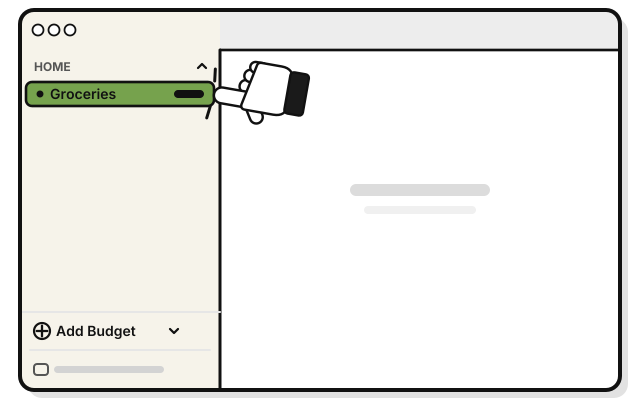

# The user guide's source

Published for every customer with GitHub Pages at help.wellspent.space, from this `docs/`
folder.

## Always ready to move

The guide stays easy to copy and move to another documentation service:
- **Plain Markdown pages,** with only a title in the front matter. No GitHub-only features,
  no Jekyll plugins in pages, and no wiki. Any static site tool or documentation service
  can take these files as they are.
- **Everything lives in this folder:** screenshots in `assets/shots/`, with example data
  only, and fonts in `assets/fonts/`, with their licences. Nothing is linked from elsewhere.
- **The page frame is one small file** (`_layouts/default.html`) plus one style sheet. A new
  service replaces those two and keeps every page.
- **Every clone of the repo holds a full copy.** GitHub only displays it.

## Pictures

- **Pictures carry the steps,** in flat-pack style: one drawing per step, inside that step.
  The step's number is the only number, so pictures need no markers.
- **Few words in pictures:** only what a person has to find on the screen. That's the label
  of the thing to click, plus the example names (Home, Groceries) where they help. The rest
  of the app's text shows as grey bars. The thing to click is green, and a hand points at it.
  Picture words come from one list, so a translated guide redraws its pictures with the
  list swapped, and needs no new drawings.
- **"You see" lines only where the next picture doesn't show it.**
- **One drawing serves the Mac and Linux** where both do the step the same way. A step done
  differently gets one drawing per system, with `-mac` or `-linux` at the end of its name.
- **Pictures are SVG files** in `assets/shots/`, named for the task and the step:
  `import-a-bank-statement-1.svg`. Each one has a short description for screen readers.
- **A step with a picture** puts the picture first and the caption on the next line:

  ```markdown
  1. 
     Click a budget in the group the statement is for.
  ```

- **A tour of a screen** shows every field, button and menu: one picture with a numbered
  marker on each part, then the numbered list of captions right after it, with nothing in
  between. Each marker's number matches its caption. Markers go in reading order: the
  sidebar top to bottom, then the main area top to bottom and left to right. Tour pictures
  are named for the screen: `tour-a-budgets-page.svg`.

  ```markdown
  

  1. **The group.** Its budgets are listed under it.
  2. **A budget.** Click one to open its page.
  ```

- **The quest line** goes right under the title, as a quote in italics:
  `> *Carry your gold home from the bank, and give each coin a budget.*`

