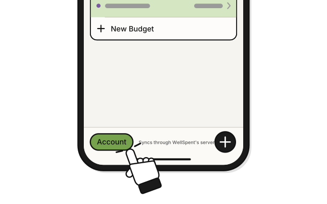
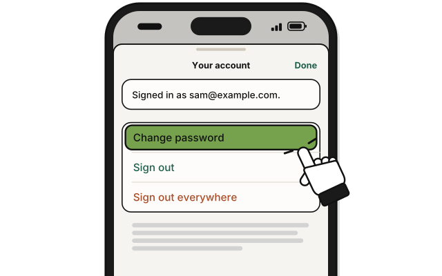
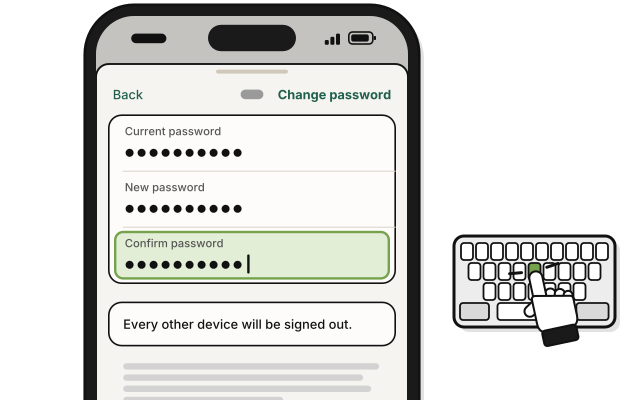
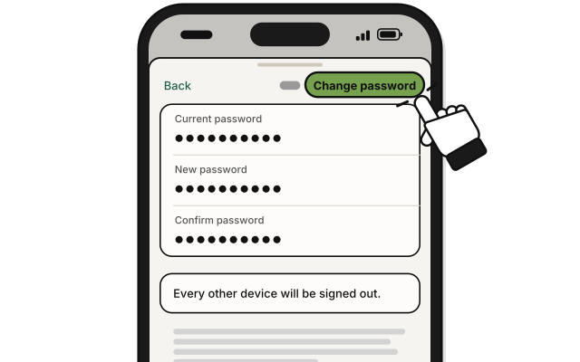

# Side quest: Change your password

> *New lock, same door. Only your key opens it.*

**Before you start:** sign in, and have your current password.

1. Press **Account**, the person at the top of a budget's page.

2. Press **Change password…**

   > You see "Every other device will be signed out."

3. Type your password now in **Current password**.

4. Type the new one in **New password**, and again in **Confirm password**.

5. Press **Change password**.

   > You see your budget again, still signed in.

Your other devices are signed out. Sign in on each with the new password. Your budgets stay on the server, and come back when you do.

## On an iPhone

1. 
   Tap **Account** at the bottom left of Home.

2. 
   Tap **Change password**.

3. 
   Type **Current password**, **New password** and **Confirm password**.

4. 
   Tap **Change password**.

## On Linux

Press **Account** at the bottom of the sidebar. The other steps are the same as on a Mac.

## Related

- [Side quest: Reset a forgotten password](reset-a-forgotten-password.md)
- [Side quest: Sign out on every device](sign-out-everywhere.md)

<!-- Scenarios: ACCT-17 -->
