# Side quest: Reset a forgotten password

> *Lost the key to the vault? The smith can make you a new one.*

**Before you start:** your email must be confirmed. A reset code lasts 30 minutes.

1. 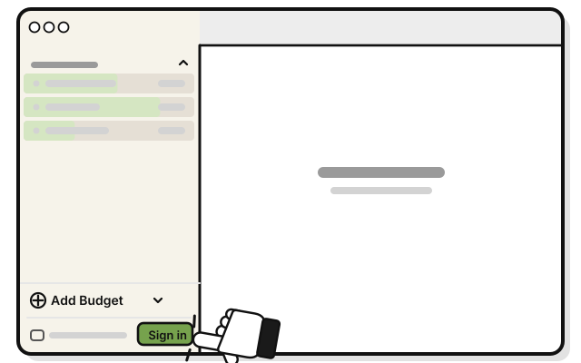
   Press **Sign in** at the bottom of the sidebar.

2. 
   Type your email in **Email**.

3. 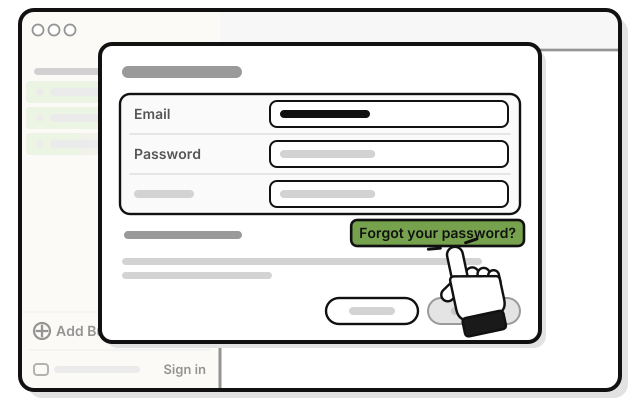
   Press **Forgot your password?**

4. 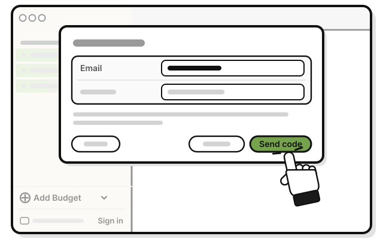
   Press **Send code**.

   > You see that a code is on its way, and that it lasts 30 minutes.

5. 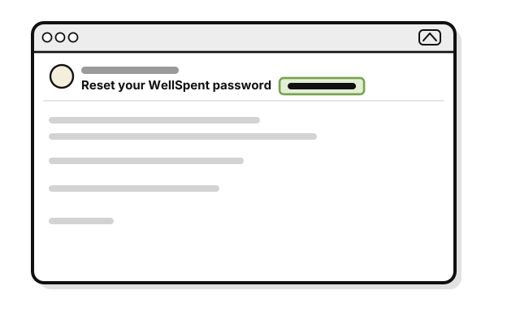
   Open the email from WellSpent whose subject starts with **Reset your WellSpent password**. The code follows in the subject.

6. 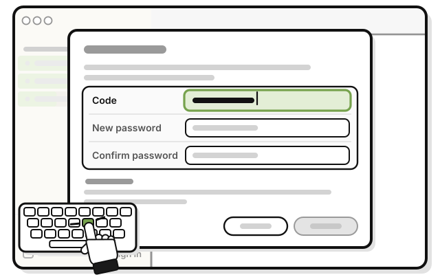
   Type or paste the code in **Code**.

7. 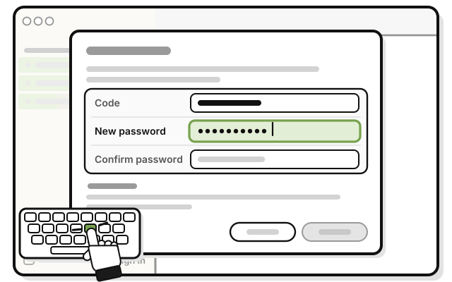
   Type a new password of at least 10 characters in **New password**.

8. 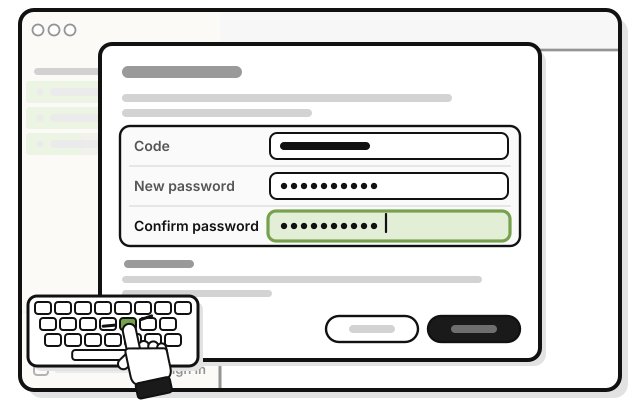
   Type the same password in **Confirm password**.

9. 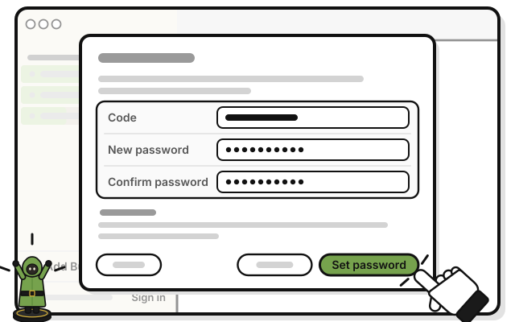
   Press **Set password**.

   > You see "Your password is changed, and you are signed in. Every other device was signed out."

Then sign in again on your other devices. Your budgets stay.

## On an iPhone

1. 
   Tap **Sign in** at the bottom left of Home.

2. 
   Type your email in **Email**.

3. 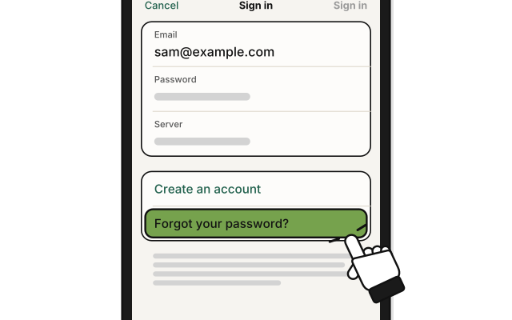
   Tap **Forgot your password?**

4. 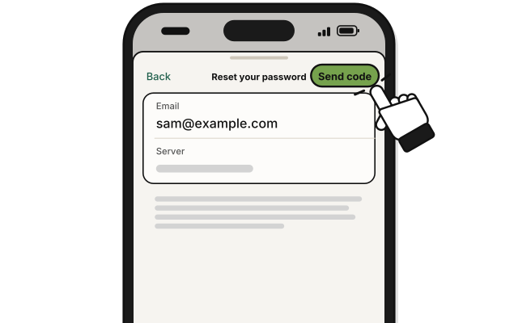
   Tap **Send code**.

5. 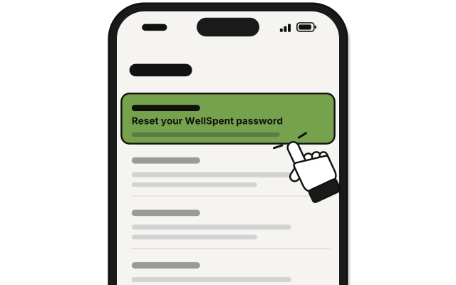
   Open the email whose subject starts with **Reset your WellSpent password**. The code follows in the subject.

6. 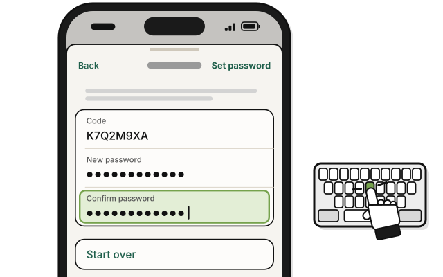
   Type the code in **Code**, and a new password of at least 10 characters in **New password** and **Confirm password**.

7. 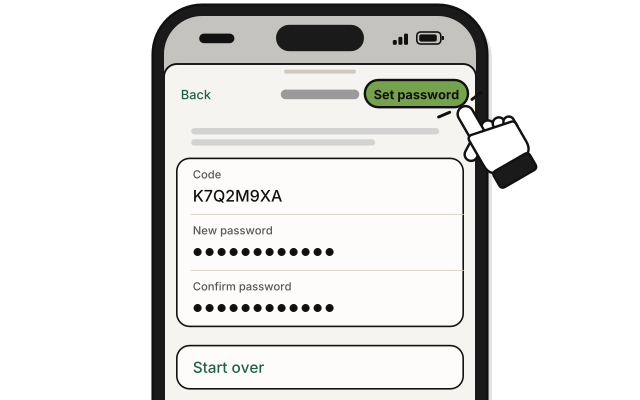
   Tap **Set password**.

## If it doesn't work

- **No code email:** check your spam or junk folder. A code goes only to an email that has an account and was confirmed. If yours was never confirmed, write to **dev@wellspent.space**.
- **The code ran out:** press **Start over**, then **Send code** again.

## Related

- [Side quest: Sign in](sign-in.md)
- [Tour: The Sign in window](tour-the-sign-in-window.md)

<!-- Scenarios: ACCT-10 -->
