# Side quest: Sign in

> *Back to the table. Your party kept your seat.*

**Before you start:** your account's email and password.

1. 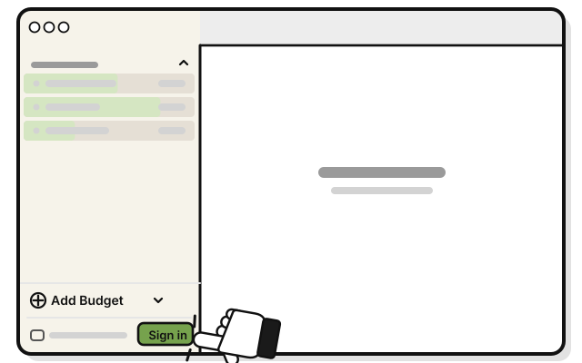
   Press **Sign in** at the bottom of the sidebar.

2. 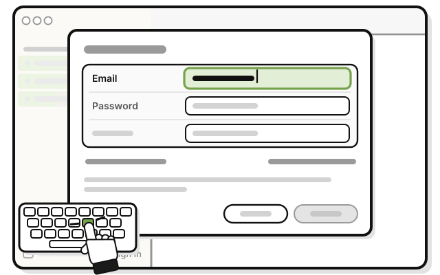
   Type your email in **Email**.

3. 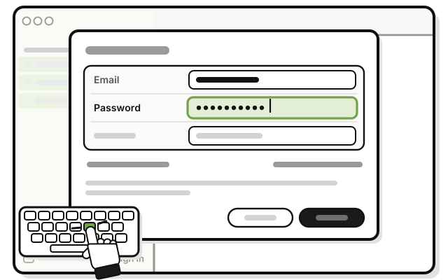
   Type your password in **Password**.

4. 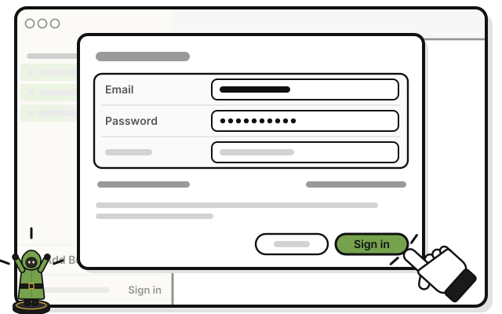
   Press **Sign in**.

   > You see your account's budgets, and **Syncs through WellSpent's server** at the bottom of the sidebar.

Budgets made on this computer while signed out stay hidden while you're signed in.

## On an iPhone

1. 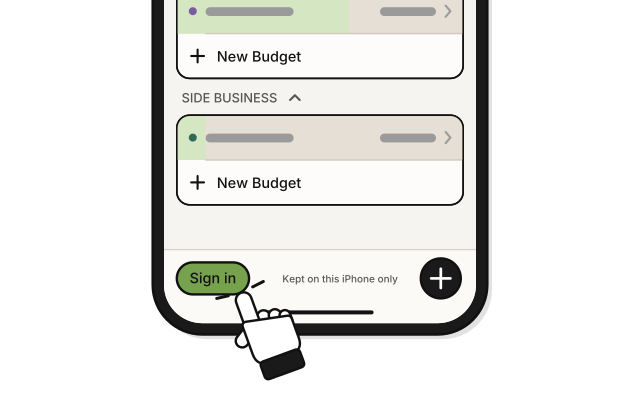
   Tap **Sign in** at the bottom left of Home.

2. 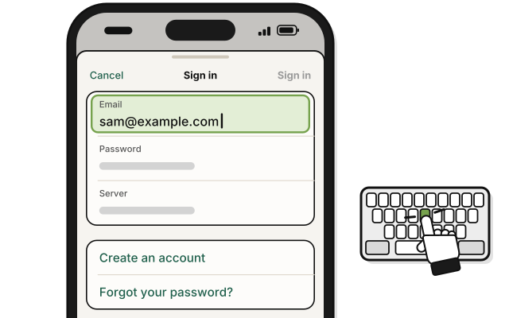
   Type your email in **Email**.

3. 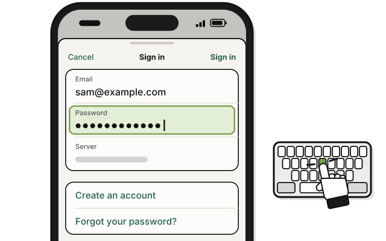
   Type your password in **Password**.

4. 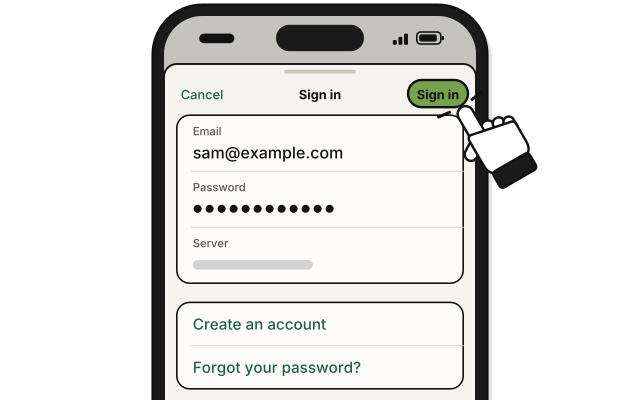
   Tap **Sign in**.

   > You see your account's budgets on Home.

## On Linux

1. 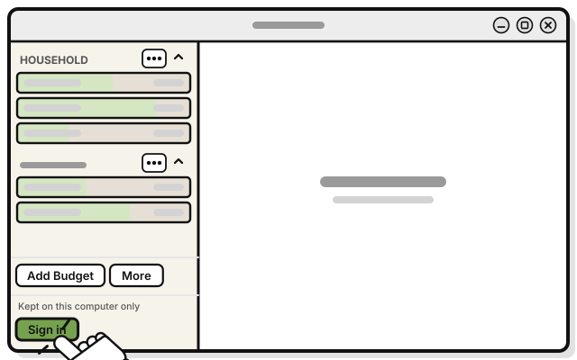
   Press **Sign in** at the bottom of the sidebar.

2. 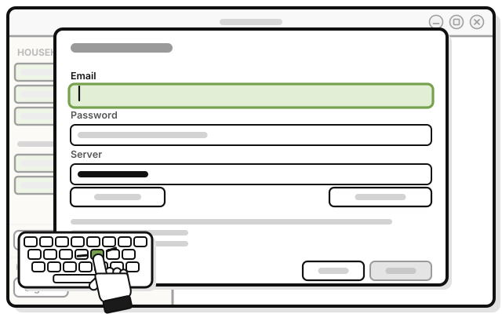
   Click **Email**, and type your email.

3. 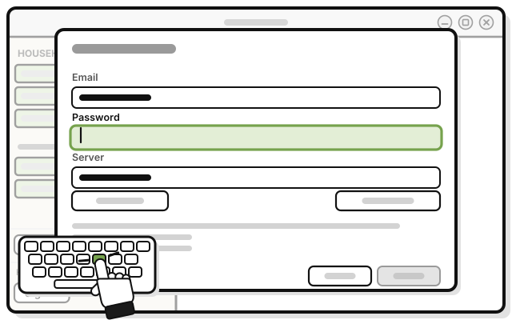
   Click **Password**, and type your password.

4. 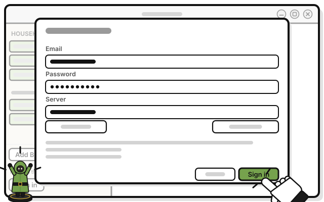
   Press **Sign in**.

   > You see your account's budgets, and **Syncs through WellSpent's server** at the bottom of the sidebar.

## If it doesn't work

- **"That email or password is wrong.":** check both, and try again. Forgot your password? [Side quest: Reset a forgotten password](reset-a-forgotten-password.md)
- **"Too many attempts. Try again in a few minutes.":** wait a few minutes, and try again.
- **"You were signed out on this device. Sign in again. Your budgets are still here.":** you signed out everywhere, or changed your password, on another device. Sign in again.
- **Confirm your email shows:** your email isn't confirmed yet. Press **Send a code**, type the code WellSpent emails you in **Code**, then press **Confirm** (on an iPhone, at the top right). Or press **Not now**, and confirm it later.

## Related

- [Tour: The Sign in window](tour-the-sign-in-window.md)
- [Side quest: Sign out](sign-out.md)

<!-- Scenarios: ACCT-07, ACCT-08, ACCT-09, ACCT-13 -->
