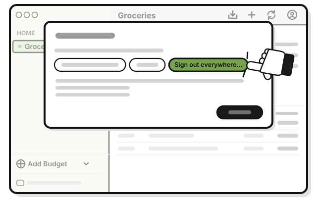
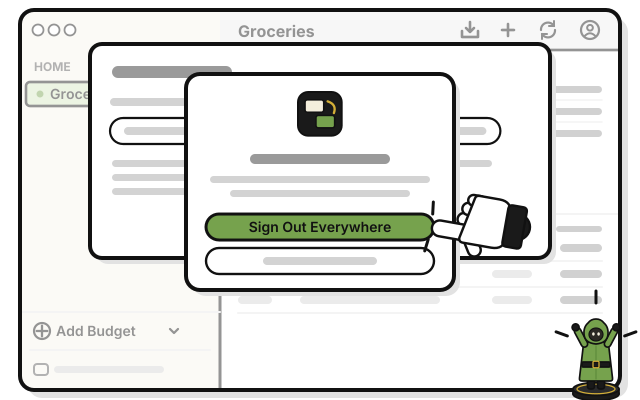
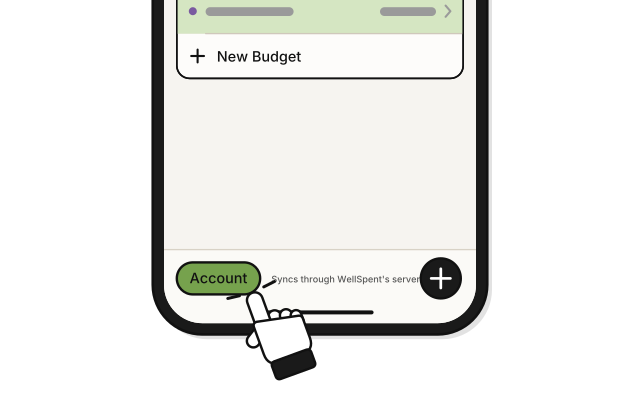
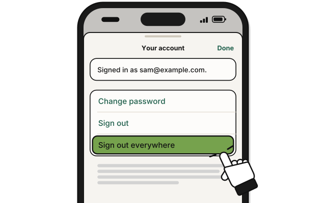
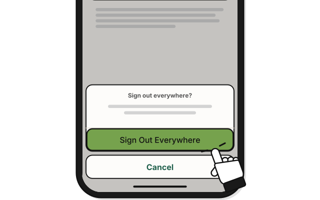

# Side quest: Sign out on every device

> *Call every scout home at once.*

This signs out every device signed in to your account, this one too. Each device keeps its budgets.

1. 
   Press **Account**, the person at the top of a budget's page.

2. 
   Press **Sign out everywhere…**

3. 
   Press **Sign Out Everywhere** in the question.

   > You see **Kept on this computer only** at the bottom of the sidebar. Every other device asks you to sign in again at its next sync.

## On an iPhone

1. 
   Tap **Account** at the bottom left of Home.

2. 
   Tap **Sign out everywhere**.

3. 
   Tap **Sign Out Everywhere** in the question.

## If it doesn't work

- **"This computer is not connected to the internet.":** signing out everywhere needs the internet. You stay signed in until it works. Connect, and try again.

## Related

- [Side quest: Sign out](sign-out.md)
- [Side quest: Sign in](sign-in.md)

<!-- Scenarios: ACCT-12, ACCT-13 -->
