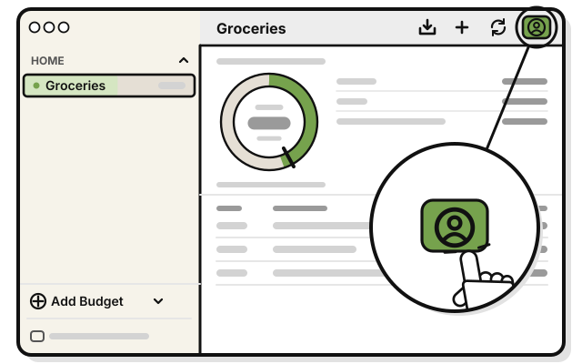
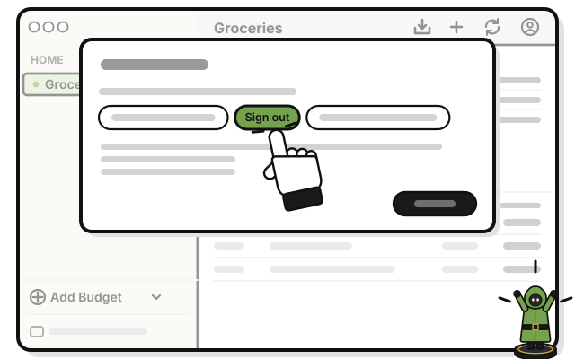

# Side quest: Sign out

> *Pack up your gear. It'll be here when you're back.*

Signing out doesn't delete your budgets. They come back when you sign in again.

1. 
   Press **Account**, the person at the top of a budget's page.

2. 
   Press **Sign out**.

   > You see **Kept on this computer only** at the bottom of the sidebar. Your account's budgets are hidden until you sign in again.

Signing out works even with no internet.

## On an iPhone

1. Tap **Account** at the bottom left of Home.

2. Tap **Sign out**.

   > You see **Kept on this iPhone only** at the bottom of Home.

## Related

- [Side quest: Sign out on every device](sign-out-everywhere.md)
- [Tour: Your account](tour-your-account.md)

<!-- Scenarios: ACCT-11 -->
