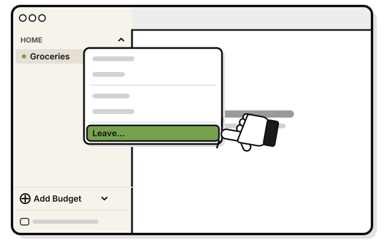
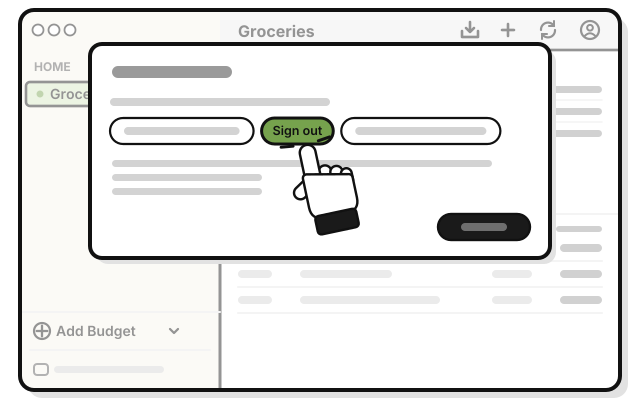
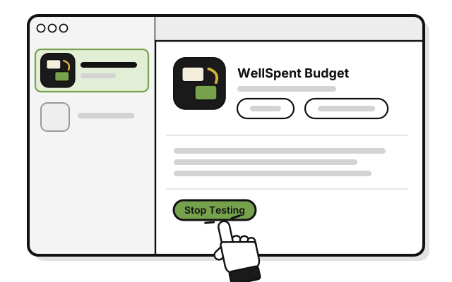
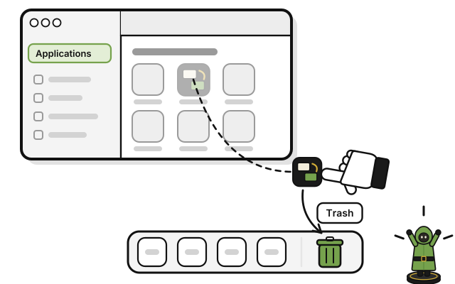

# Stop using WellSpent

These steps take WellSpent off a Mac. On an iPhone, see the end of this page. Your account stays until you ask us to delete it.

1. 
   Leave each shared group first, so the others see you've gone. [Side quest: Leave a group](../sharing/leave-a-group.md)

2. 
   Press **Account**, then **Sign out**.

3. 
   In the TestFlight app, open WellSpent Budget, and click **Stop Testing**.

4. 
   Drag WellSpent from **Applications** to the **Trash**.

## Your budgets and your account

- Your budgets stay on your Mac after you remove the app, in the folder `~/Library/Containers/app.wellspent.mac/Data/Library/Application Support/WellSpent`. Delete that folder to remove them from this Mac.
- Your account, and the groups you synced, stay on WellSpent's server. There's no way to delete an account in the app yet. To have yours deleted, write to **dev@wellspent.space** and say so.

## On an iPhone

Leave your shared groups and sign out first, as above. Then, in the TestFlight app, open WellSpent Budget, and tap **Stop Testing**. To remove the app, touch and hold its icon on the iPhone's Home Screen, tap **Remove App**, then **Delete App**.

Budgets kept only on this iPhone are deleted with the app, for good. To keep them, make an account before you delete the app. The groups you made move into your account, and the server keeps them. [Quest 2: Make your account](../getting-started/make-your-account.md)

<!-- Scenarios: SHARE-15, ACCT-11, SAMP-03 -->
