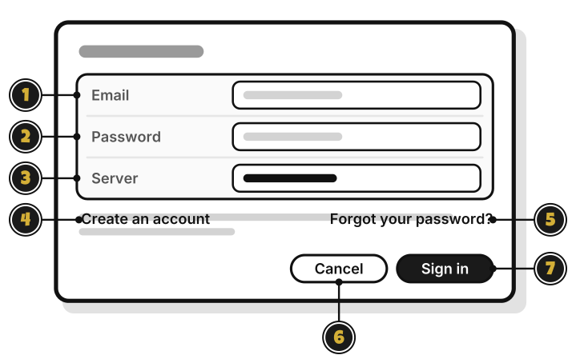
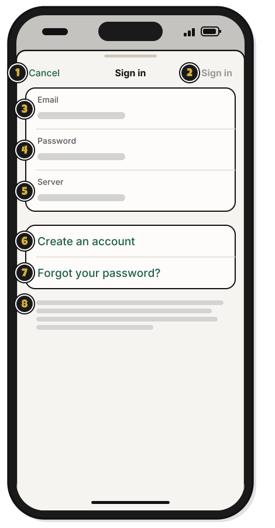
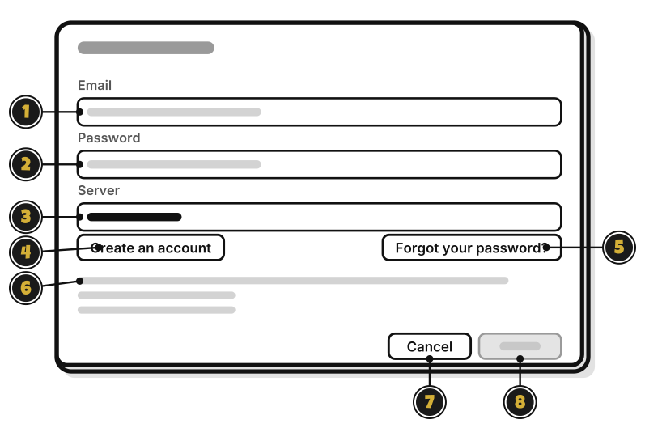

# Tour: The Sign in window

> *Knock on the guild's door.*

**Sign in**, at the bottom of the sidebar, opens this window.

1. **Email**: your account's email.
2. **Password**: your password.
3. **Server**: where your budgets sync. Leave it as it is.
4. **Create an account**: make a new account. [Quest 2](../getting-started/make-your-account.md)
5. **Forgot your password?**: set a new one, with a code WellSpent emails you.
6. **Cancel**: close without signing in.
7. **Sign in**: sign in with the email and password above.

## On an iPhone

**Sign in**, at the bottom left of Home, opens this sheet.

1. **Cancel**: close without signing in.
2. **Sign in**: sign in with the email and password below. It stays dimmed until they're filled in.
3. **Email**: your account's email.
4. **Password**: your password.
5. **Server**: where your budgets sync. Leave it as it is.
6. **Create an account**: make a new account. [Quest 2](../getting-started/make-your-account.md)
7. **Forgot your password?**: set a new one, with a code WellSpent emails you.
8. How your budgets sync: "Your budgets sync through WellSpent's server. Connections and backups are encrypted. The server can read your budgets. That's how it checks who may change what, and why resetting a forgotten password doesn't lose your budgets."

## On Linux

**Sign in**, at the bottom of the sidebar, opens this window. Each field's label sits above it.

1. **Email**: your account's email.
2. **Password**: your password.
3. **Server**: where your budgets sync. Leave it as it is.
4. **Create an account**: make a new account. [Quest 2](../getting-started/make-your-account.md)
5. **Forgot your password?**: set a new one, with a code WellSpent emails you.
6. How your budgets sync: "Your budgets sync through WellSpent's server. Connections and backups are encrypted. The server can read your budgets. That's how it checks who may change what, and why resetting a forgotten password doesn't lose your budgets."
7. **Cancel**: close without signing in.
8. **Sign in**: sign in with the email and password above. It stays dimmed until they're filled in.

<!-- Scenarios: ACCT-02, ACCT-08, ACCT-09, ACCT-10 -->
