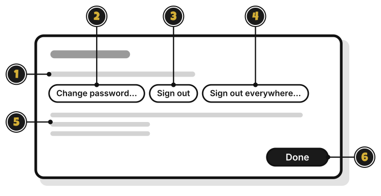
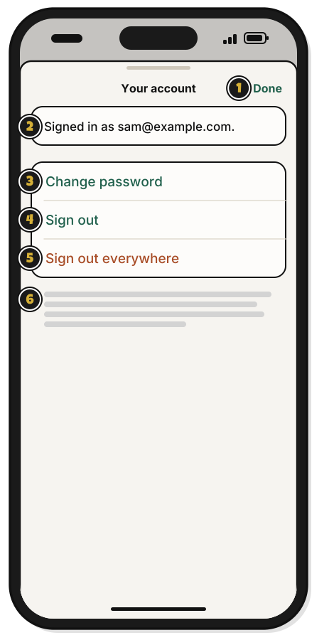

# Tour: Your account

> *Your character sheet.*

**Account**, the person at the top of a budget's page, opens this window when you're signed in.

1. **Signed in as** your email: the account you're using.
2. **Change password…**: set a new password. Every other device is signed out.
3. **Sign out**: sign out on this computer. Your budgets come back when you sign in again.
4. **Sign out everywhere…**: sign out on every device at once. It asks first, and each device keeps its budgets.
5. How your budgets sync: "Your budgets sync through WellSpent's server. Connections and backups are encrypted. The server can read your budgets. That's how it checks who may change what, and why resetting a forgotten password doesn't lose your budgets."
6. **Done**: close the window.

Email not confirmed yet? A line says why, with **Confirm your email…**

## On an iPhone

**Account**, at the bottom left of Home, opens this sheet when you're signed in.

1. **Done**: close the sheet.
2. **Signed in as** your email: the account you're using.
3. **Change password**: set a new password. Every other device is signed out.
4. **Sign out**: sign out on this iPhone. Your budgets come back when you sign in again.
5. **Sign out everywhere**: sign out on every device at once. It asks first, and each device keeps its budgets.
6. How your budgets sync: "Your budgets sync through WellSpent's server. Connections and backups are encrypted. The server can read your budgets. That's how it checks who may change what, and why resetting a forgotten password doesn't lose your budgets."

Email not confirmed yet? A line says why, with **Confirm your email**. Tap it, then **Send a code**, type the code in **Code**, and tap **Confirm** at the top right.

## On Linux

The window is the same as on a Mac. **Change password…**, **Sign out** and **Sign out everywhere…** sit in one row. **Account** is at the bottom of the sidebar.

<!-- Scenarios: ACCT-05, ACCT-07, ACCT-11, ACCT-12 -->
