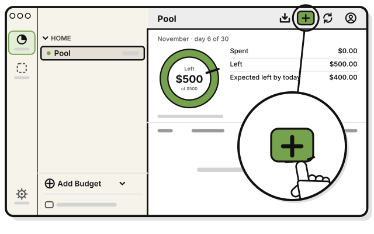
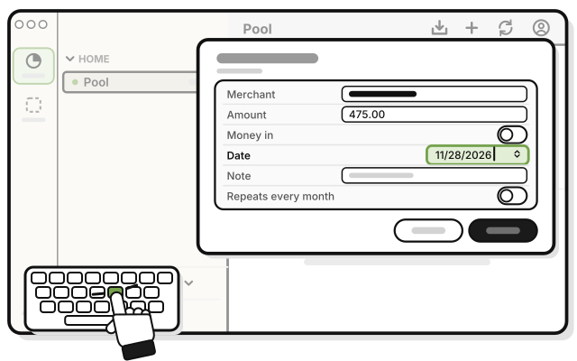
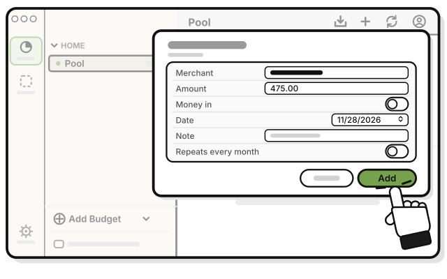
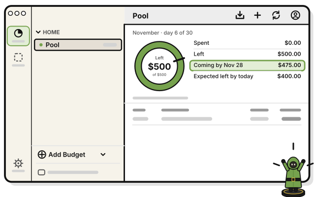

# Side quest: Add a bill dated later this month

**Coming in the next update.**

> *A card in your hand isn't played yet.*

A bill dated later this month doesn't count as spent until its date. Until then, the budget's page shows it on a **Coming by** line.

**Before you start:** a budget. See [Quest 4: Make your first budget](make-your-first-budget.md).

1. 
   Add a transaction, as in [Quest 5](../transactions/add-your-first-transaction.md).

2. 
   Set **Date** to a day later this month, like Nov 28.

3. 
   Press **Add**.

   > You see the bill in the list, with its own date. **Spent** and **Left** don't change.

4. 
   Look under **Left** for **Coming by Nov 28**, and how much is still to come.

When Nov 28 arrives, the bill counts as spent, and the **Coming by** line goes away.

## What the line tells you

- **Coming by** adds up every bill dated later this month. The date is the latest of them.
- **In the warning color:** what's coming is more than what's left. Plan for it now.
- **A group's page** shows the same line, for all its budgets added up.
- **Money in** dated later doesn't count until its date either. It isn't on the **Coming by** line.

## On an iPhone

The steps are the same. Tap where the Mac says press.

## On Linux

The steps are the same as on a Mac.

## If it doesn't work

- **It counts as spent today:** check its **Date**. A bill dated today or earlier counts at once.
- **There's no Coming by line:** the bill may be dated next month. A budget's page shows this month only.

## Related

- [Tour: A budget's page](tour-a-budgets-page.md)
- [Side quest: Make a bill repeat every month](../transactions/make-a-bill-repeat.md)

<!-- Scenarios: WHEEL-21, WHEEL-22, WHEEL-23 -->
