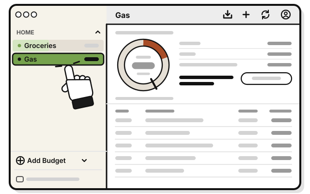
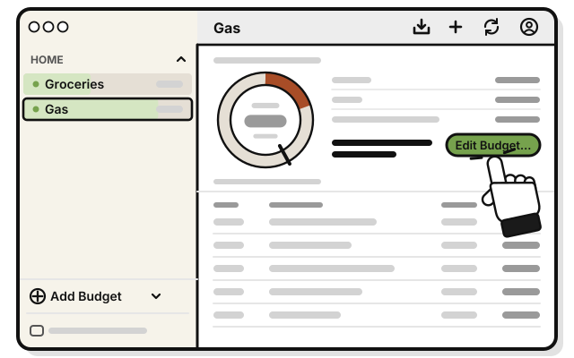
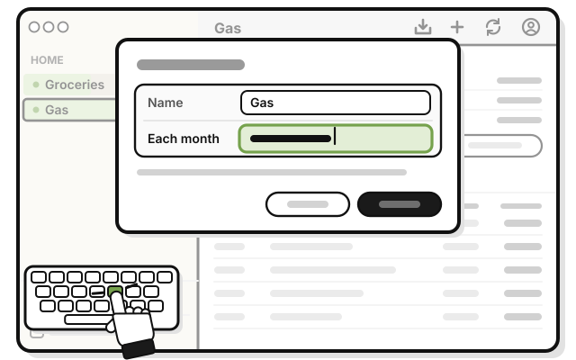
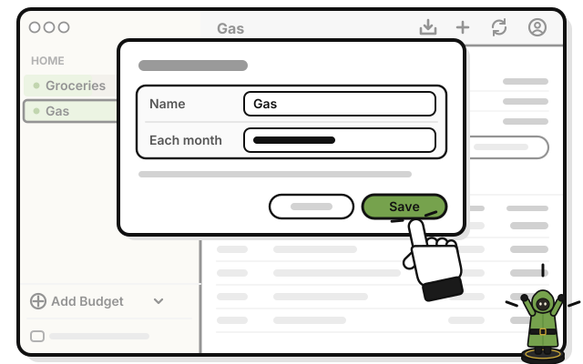

# Side quest: Change a budget from its wheel

> *Pace your gold, and it lasts the whole campaign.*

A budget's wheel is full on the 1st, and empties as money goes out. When you spend faster than an even pace, it turns orange and says when the money runs out. In the month's last week, with more left than expected, it asks whether to lower the budget. Both times, **Edit Budget…** sits beside the words.

On an iPhone, Home starts with your first group's wheel, with what's left of the whole group's month. The wheels and rows follow your iPhone's light or dark setting.

**Before you start:** you need the Manage level or higher in the group.

1. 
   Click a budget in the sidebar.

   > You see the budget's wheel.

2. 
   Press **Edit Budget…**

3. 
   Type a new amount in **Each month**.

4. 
   Press **Save**.

   > You see the wheel drawn again for the new amount.

## On an iPhone

1. Tap a budget on Home.

   > You see the budget's wheel.

2. Tap **Edit Budget**.

3. Type a new amount in **Each month**.

4. Tap **Save**.

## If it doesn't work

- **There's no Edit Budget…:** it shows only when the wheel has something to say, and only at the Manage level or higher. Any day, **Edit…** on the budget's menu changes it too.

## Related

- [Tour: A budget's page](tour-a-budgets-page.md)

<!-- Scenarios: WHEEL-04, WHEEL-13, WHEEL-05, WHEEL-06, WHEEL-07, WHEEL-08, WHEEL-09, BUDGET-06, BUDGET-07 -->
