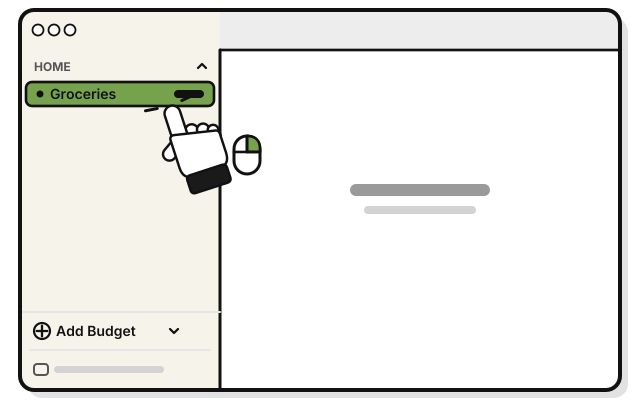
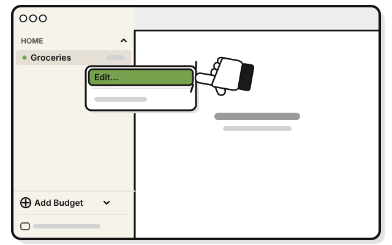
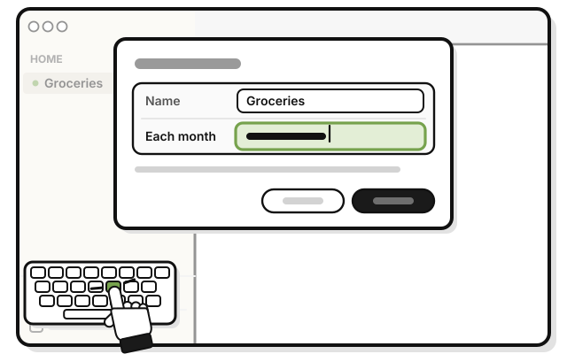
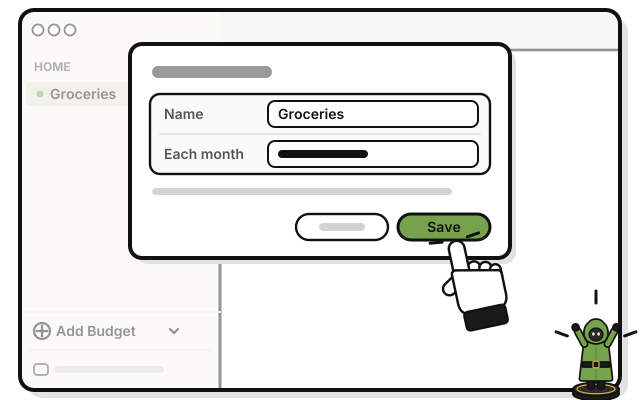

# Side quest: Change a budget's name or amount

> *A bigger pouch, or a smaller one.*

**Before you start:** you need the Manage level or higher.

1. 
   Right-click the budget in the sidebar.

2. 
   Pick **Edit…**

3. 
   Change **Name**, or **Each month**.

4. 
   Press **Save**.

   > You see the budget's new name or amount, and what's left follows at once.

When the money wheel has something to say, **Edit Budget…** on the budget's page opens the same window. [Side quest: Change a budget from its wheel](change-a-budget-from-its-wheel.md)

## On an iPhone

1. Touch and hold the budget on Home.

2. Tap **Edit**.

3. Change **Name**, or **Each month**.

4. Tap **Save**.

<!-- Scenarios: BUDGET-06, BUDGET-07 -->
