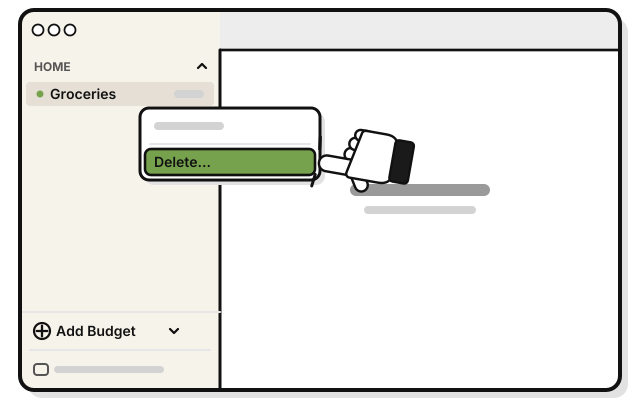
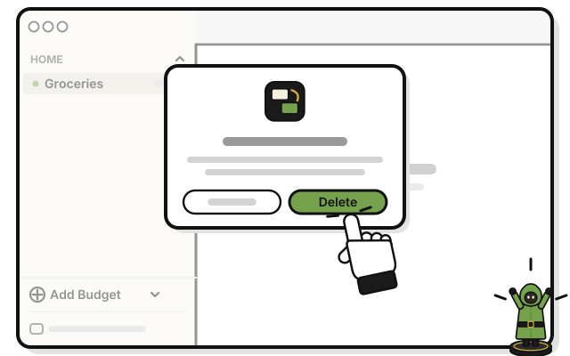
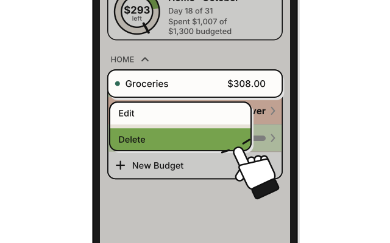
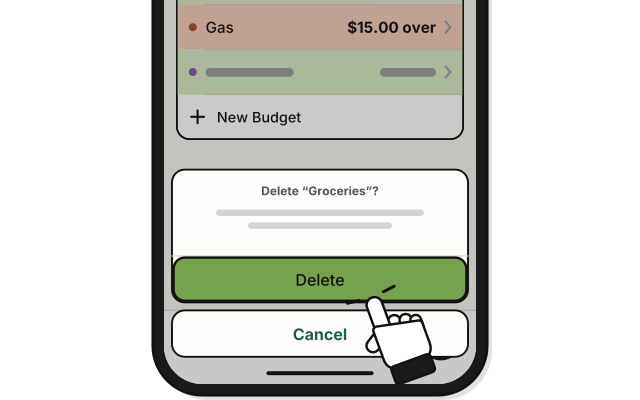

# Side quest: Delete a budget

> *Empty a pouch for good.*

**Before you start:** you need the Manage level or higher. A budget's transactions are deleted with it. This can't be undone.

1. 
   Right-click the budget in the sidebar.

2. 
   Pick **Delete…**

   > You see a question that names the budget, and how many transactions go with it.

3. 
   Press **Delete** in the question.

## On an iPhone

1. 
   Touch and hold the budget on Home.

2. 
   Tap **Delete**.

3. 
   Tap **Delete** in the question.

<!-- Scenarios: BUDGET-07, BUDGET-08 -->
