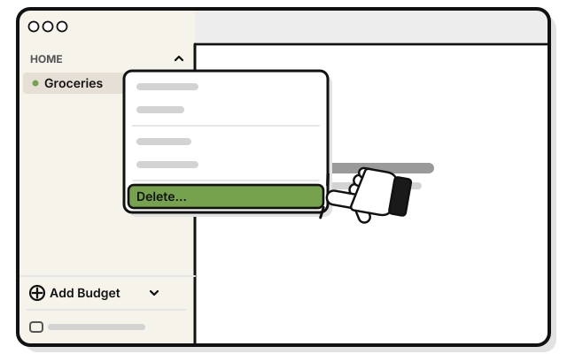
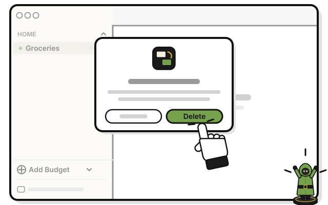
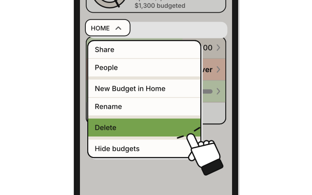
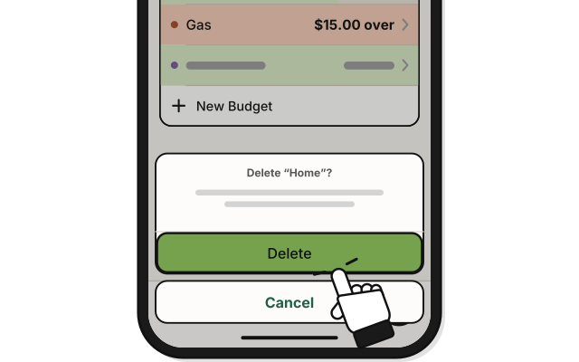
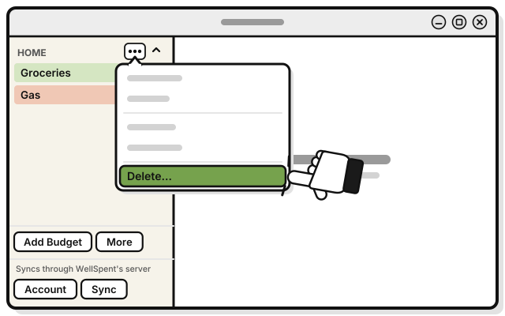
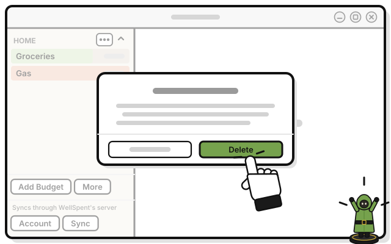

# Side quest: Delete a group

> *Pack up the whole camp.*

**Before you start:** only the person who made the group, or an Admin, can delete it. A shared group is deleted for everyone in it. This can't be undone.

1. 
   Right-click the group's name in the sidebar.

2. 
   Pick **Delete…**

   > You see a question that names the group, and how many budgets and transactions go with it.

3. 
   Press **Delete** in the question.

   > You see the group gone from your sidebar.

## On an iPhone

1. 
   Touch and hold the group's name on Home.

2. 
   Tap **Delete**.

3. 
   Tap **Delete** in the question.

## On Linux

1. 
   Press **⋯** beside the group's name in the sidebar.

2. 
   Pick **Delete…**

   > You see a question that names the group, and how many budgets and transactions go with it.

3. 
   Press **Delete** in the question.

   > You see the group gone from your sidebar.

## If it doesn't work

- **The menu says Leave…, not Delete…:** someone else made the group. You can leave it. [Side quest: Leave a group](../sharing/leave-a-group.md)

<!-- Scenarios: BUDGET-11, BUDGET-12, BUDGET-13 -->
