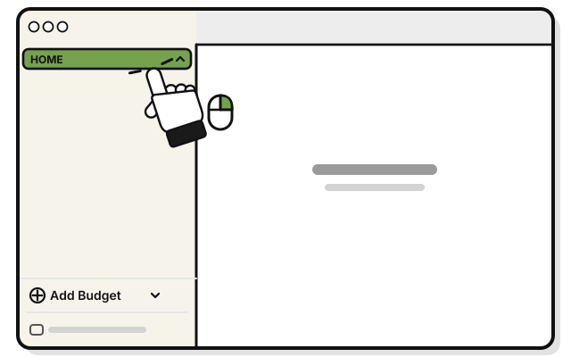
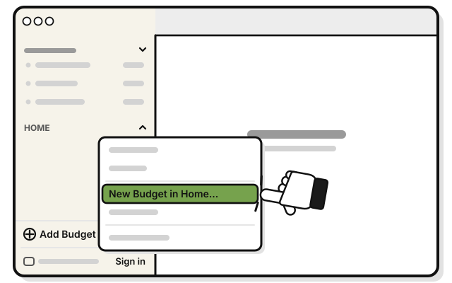
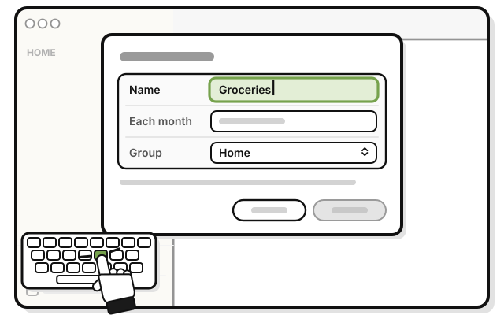
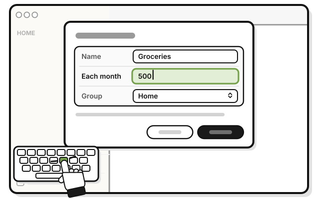
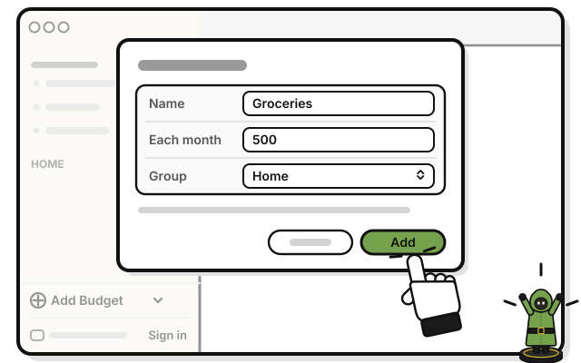

# Quest 4: Make your first budget

> *A pouch for every kind of coin.*

A budget is an amount to spend each month. It starts again on the 1st.

1. 
   Right-click **HOME** in the sidebar. Or hold Control and click it.

2. 
   Pick **New Budget in Home…**

3. 
   Type a name in **Name**, like Groceries.

4. 
   Type how much a month in **Each month**, like 500.

5. 
   Press **Add**.

   > You see **Groceries** under **HOME**, with what's left beside it.

## If it doesn't work

- **The menu has only Edit… and Delete…:** that's a budget's menu. Right-click the group's name instead. It's in capital letters.
- **Add stays dimmed:** a budget needs a name, and an amount above zero.
- **You can't see the budget:** click the small arrow at the end of the group's line. It shows or hides the group's budgets.

## Next quest

[Quest 5: Add your first transaction](../transactions/add-your-first-transaction.md)

<!-- Scenarios: BUDGET-03, BUDGET-04, BUDGET-14, PAGE-05 -->
