# Quest 3: Make your first group

> *Gather your party, and give it a name.*

A group holds budgets you track together. It's also what you share with someone later.

1. 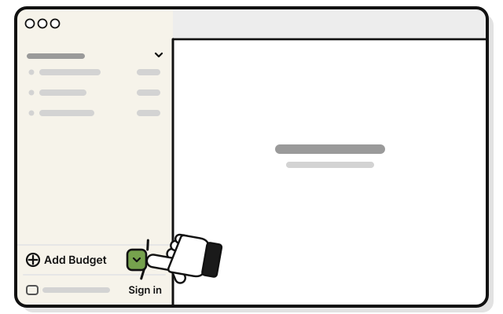
   Click the small arrow just right of **Add Budget**, at the bottom of the sidebar.

2. 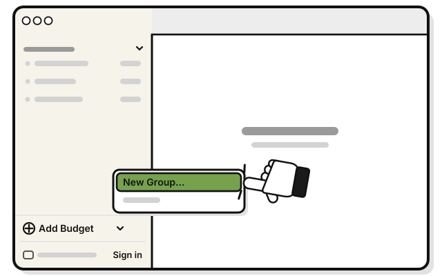
   Pick **New Group…**

3. 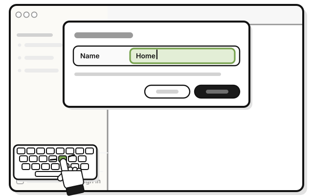
   Type a name in **Name**, like Home.

4. 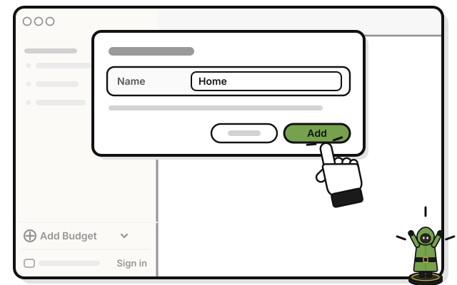
   Press **Add**.

   > You see **HOME** in the sidebar.

## On an iPhone

1. 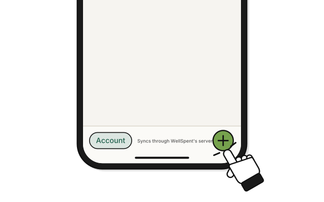
   Tap **+** at the bottom right of Home.

2. 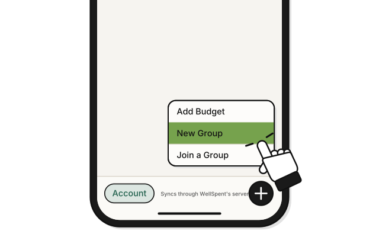
   Tap **New Group**.

3. 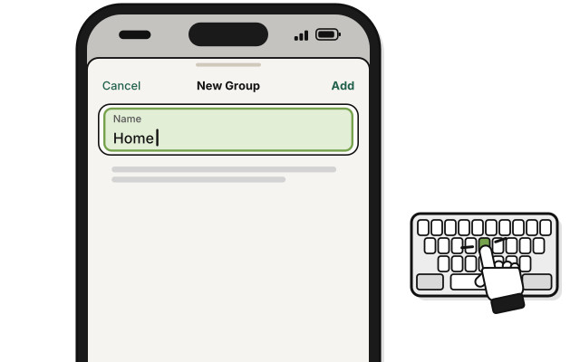
   Type a name in **Name**, like Home.

4. 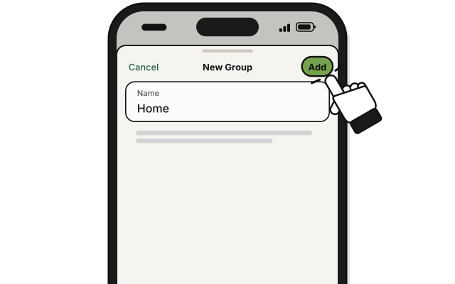
   Tap **Add**.

   > You see **HOME** on Home.

## On Linux

1. 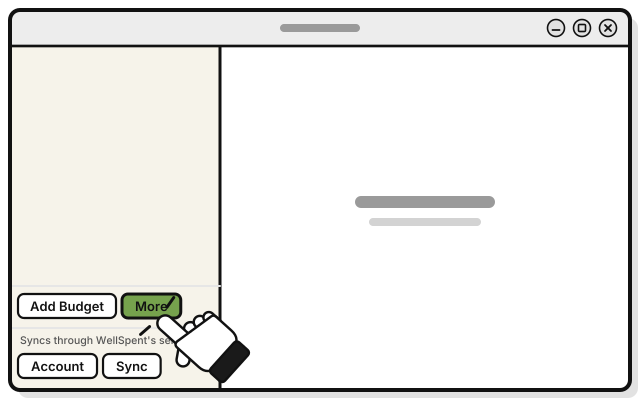
   Press **More**, next to **Add Budget** at the bottom of the sidebar.

2. 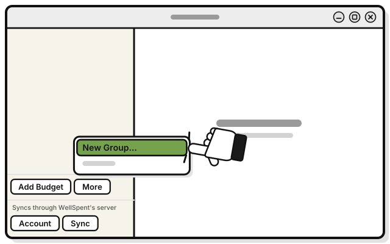
   Pick **New Group…**

3. 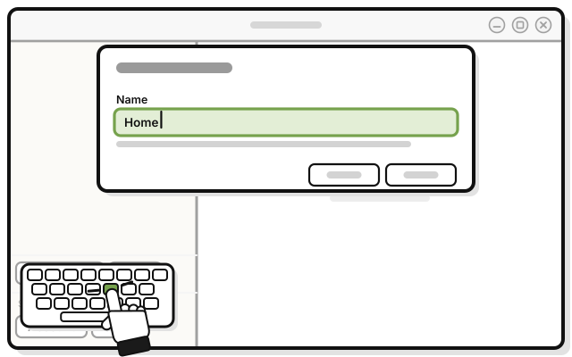
   Type a name in **Name**, like Home.

4. 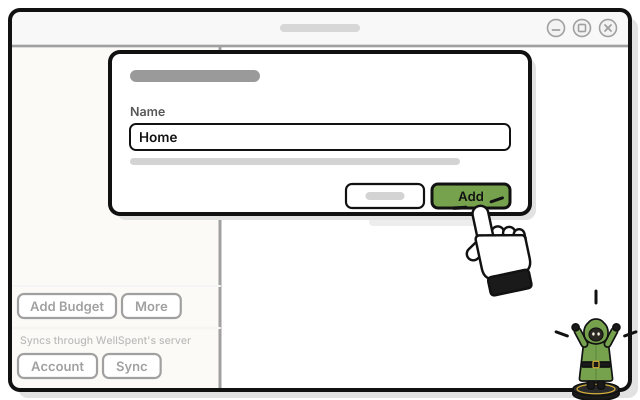
   Press **Add**.

   > You see **HOME** in the sidebar.

## If it doesn't work

- **A New Budget window opens:** press **Cancel**. Then click the small arrow, not the words **Add Budget**.
- **Add stays dimmed:** the group needs a name.

## Next quest

[Quest 4: Make your first budget](make-your-first-budget.md)

<!-- Scenarios: BUDGET-01 -->
