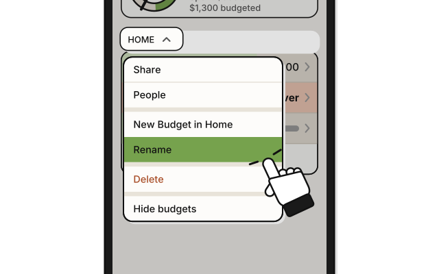
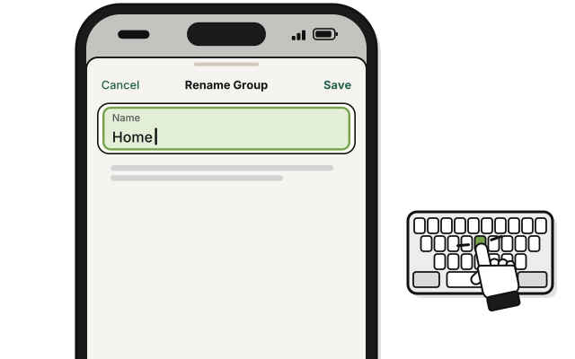
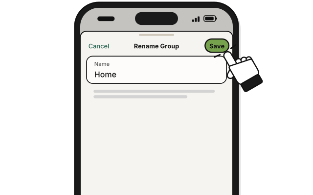
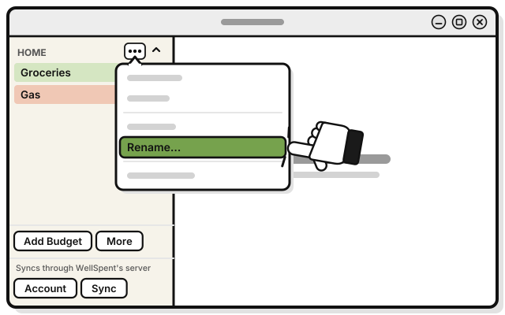
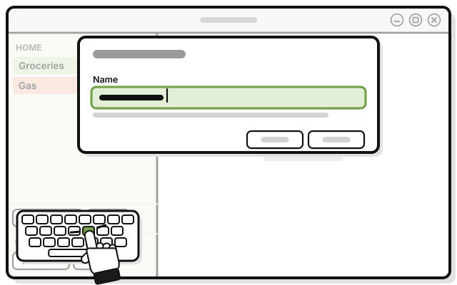
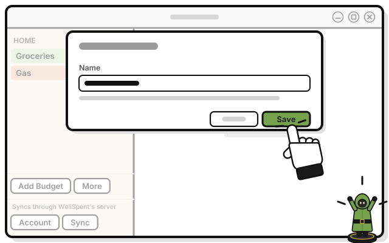

# Side quest: Rename a group

> *Every party deserves a good name.*

**Before you start:** you need the Manage level or higher.

1. 
   Right-click the group's name in the sidebar.

2. 
   Pick **Rename…**

3. 
   Type a new name in **Name**.

4. 
   Press **Save**.

   > You see the new name in the sidebar, in capital letters.

## On an iPhone

1. 
   Touch and hold the group's name on Home.

2. 
   Tap **Rename**.

3. 
   Type a new name in **Name**.

4. 
   Tap **Save**.

## On Linux

1. 
   Press **⋯** beside the group's name in the sidebar.

2. 
   Pick **Rename…**

3. 
   Type a new name in **Name**.

4. 
   Press **Save**.

   > You see the new name in the sidebar, in capital letters.

<!-- Scenarios: BUDGET-02, BUDGET-07 -->
