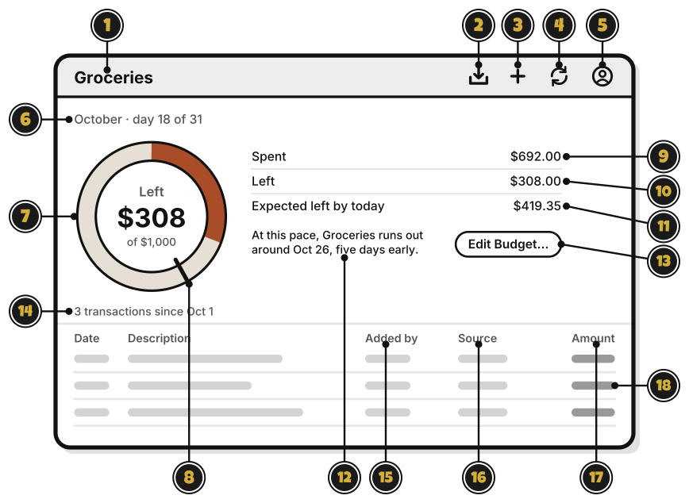

# Tour: A budget's page

> *Every good quest starts with a look at the map.*

Click a budget in the sidebar, and its page opens on the right.

1. **Groceries**: the budget's name.
2. **Import statement**, the box with an arrow pointing down: bring in a statement from your bank. [Quest 6](../statements/bring-in-your-first-statement.md)
3. **Add**, the plus sign: add a transaction. [Quest 5](../transactions/add-your-first-transaction.md)
4. **Sync**, the two arrows: send and get changes now. Sync also runs on its own. It shows only when you're signed in.
5. **Account**, the person: your account, and signing out. Signed out, it's **Sign in**.
6. **$154.08**: what's spent this period.
7. **of $500.00 this period**: the budget for this period. This one starts again on the 1st.
8. **$345.92 left**: what's left. Over the budget, it says how far over.
9. The bar: how much of the budget is spent.
10. **2 transactions since Oct 1**: how many transactions count this period.
11. **Added by**: who added each transaction, in a shared group.
12. **Source**: **Manual** if you typed it, **Statement** if it came from your bank.
13. A transaction. **Coming in the next update:** click it to change, move or delete it.

<!-- Scenarios: BUDGET-09, BUDGET-14, BUDGET-15, ENTRY-01, ENTRY-08, ENTRY-10, IMPORT-14, EDIT-01 -->
