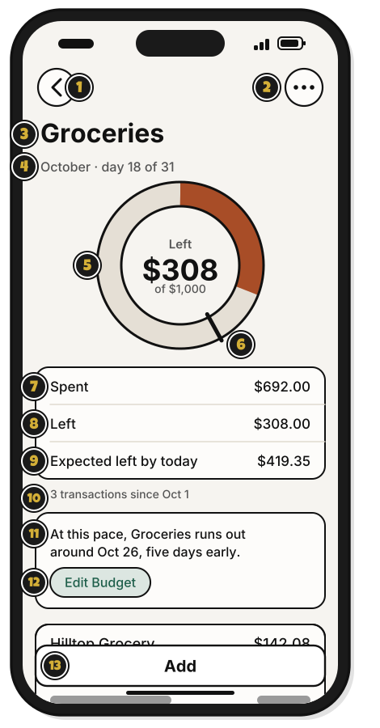
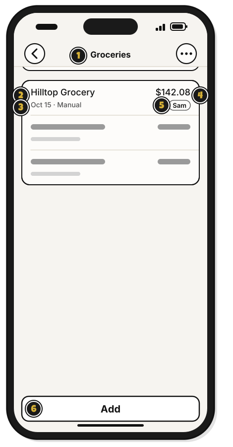
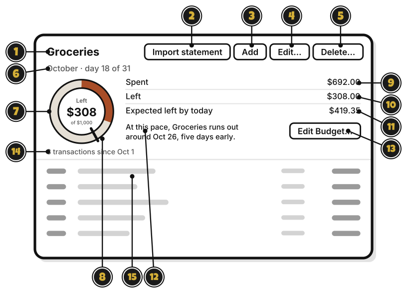

# Tour: A budget's page

> *Every good quest starts with a look at the map.*

Click a budget in the sidebar, and its page opens on the right.

1. **Groceries**: the budget's name.
2. **Import statement**, the box with an arrow pointing down: bring in a statement from your bank. [Quest 6](../statements/bring-in-your-first-statement.md)
3. **Add**, the plus sign: add a transaction. [Quest 5](../transactions/add-your-first-transaction.md)
4. **Sync**, the two arrows: send and get changes now. Sync also runs on its own. It shows only when you're signed in.
5. **Account**, the person: your account, and signing out. Signed out, it's **Sign in**.
6. **October · day 18 of 31**: the month, and how far into it you are.
7. The wheel: what's left this month. It's full on the 1st. The green runs clockwise from the top, and shrinks back toward the top as money goes out. Its middle says what's left, of how much. It turns orange when you spend faster than an even pace, and orange all the way round when you're over.
8. The tick: where the green would end today, if you spent the same each day.
9. **Spent**: what's spent this month.
10. **Left**: what's left. Over the budget, it says **Over**, and how much.
11. **Expected left by today**: what would be left today, at an even pace.
12. The pace words: when the money runs out at this pace. In the month's last week, with more left than expected, they ask whether to lower the budget.
13. **Edit Budget…**: change the budget's amount. It shows beside the pace words, at the Manage level or higher. [Side quest: Change a budget from its wheel](change-a-budget-from-its-wheel.md)
14. **3 transactions since Oct 1**: how many transactions count this month.
15. **Added by**: who added each transaction, in a shared group.
16. **Source**: **Manual** if you typed it, **Statement** if it came from your bank.
17. **Amount**: how much each one was.
18. A transaction: click it to change, move or delete it.

## On an iPhone

Tap a budget on Home, and its page opens.

1. The back arrow: go back to Home.
2. **⋯**: a menu with **Import statement**, **Edit** and **Delete**. You see the ones your level allows. [Quest 6](../statements/bring-in-your-first-statement.md)
3. **Groceries**: the budget's name.
4. **October · day 18 of 31**: the month, and how far into it you are.
5. The wheel: what's left this month. Its middle says what's left, of how much. Over the budget, it says **Over**. It turns orange when you spend faster than an even pace.
6. The tick: where the green would end today, if you spent the same each day.
7. **Spent**: what's spent this month.
8. **Left**: what's left.
9. **Expected left by today**: what would be left today, at an even pace.
10. **3 transactions since Oct 1**: how many transactions count this month.
11. The pace words: when the money runs out at this pace. They show when you spend faster than an even pace. In the month's last week, with more left than expected, they ask whether to lower the budget. That question shows only at the Manage level or higher.
12. **Edit Budget**: change the budget's amount. It shows beside the pace words, at the Manage level or higher. [Side quest: Change a budget from its wheel](change-a-budget-from-its-wheel.md)
13. **Add**: add a transaction. It shows at the Add level or higher. [Quest 5](../transactions/add-your-first-transaction.md)

## On an iPhone, further down

Scroll down for the budget's transactions, newest on top.

1. **Groceries**: the budget's name, small, once you scroll.
2. **Hilltop Grocery**: a transaction. Tap it to change, move or delete it.
3. **Oct 15 · Manual**: its date, and how it came in. **Manual** means someone typed it in.
4. **$142.08**: how much it was.
5. **Sam**: who added it, in a shared group.
6. **Add**: add a transaction.

## On Linux

Click a budget in the sidebar, and its page opens on the right.

1. **Groceries**: the budget's name.
2. **Import statement**: bring in a statement from your bank. [Quest 6](../statements/bring-in-your-first-statement.md)
3. **Add**: add a transaction. [Quest 5](../transactions/add-your-first-transaction.md)
4. **Edit…**: change the budget's name, or how much a month. It shows at the Manage level or higher.
5. **Delete…**: delete the budget and its transactions. It asks first.
6. **October · day 18 of 31**: the month, and how far into it you are.
7. The wheel: what's left this month. Its middle says what's left, of how much. It turns orange when you spend faster than an even pace.
8. The tick: where the green would end today, if you spent the same each day.
9. **Spent**: what's spent this month.
10. **Left**: what's left. Over the budget, it says **Over**, and how much.
11. **Expected left by today**: what would be left today, at an even pace.
12. The pace words: when the money runs out at this pace.
13. **Edit Budget…**: change the budget's amount. [Side quest: Change a budget from its wheel](change-a-budget-from-its-wheel.md)
14. **3 transactions since Oct 1**: how many transactions count this month.
15. A transaction: click it to change, move or delete it.

**Sync** and **Account** are at the bottom of the sidebar, not on the page.

<!-- Scenarios: BUDGET-09, BUDGET-14, BUDGET-15, WHEEL-05, WHEEL-06, WHEEL-07, WHEEL-08, WHEEL-09, WHEEL-10, ENTRY-01, ENTRY-08, ENTRY-10, IMPORT-14, EDIT-01 -->
