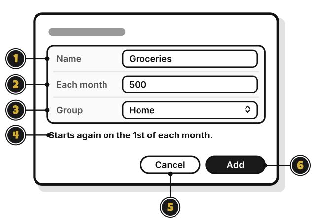

# Tour: The budget window

> *Every pouch gets a name and a size.*

**Add Budget**, or **New Budget in Home…** on a group's menu, opens this window.

1. **Name**: what the budget is for, like Groceries.
2. **Each month**: how much to spend each month.
3. **Group**: the group it goes in.
4. **Starts again on the 1st of each month.**: when the budget fills up again.
5. **Add**: make the budget. It stays dimmed until there's a name and an amount above zero.

**Edit…** on a budget's menu opens the same window, called **Edit Budget**, with **Save** in place of **Add**, and no **Group**.

<!-- Scenarios: BUDGET-03, BUDGET-04, BUDGET-05, BUDGET-06 -->
