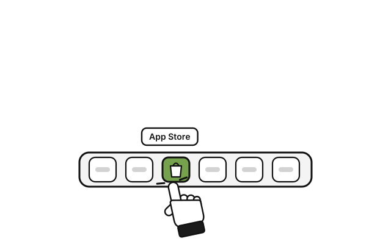
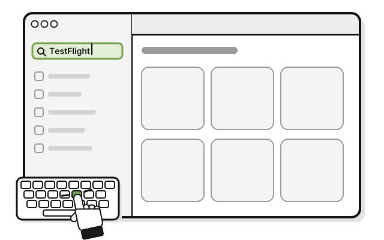
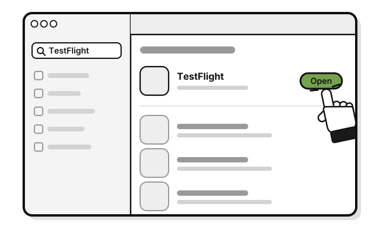
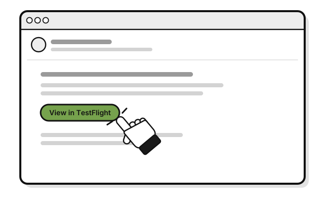
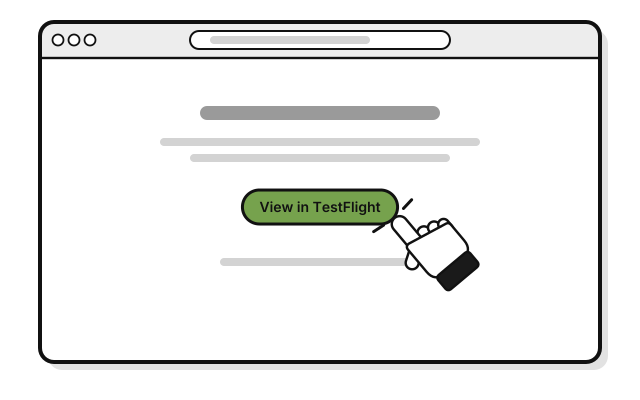
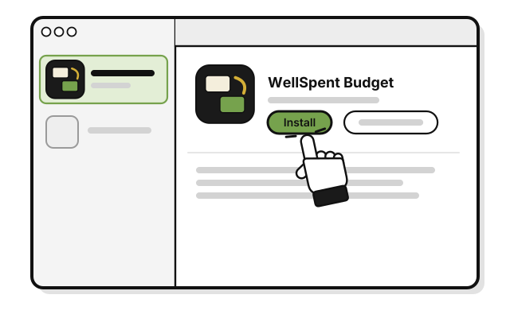
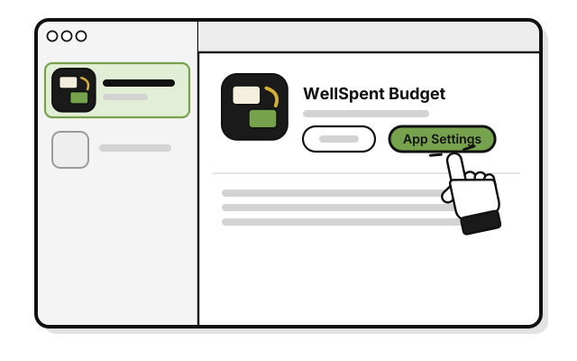
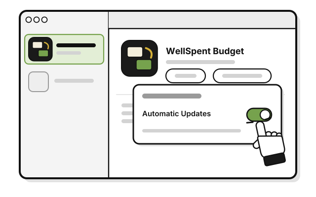
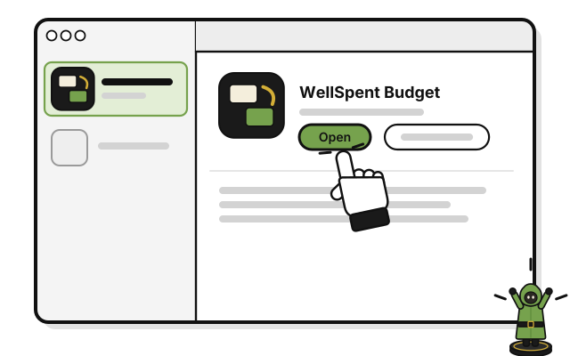

# Quest 1: Get WellSpent on your Mac

> *Every adventure starts with the gear. Here's yours.*

**Before you start:** Apple's email inviting you to test WellSpent Budget, and a Mac with macOS 14 (Sonoma) or later. Use the Apple Account you use in the App Store on this Mac.

1. 
   Open the **App Store** app on your Mac.

2. 
   Search for the **TestFlight** app.

3. 
   Click **Get**. If it changes to **Install**, click that too.

4. 
   Click **Open**.

5. 
   In Apple's email, click **View in TestFlight**.

6. 
   On the web page, click **View in TestFlight**. If Safari asks to open TestFlight, click **Allow**.

7. 
   Click **Accept**.

8. 
   Click **Install**.

9. 
   Click **App Settings**.

10. 
    Turn on **Automatic Updates**, so new versions install on their own.

11. 
    Click **Open**.

    > You see WellSpent, with two sample groups, **HOUSEHOLD** and **SIDE BUSINESS**. They're made up, so you can look around.

## If it doesn't work

- **No email from Apple:** check your spam or junk folder, and search your mail for "TestFlight".
- **You see Update or Open, not Accept:** you've tested WellSpent before. Click **Update**, then **Open**.
- **No Install button:** Apple shows **Install** only when this version works on your Mac. WellSpent needs macOS 14 or later.
- **WellSpent won't open:** each test version works for up to 90 days. Open TestFlight, and click **Update**.
- **Your Mac shows another warning:** don't change any settings. Write to **dev@wellspent.space**, with a picture of the warning.

## Next quest

[Quest 2: Make your account](make-your-account.md)

<!-- Scenarios: SAMP-01 -->
