# Quest 1: Get WellSpent

> *Every adventure starts with the gear. Here's yours.*

WellSpent runs on a Mac, an iPhone or a Linux computer. Pick yours: [On a Mac](#on-a-mac), [On an iPhone](#on-an-iphone) or [On Linux](#on-linux).

## On a Mac

**Before you start:** Apple's email inviting you to test WellSpent Budget, and a Mac with macOS 14 or later. Use the same account you use in the App Store on that Mac.

1. 
   Open the **App Store** app on your Mac.

2. 
   Search for the **TestFlight** app.

3. 
   Click **Get**. If it changes to **Install**, click that too.

4. 
   Click **Open**.

5. 
   In Apple's email, click **View in TestFlight**.

6. 
   On the web page, click **View in TestFlight**. If Safari asks to open TestFlight, click **Allow**.

7. 
   Click **Accept**.

8. 
   Click **Install**.

9. 
   Click **App Settings**.

10. 
    Turn on **Automatic Updates**, so new versions install on their own.

11. 
    Click **Open**.

    > You see WellSpent, with two sample groups, **HOUSEHOLD** and **SIDE BUSINESS**. They're made up, so you can look around.

## On an iPhone

**Before you start:** Apple's email inviting you to test WellSpent Budget, and an iPhone with iOS 17 or later. Use the same account you use in the App Store on that iPhone.

1. 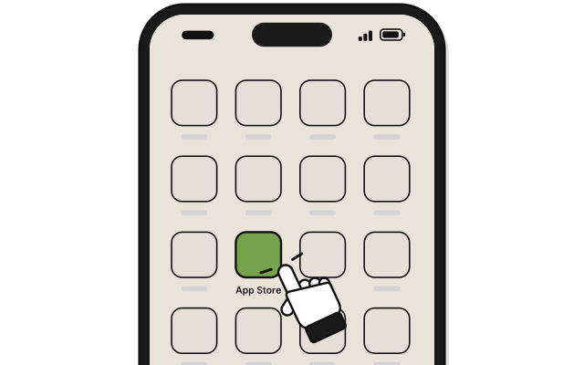
   Open the **App Store** app on your iPhone.

2. 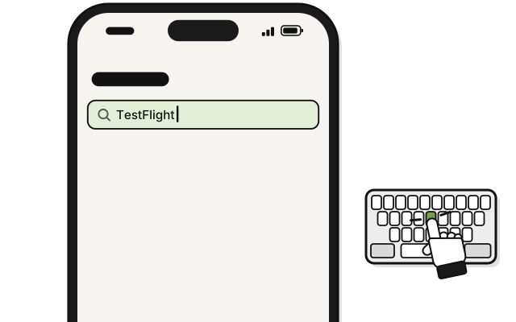
   Search for the **TestFlight** app.

3. 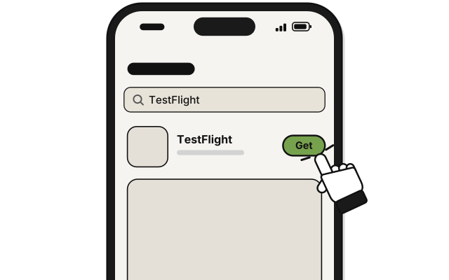
   Tap **Get**.

4. 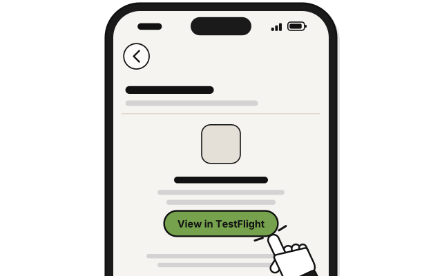
   In Apple's email, tap **View in TestFlight**.

5. 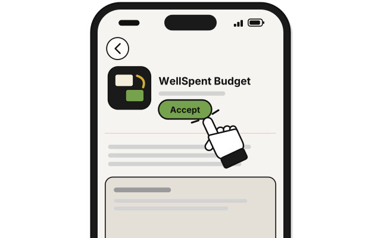
   Tap **Accept**.

6. 
   Tap **Install**.

7. 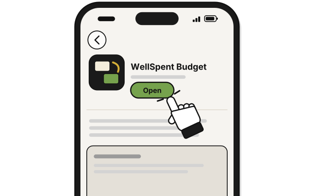
   Tap **Open**.

   > You see WellSpent, with two sample groups, **HOUSEHOLD** and **SIDE BUSINESS**.

Got a link instead of Apple's email? Tap the link, then tap **Accept** and **Install**.

## On Linux

**Before you start:** the WellSpent file for Linux, saved in your **Downloads** folder. Its name ends in `.tar.gz`. Installing means typing a few commands in a terminal. It doesn't need your computer's password. To paste a command in the terminal, press **Ctrl+Shift+V**.

1. 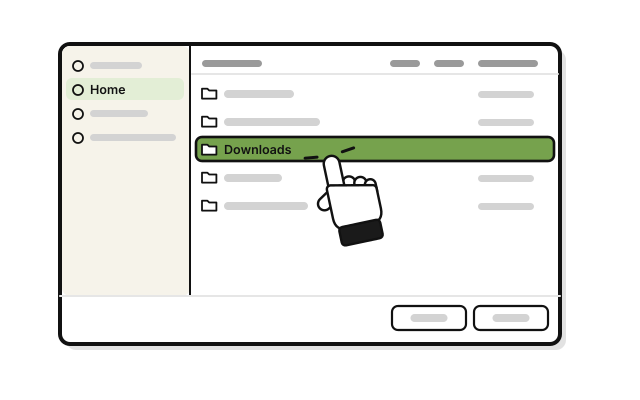
   Check that the file is in your **Downloads** folder.

2. 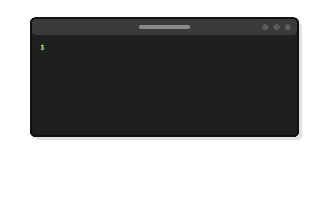
   Open your terminal app. In your app menu, it may be called **Terminal**, **Console** or **Konsole**.

3. Type `cd ~/Downloads` and press **Enter**.

4. 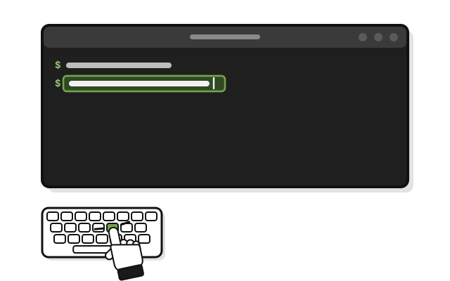
   Type `tar -xzf`, a space, and the file's name, such as `wellspent.tar.gz`. Press **Enter**.

   > You see no message. A new folder, `wellspent`, is in Downloads.

5. Type `cd wellspent` and press **Enter**.

6. 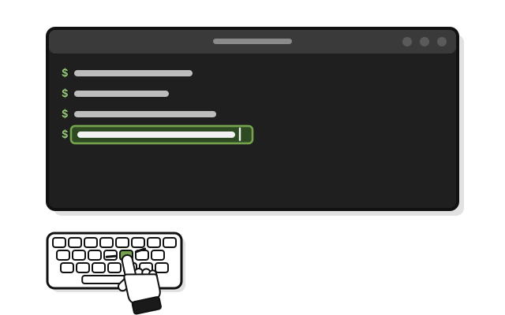
   Type `./install.sh` and press **Enter**.

   > You see "WellSpent is installed. It is in the app menu."

7. 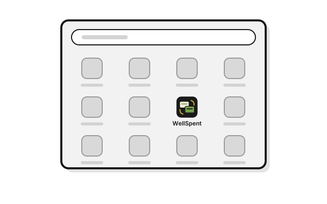
   Open your app menu.

8. 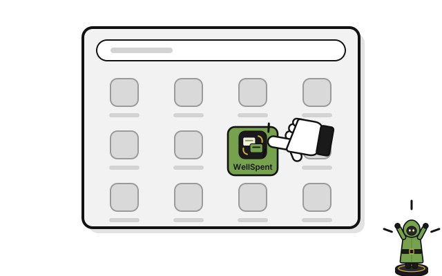
   Click **WellSpent**.

   > You see WellSpent, with two sample groups, **HOUSEHOLD** and **SIDE BUSINESS**. They're made up, so you can look around.

Keep the `wellspent` folder in Downloads. You need it to remove WellSpent.

## If it doesn't work

**On a Mac or an iPhone:**

- **No email from Apple:** check your spam or junk folder, and search your mail for "TestFlight".
- **You see Update or Open, not Accept:** you've tested WellSpent before. Click or tap **Update**, then **Open**.
- **No Install button:** Apple shows **Install** only when this version works on your device. WellSpent needs macOS 14 or later on a Mac, or iOS 17 or later on an iPhone.
- **WellSpent won't open:** each test version works for up to 90 days. Open TestFlight, and click or tap **Update**.
- **Your Mac shows another warning:** don't change any settings. Write to **dev@wellspent.space**, with a picture of the warning.

**On Linux:**

- **"No such file or directory":** check the name, capital letters too, and try again. To see what's in the folder, type `ls` and press **Enter**.
- **Something asks for a password:** don't type it. Write to **dev@wellspent.space**.
- **WellSpent isn't in your app menu:** in the terminal, type `~/.local/opt/wellspent/wellspent` and press **Enter**. If the window opens, the app works. Write to **dev@wellspent.space** to say the menu entry was missing.
- **No window opens:** the terminal shows a message. Copy it into an email to **dev@wellspent.space**.
- **Not sure your computer can run it:** type `uname -m` and press **Enter**. WellSpent runs where that shows `x86_64`. It also needs a recent Linux, such as Ubuntu 24.04 or Fedora 39 or newer, with GTK 4 and a desktop keyring.

## Next quest

[Quest 2: Make your account](make-your-account.md)

<!-- Scenarios: SAMP-01 -->
