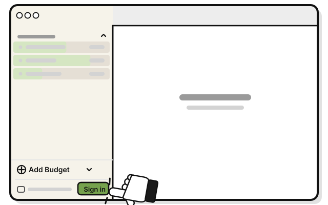
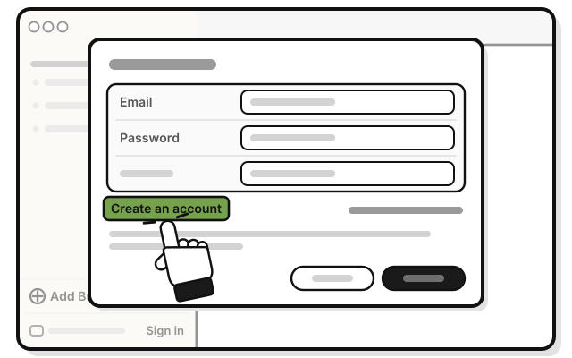
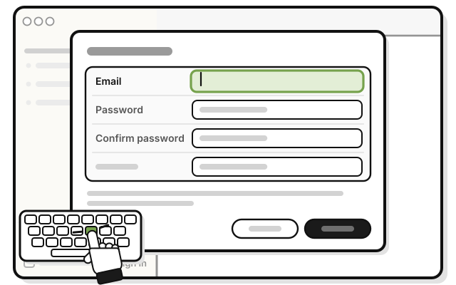
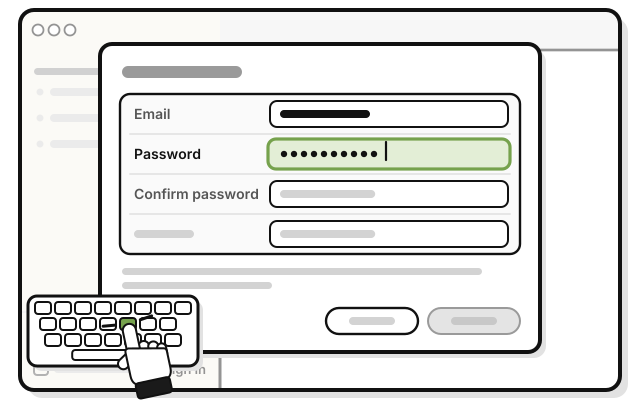
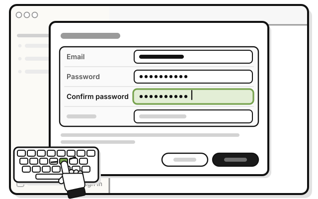
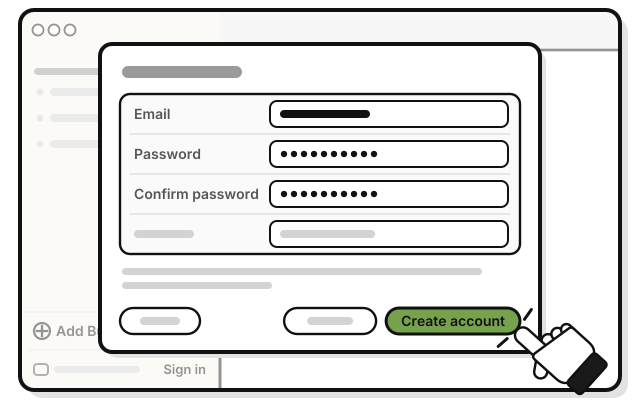
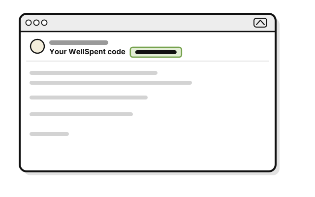
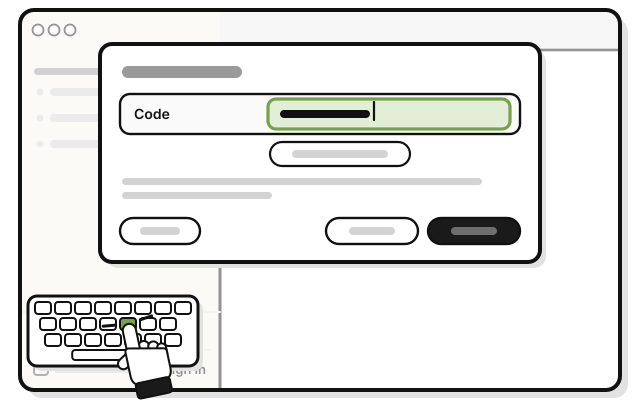
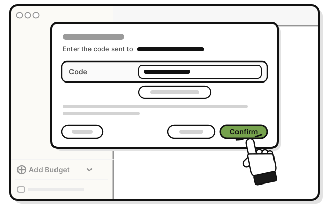
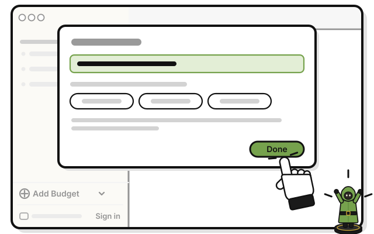

# Quest 2: Make your account

> *Sign the guild book, and your budgets travel with you.*

**Before you start:** you need an account to sync between computers and to share a group. Changed or added to a sample group? Delete it first, or it comes into your account. Sample groups you haven't changed stay out.

Your budgets sync through WellSpent's server. Connections and backups are encrypted. The server can read your budgets. That's how it checks who may change what, and why resetting a forgotten password doesn't lose your budgets.

1. 
   Press **Sign in** at the bottom of the sidebar.

2. 
   Press **Create an account**.

3. 
   Type your email in **Email**.

4. 
   Type a password of at least 10 characters in **Password**.

5. 
   Type the same password in **Confirm password**.

6. 
   Press **Create account**.

   > You see **Confirm your email**, and "Enter the code sent to" your email.

7. 
   Open the email from WellSpent with the subject **Your WellSpent code**. The code is in the subject.

8. 
   Type the code in **Code**.

9. 
   Press **Confirm**.

   > You see "Your email is confirmed."

10. 
    Press **Done**.

    > You see **Syncs through WellSpent's server** at the bottom of the sidebar.

## If it doesn't work

- **"That email already has an account":** sign in with that email and its password instead.
- **"That does not look like an email address."**, **"A password needs at least 10 characters."** or **"The two passwords are not the same.":** fix it, and press **Create account** again.
- **No code email after two minutes:** check your spam or junk folder. Then press **Send another code**, and use the code in the newest email.
- **"That code is wrong or has expired":** a code works for 24 hours, and for five tries. Press **Send another code**, and use the new one.

## Next quest

[Quest 3: Make your first group](../budgets/make-your-first-group.md)

<!-- Scenarios: ACCT-02, ACCT-03, ACCT-04, ACCT-05, ACCT-06, SAMP-02, SAMP-04, SAMP-05 -->
