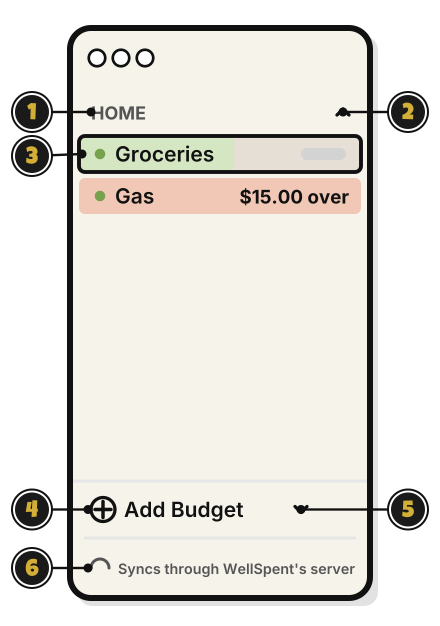
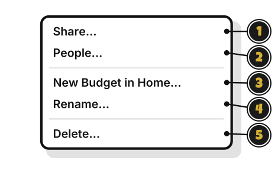
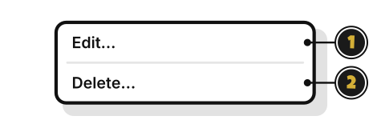
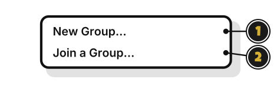
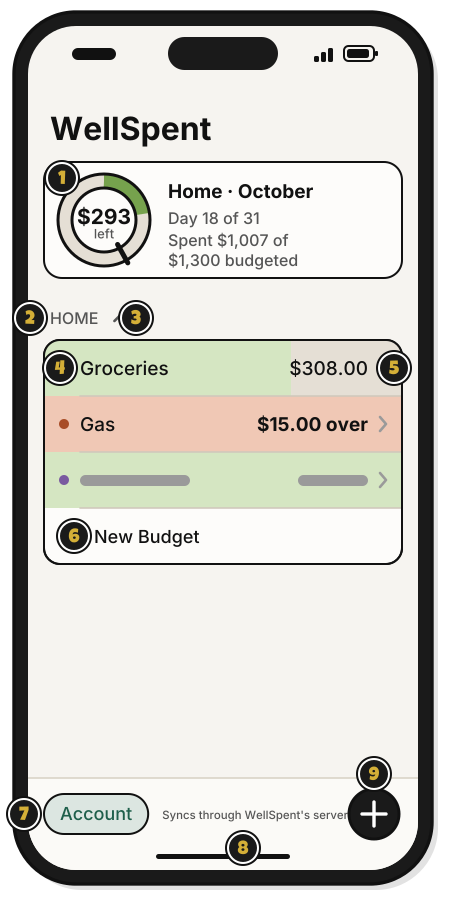
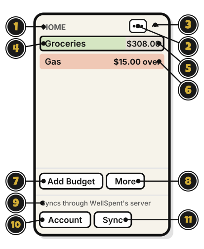

# Tour: The sidebar, and Home on an iPhone

> *Your map of the realm. Every group and budget lives here.*

The sidebar is the list on the left of the window, shown here signed in.

1. **HOME**: a group, in capital letters. Right-click it for its menu.
2. The arrow: hides or shows the group's budgets. It points up while they show.
3. **Groceries**: a budget. Its row fills from the left as its money is used this month, with what's left at the right. Over its limit, it fills all the way and says how far over. Click it to open its page.
4. **Add Budget**: make a budget. [Quest 4](../budgets/make-your-first-budget.md)
5. The small arrow: opens a menu with **New Group…** and **Join a Group…**
6. **Syncs through WellSpent's server**: you're signed in. Signed out, it says **Kept on this computer only**, with **Sign in**.

## A group's menu

1. **Share…**: invite someone to the group. [Quest 7](../sharing/share-a-group.md)
2. **People…**: see who's in the group, and what each person can do.
3. **New Budget in Home…**: make a budget in this group.
4. **Rename…**: change the group's name.
5. **Delete…**: delete the group and everything in it. It asks first. Someone who joined a group sees **Leave…** here instead. An Admin sees **Delete…**, and it deletes the group for everyone.

## A budget's menu

1. **Edit…**: change the budget's name, or how much a month.
2. **Delete…**: delete the budget and its transactions. It asks first.

## The menu beside Add Budget

1. **New Group…**: make a group. [Quest 3](../budgets/make-your-first-group.md)
2. **Join a Group…**: join a group with an invite link. [Quest 8](../sharing/join-a-group.md)

## On an iPhone: Home

On an iPhone, Home takes the sidebar's place. Shown here signed in.

1. The money card: this month for your first group that has a budget. The middle of the wheel says what's left, or how far over. Beside it: the day of the month, and what's spent of what's budgeted.
2. **HOME**: a group, in capital letters. Tap it to open its page. Touch and hold it for its menu.
3. The arrow: hides or shows the group's budgets.
4. **Groceries**: a budget. Its row fills from the left as its money is used this month. Tap it to open its page. At the Manage level or higher, touch and hold it for **Edit** and **Delete**.
5. **$308.00**: what's left this month. Over its limit, the row fills all the way and says how far over, like **$15.00 over**.
6. **New Budget**: make a budget in this group. It shows at the Manage level or higher. [Quest 4](../budgets/make-your-first-budget.md)
7. **Account**: your account, and signing out. Signed out, it's **Sign in**.
8. **Syncs through WellSpent's server**: you're signed in. Signed out, it says **Kept on this iPhone only**. If a sync fails, it says why, in orange. Pull Home down to sync now.
9. **+**: a menu with **Add Budget**, **New Group** and **Join a Group**.

A group's menu has the same items as on a Mac, plus **Hide budgets**.

## On Linux

The sidebar is on the left of the window, shown here signed in. There's no right-click menu on Linux.

1. **HOME**: a group, in capital letters. Click it to open the group's page.
2. **⋯**: the group's menu, with **Share…**, **People…**, **New Budget in Home…**, **Rename…** and **Delete…** (or **Leave…**).
3. The arrow: hides or shows the group's budgets.
4. **Groceries**: a budget. Its row fills from the left as its money is used this month. Click it to open its page. Its **Edit…** and **Delete…** are at the top of that page.
5. **$308.00**: what's left this month.
6. **Gas**: a budget over its limit. The row fills all the way and says how far over.
7. **Add Budget**: make a budget. [Quest 4](../budgets/make-your-first-budget.md)
8. **More**: a menu with **New Group…** and **Join a Group…**
9. **Syncs through WellSpent's server**: you're signed in. Signed out, it says **Kept on this computer only**.
10. **Account**: your account, and signing out. Signed out, it's **Sign in**.
11. **Sync**: send and get changes now. It shows only when you're signed in.

<!-- Scenarios: BUDGET-01, BUDGET-02, BUDGET-03, BUDGET-06, BUDGET-08, BUDGET-11, BUDGET-13, PAGE-02, PAGE-05, WHEEL-01, WHEEL-02, WHEEL-03, SHARE-01, SHARE-07, ACCT-01 -->
