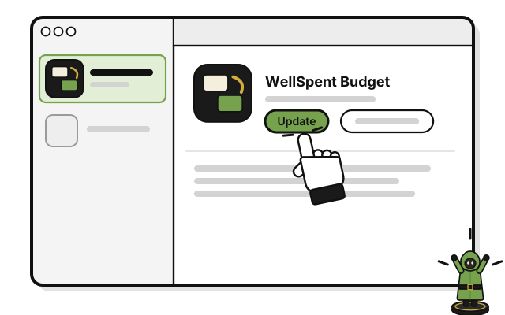
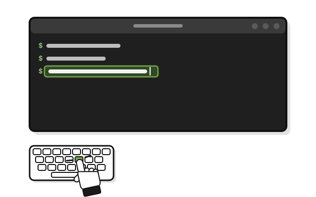

# Side quest: Update WellSpent

> *New gear arrives. Equip it.*

On a Mac or iPhone, new versions come through TestFlight. Your budgets stay through every update.

1. 
   Open the TestFlight app, and click or tap **Update** beside WellSpent Budget.

To get new versions on their own, turn on **Automatic Updates** for WellSpent Budget in TestFlight. On a Mac, it's under **App Settings**.

Each test version works for up to 90 days. If WellSpent won't open, open TestFlight and look for **Update**.

## On Linux

A new version comes as a new file, like the first one. Your budgets stay through every update, because they're kept apart from the app.

1. 
   Unpack the new file, and run its `install.sh`, as in [Quest 1, On Linux](get-wellspent.md#on-linux), steps 2 to 6.

   > You see "WellSpent is installed. It is in the app menu."

2. Close WellSpent's window, and open WellSpent again from your app menu.

