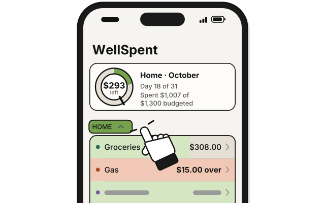
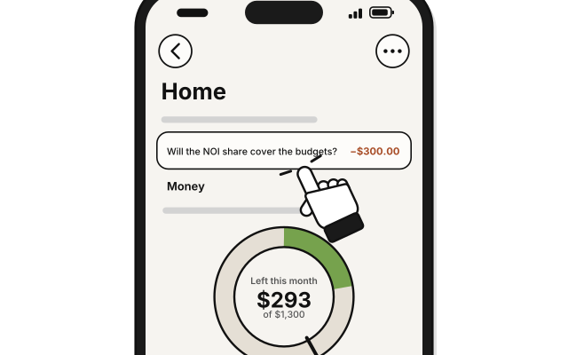
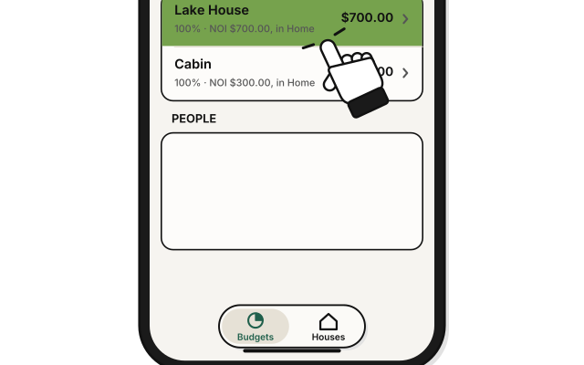
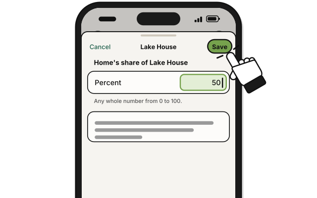

# Side quest: Change a house's share

> *Split the loot. Say how much of each house's earnings the group counts on.*

A group with houses shows one more section on its page in **Budget**: "Will the NOI share cover the budgets?" Its wheel puts the group's budgets against its share of the houses' net operating income (NOI). Each house counts 100% until you change it.

**Before you start:** the Manage level in the group. Below it, you see each share with "Ask a manager to change a share."

1. Press **Budget** on the rail.

2. Click the group's name in the sidebar.

   > You see the group's page. The **Money** section comes first, as always. The NOI section is below it.

3. In **Home's share of NOI**, press the house's percent, such as **100%**.

4. Type a whole number from 0 to 100 in **Percent**, and press **Save**.

   > You see the wheel change, and Runway on **Houses** follows.

Marking or unmarking a bill with a house never moves this wheel. A group with no houses looks just as it did before. A group with houses but no budgets says **No budgets yet**.

## On an iPhone

**Coming in the next update.**

1. 
   In the **Budgets** tab, tap the group.

2. 
   Tap the line under the title. It takes you to the NOI section.

3. 
   Under **Home's share of NOI**, tap the house's row. Its percent is in the small line under its name.

4. 
   Type a whole number from 0 to 100 in **Percent**, and tap **Save**.

## On Linux

Properties isn't on Linux yet.

## Related

- [How Houses counts the money](how-houses-counts-the-money.md)

<!-- Scenarios: PROP-40, PROP-41, PROP-42, PROP-43, PROP-44, PROP-45, PROP-46, PROP-49 -->
