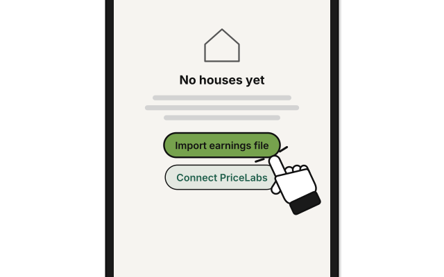
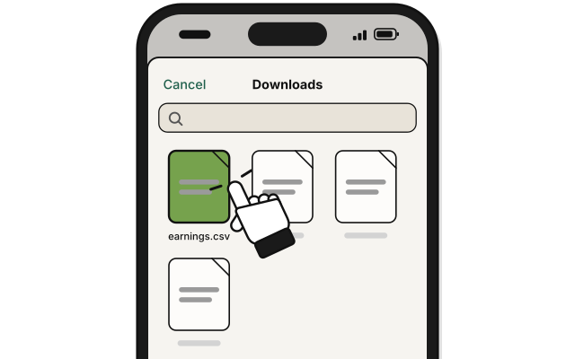
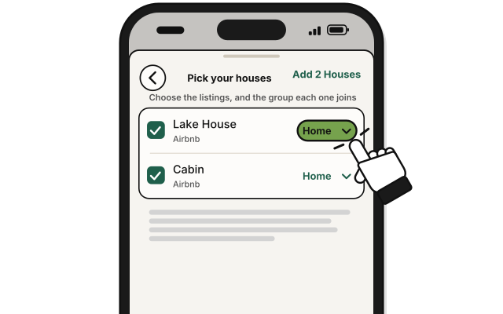
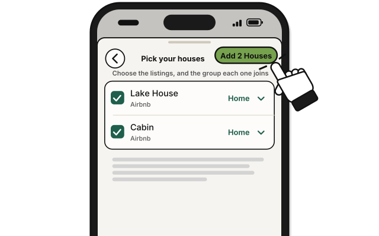

# Side quest: Import an earnings file

**Coming in the next update.**

> *No scout? Read the map yourself, from Airbnb's own records.*

**Before you start:**

- Properties is on. See [Side quest: Turn on Properties](turn-on-properties.md).
- An earnings file you downloaded from Airbnb. It's a CSV file. Paid and pending files both work. Earnings files work from Airbnb only for now.
- The Manage level in each group a house will join.
- Choose the group with care. Your stays and house names sync through WellSpent's server. Everyone in the group can see them. The server can read them. Guest names aren't saved.

1. On **Houses**, press **Import earnings file**. Once you have a house, it's in **Add House**, under a group's houses.

2. Pick the file, and press **Open**.

   > You see **Pick your houses**, with the file's listings.

3. Tick each listing that is one of your houses, and pick its group in **Group**.

4. Press **Add 2 Houses**. The button counts what you ticked: with one, it says **Add 1 House**.

   > You see how many stays came in, such as "Brought in 12 stays."

- Only reservations become stays. Payouts and other rows are skipped, and the app says how many.
- Stays older than 12 months are left out.
- Importing the same file twice adds nothing.
- It adds nothing to your budgets.

## On an iPhone

**Coming in the next update.**

1. 
   In the **Houses** tab, tap **Import earnings file**. Once a group has a house, it's in the **…** button at the top right of the group's page. Only a manager sees it there.

2. 
   Pick the file.

3. 
   Tick each listing that is one of your houses, and pick its group.

4. 
   Tap **Add 2 Houses**. The button counts what you ticked.

## On Linux

Properties isn't on Linux yet.

## If it doesn't work

- **"This file can't be read, so nothing was added.":** it needs to be an Airbnb earnings CSV file.

## Related

- [Side quest: Connect PriceLabs](connect-pricelabs.md)
- [How Houses counts the money](how-houses-counts-the-money.md)

<!-- Scenarios: PROP-16 -->
