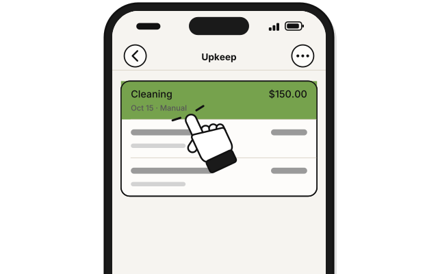
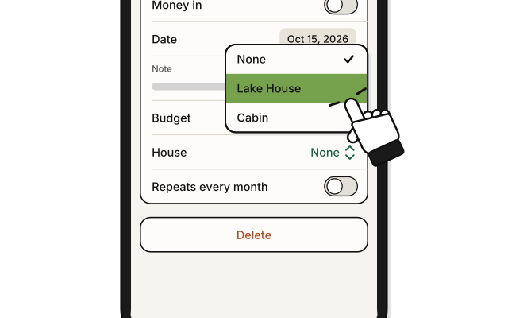
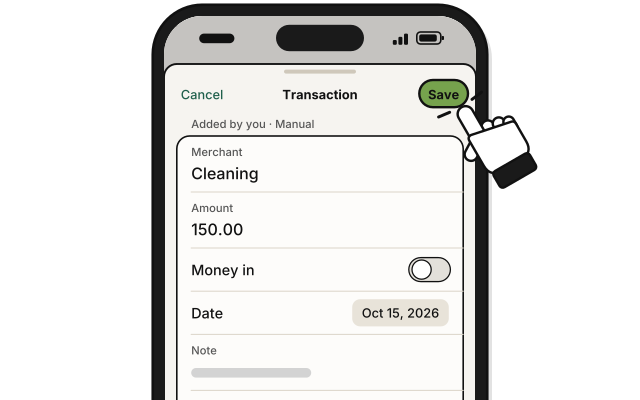

# Side quest: Mark a bill with a house

> *Tag each cost with the house that ran it up.*

A bill marked with a house counts in that house's net operating income (NOI). It stays in its budget, and the budget's spent and left don't change.

**Before you start:** Properties is on, and the bill's group has a house.

1. Click the bill in the budget's list.

2. In **House**, pick the house.

3. Press **Save**.

   > You see the bill on that house's **Operating expenses** list.

**House** lists only the houses in the bill's group, and **None**.

A repeating bill can have a house too. Each month's bill then carries it.

## Add a bill from a house's page

1. On **Houses**, click the house.

2. Press **Add** beside **Operating expenses**.

   > You see the usual sheet for a new bill, with **House** already set.

3. Fill it in, pick its **Budget**, and press **Add**.

If the group has no budgets yet, a manager sees **+ New budget**, with **Budget name** and **Monthly amount**. Below the Manage level, the sheet says "Ask a manager to add a budget first."

## On an iPhone

**Coming in the next update.**

1. 
   In the budget, tap the bill.

2. 
   In **House**, pick the house.

3. 
   Tap **Save**.

## On Linux

Properties isn't on Linux yet.

## If it doesn't work

- **There's no House:** Properties is off on this device, or the group has no houses. Someone with Properties off can still change the bill, and its house stays.

## Related

- [How Houses counts the money](how-houses-counts-the-money.md)
- [Side quest: Make a bill repeat every month](../transactions/make-a-bill-repeat.md)

<!-- Scenarios: PROP-35, PROP-36, PROP-37, PROP-38, PROP-39, PROP-51, REPEAT-16 -->
