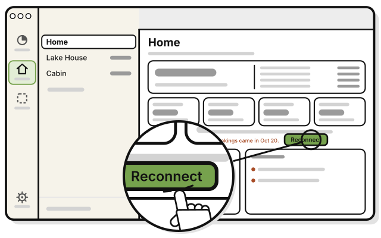
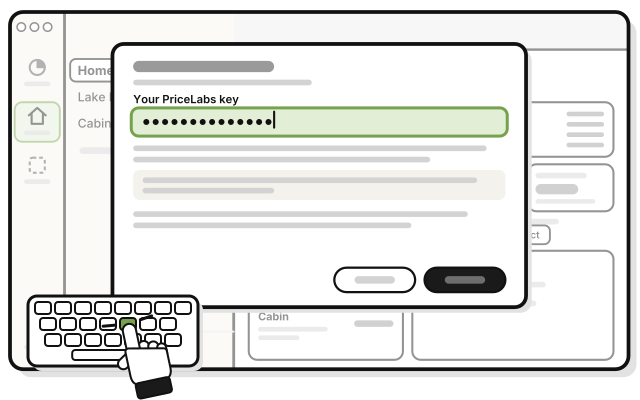
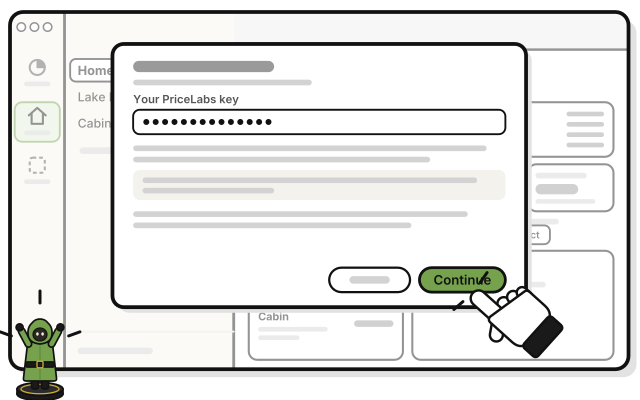

# Side quest: Reconnect PriceLabs

> *Your scout went quiet. Send a new message.*

If PriceLabs stops accepting your key, a line on the group's page says so, and on **Houses** while it has no houses, such as "PriceLabs is paused. Last bookings came in Oct 20." Nothing is lost. Every house and stay already brought in stays.

1. 
   Press **Reconnect** beside that line.

   > You see the Connect PriceLabs sheet.

2. 
   Copy a new key from PriceLabs, and paste it into **Your PriceLabs key**.

3. 
   Press **Continue**.

## On an iPhone

**Coming in the next update.**

The steps are the same. Tap **Reconnect**, paste the new key, and tap **Continue**.

## On Linux

Properties isn't on Linux yet.

## Related

- [Side quest: Connect PriceLabs](connect-pricelabs.md)

<!-- Scenarios: PROP-17 -->
