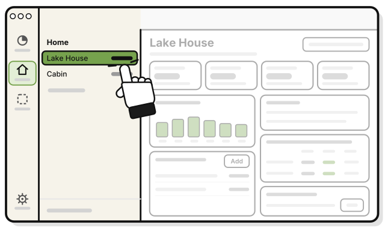
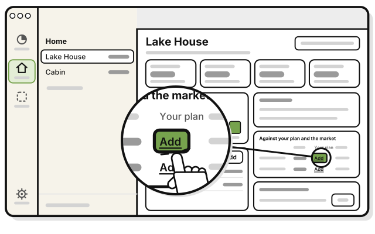
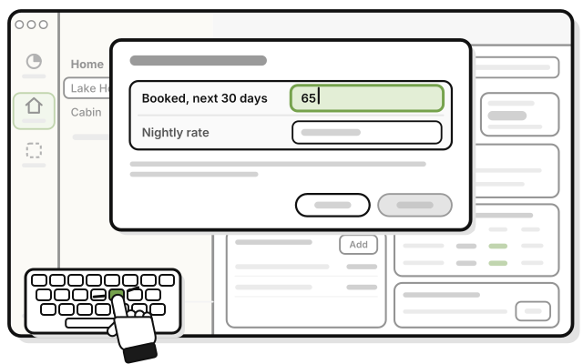
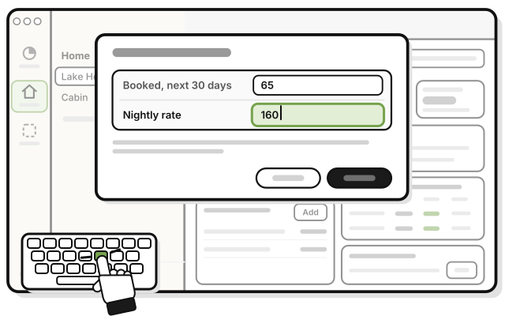
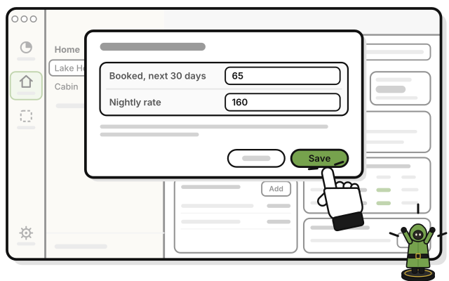

# Side quest: Set a plan for a house

**Coming in the next update.**

> *Set your target, then see how you stack up against the other players.*

On a house's page, **Against your plan** puts how the house is doing beside your plan. It's for comparing only. It doesn't change NOI, the wheel or Runway.

**Before you start:** the Manage level in the house's group. Below it, **Your plan** reads **Not set** until a manager adds it.

1. 
   On **Houses**, click the house.

2. 
   In **Against your plan**, press **Add** under **Your plan**.

3. 
   Type the percent of nights you plan to book in **Booked, next 30 days**.

4. 
   Type your planned rate in **Nightly rate**.

5. 
   Press **Save**.

   > You see two rows, **Booked, next 30 days** and **Nightly rate, this month**, under **You** and **Your plan**.

- **You:** from your stays.
- **Your plan:** what you typed. Everyone in the group sees it.
- On the iPhone, until the next update, the card also shows **Market**, and is called **Against your plan and the market**.

## On an iPhone

**Coming in the next update.**

The steps are the same. In the **Houses** tab, tap the house, then tap **Add** under **Your plan**.

## On Linux

Properties isn't on Linux yet.

## Related

- [How Houses counts the money](how-houses-counts-the-money.md)

<!-- Scenarios: PROP-56 -->
