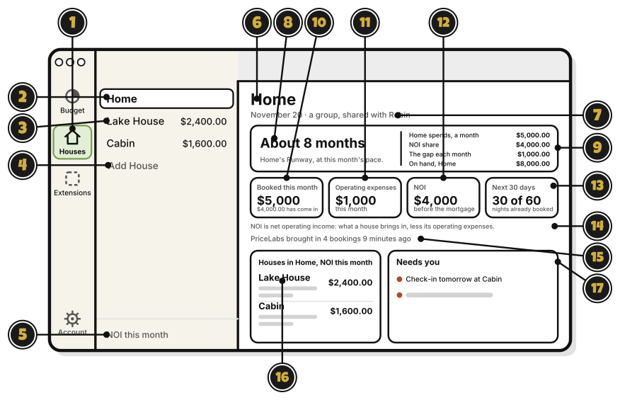
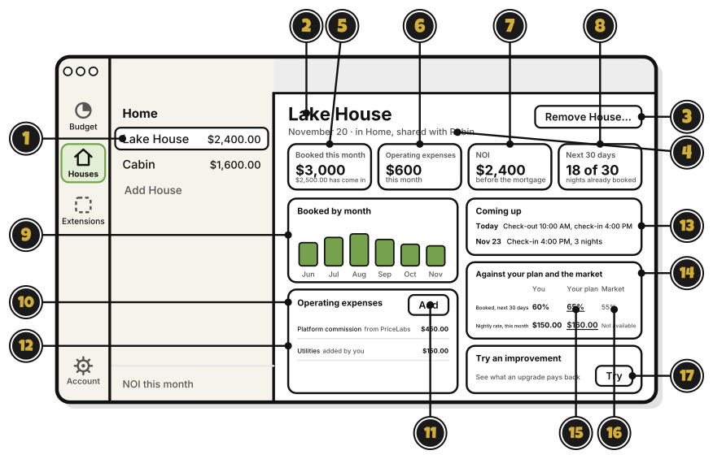
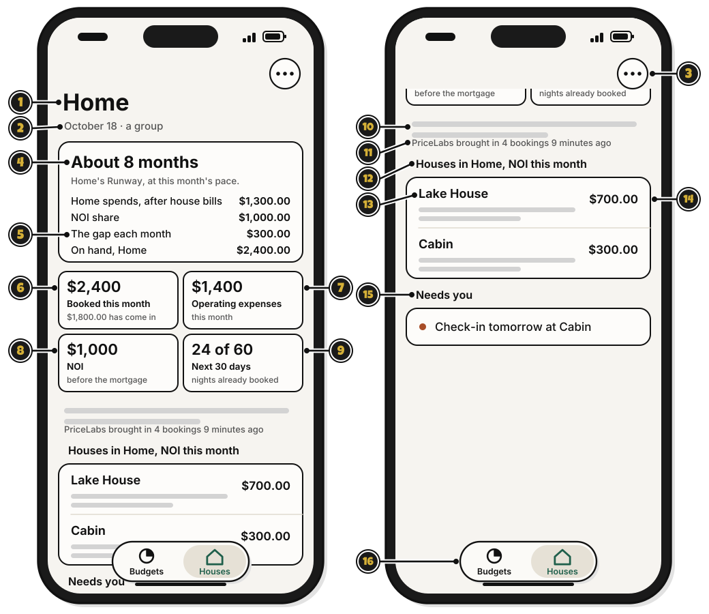
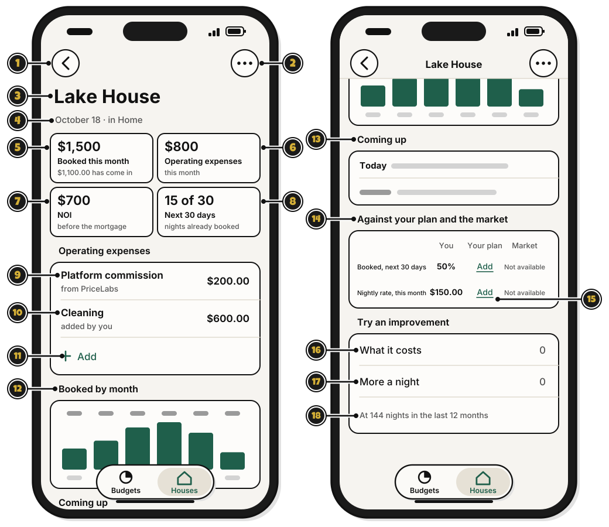

# Tour: Houses

> *Survey your holdings before the next move.*

**Houses** has two kinds of page: a group's page, with all its houses, and a house's page.

## On a Mac: a group's page

**Houses** on the rail opens a list of your groups with houses. Click a group to open its page.

1. **Houses** on the rail: open Houses. It's on the rail once Properties is on. [Side quest: Turn on Properties](turn-on-properties.md)
2. **Home**: a group with houses. Click it to open its page.
3. **Lake House**: a house in the group, with its NOI this month. Click it to open its page.
4. **Add House**: add a house from an earnings file. Until the next update, **Connect PriceLabs** is here too. [Side quest: Import an earnings file](import-an-earnings-file.md)
5. **NOI this month**: what the list's amounts are.
6. **Home**: the group's name.
7. **November 20 · a group, shared with Robin**: today's date, and who shares the group.
8. **About 8 months**: Runway, about how long the group can keep going at this month's pace.
9. The four lines beside it: what Home spends a month, its NOI share, the gap each month, and what it has on hand. Runway comes from these.
10. **Booked this month**: what the group's houses booked, and how much has come in.
11. **Operating expenses**: this month's costs of running the houses.
12. **NOI**: net operating income, what the houses bring in less their operating expenses, before the mortgage.
13. **Next 30 days**: nights already booked, of the nights there are.
14. The line about NOI: what NOI means.
15. The PriceLabs line: when PriceLabs last brought in bookings. If PriceLabs is paused, **Reconnect** is here. It goes away in the next update. [Side quest: Reconnect PriceLabs](reconnect-pricelabs.md)
16. A house's row: click it to open the house.
17. **Needs you**: today's turnovers, tomorrow's check-ins, and empty nights between stays. Until setup is done, **Finish setting up** is here instead. [Side quest: Finish setting up](finish-setting-up.md)

## On a Mac: a house's page

Click a house in the list.

1. **Lake House**, picked in the list: the house that's open.
2. **Lake House**: the house's name.
3. **Remove House…**: take the house out. It asks first. [Side quest: Remove a house](remove-a-house.md)
4. **November 20 · in Home, shared with Robin**: today's date, and the house's group.
5. **Booked this month**: what the house booked, and how much has come in.
6. **Operating expenses**: this month's costs of running it.
7. **NOI**: what it brings in less its operating expenses, before the mortgage.
8. **Next 30 days**: nights already booked, of the next 30.
9. **Booked by month**: what the house booked each month.
10. **Operating expenses**: each cost this month.
11. **Add**: add a bill with **House** already set to this house. [Side quest: Mark a bill with a house](mark-a-bill-with-a-house.md)
12. **Platform commission from PriceLabs**: one cost, and where it came from.
13. **Coming up**: the next stays.
14. **Against your plan and the market**: what's booked and the nightly rate, beside **Your plan** and the **Market**.
15. **Your plan**: click a number to change it. [Side quest: Set a plan for a house](set-a-plan-for-a-house.md)
16. **Market**: the market's figures, from PriceLabs. PriceLabs sends no market nightly rate, so that reads **Not available**. It goes away in the next update.
17. **Try**: try an upgrade, and see what it might pay back. [Side quest: Try an improvement](try-an-improvement.md)

## On an iPhone: a group's page

**Coming in the next update.**

The **Houses** tab opens on your first group's page.

1. **Home**: the group's name. Once two groups have houses, tap it to pick another.
2. **October 18 · a group**: today's date, and that this is a group.
3. **…**: for a manager, **Import earnings file**.
4. **About 8 months**: Runway, about how long the group can keep going at this month's pace.
5. The four lines under it: what Home spends after house bills, its NOI share, the gap each month, and what it has on hand. Runway comes from these.
6. **Booked this month**: what the group's houses booked, and how much has come in.
7. **Operating expenses**: this month's costs of running the houses.
8. **NOI**: net operating income, what the houses bring in less their operating expenses, before the mortgage.
9. **Next 30 days**: nights already booked, of the nights there are.
10. The line about NOI: what NOI means.
11. The PriceLabs line. It doesn't show on the iPhone.
12. **Houses in Home, NOI this month**: the group's houses.
13. **Lake House**: a house. Tap its row to open its page.
14. **$700.00**: the house's NOI this month.
15. **Needs you**: today's turnovers, tomorrow's check-ins, and empty nights between stays. Until setup is done, **Finish setting up** is here instead. [Side quest: Finish setting up](finish-setting-up.md)
16. **Budgets** and **Houses**: the two tabs.

## On an iPhone: a house's page

**Coming in the next update.**

Tap a house on its group's page.

1. The back arrow: go back to the group's page.
2. **…**: for a manager, **Remove House**. [Side quest: Remove a house](remove-a-house.md)
3. **Lake House**: the house's name.
4. **October 18 · in Home**: today's date, and the house's group.
5. **Booked this month**: what the house booked, and how much has come in.
6. **Operating expenses**: this month's costs of running it.
7. **NOI**: what it brings in less its operating expenses, before the mortgage.
8. **Next 30 days**: nights already booked, of the next 30.
9. **Platform commission**: the booking site's cut, from PriceLabs.
10. **Cleaning**: a bill marked with this house. Tap it to open the bill.
11. **Add**: add a bill with **House** already set to this house. [Side quest: Mark a bill with a house](mark-a-bill-with-a-house.md)
12. **Booked by month**: what the house booked each month.
13. **Coming up**: the next stays.
14. **Against your plan**: what's booked and the nightly rate, beside **Your plan**. [Side quest: Set a plan for a house](set-a-plan-for-a-house.md)
15. **Add** under **Your plan**: a manager sets the plan. Everyone else sees **Not set**.
16. **What it costs**: the price of an upgrade you're thinking about. [Side quest: Try an improvement](try-an-improvement.md)
17. **More a night**: how much more you'd charge a night after it.
18. The line under them: the nights the guess works from.

## On Linux

Properties isn't on Linux yet.

## Related

- [How Houses counts the money](how-houses-counts-the-money.md)
- [Side quest: Turn on Properties](turn-on-properties.md)

<!-- Scenarios: PROP-04, PROP-11, PROP-30, PROP-31, PROP-56 -->
