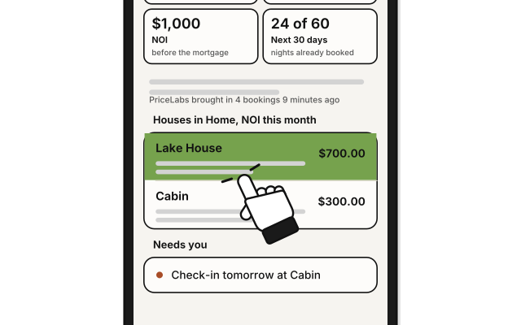
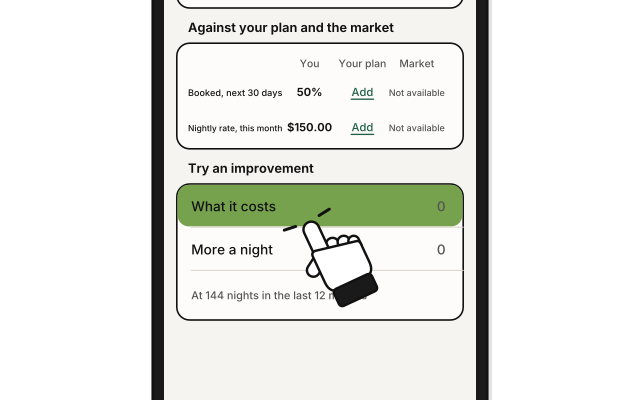
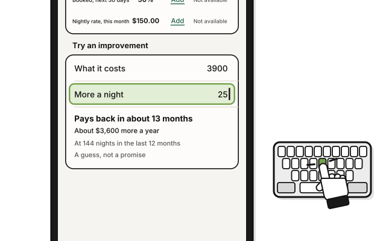

# Side quest: Try an improvement

> *Thinking of an upgrade? Roll the numbers before you spend the gold.*

See about how long an upgrade to a house would take to pay for itself. Nothing in your budgets, bills or stays changes.

1. On **Houses**, click the house.

2. In **Try an improvement**, press **Try**.

3. Type the upgrade's price in **What it costs**.

4. Type how much more you'd charge a night in **More a night**.

   > You see how long it takes to pay back, such as "Pays back in about 13 months", and that it's a guess, not a promise.

5. Press **Done**.

It works from the nights the house was booked in the last 12 months. A house with fewer months of stays scales them to a year, and says so.

## On an iPhone

**Coming in the next update.**

1. 
   In the **Houses** tab, tap the house.

2. 
   Scroll to **Try an improvement**, and tap **What it costs**.

3. 
   Type the price, and tap **Done** above the number pad. Then do the same in **More a night**.

## On Linux

Properties isn't on Linux yet.

## Related

- [How Houses counts the money](how-houses-counts-the-money.md)

<!-- Scenarios: PROP-10 -->
