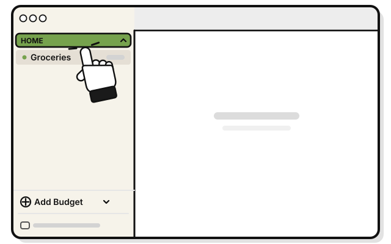
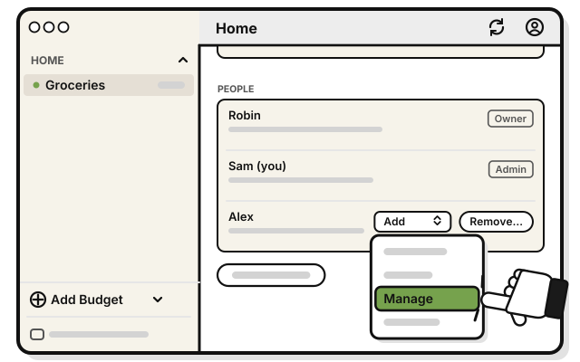
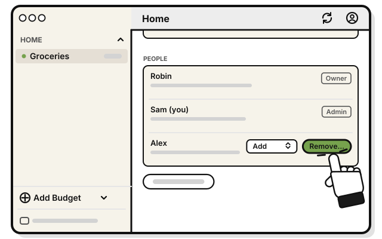
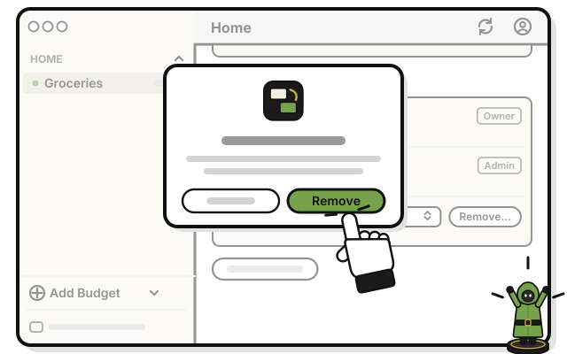

# Side quest: Change someone's level, or remove them

> *Promote a squire, or send someone home.*

**Before you start:** you need the Manage level or higher. A manager can change and remove only people at View or Add. Only the Owner or an Admin can make someone an Admin.

1. 
   Click the group's name in the sidebar.

   > You see the group's page, with PEOPLE.

2. 
   To change a level, pick the new one in the person's level list.

   > You see the line under their name change, to say what the new level can do.

3. 
   To take someone out of the group, press **Remove…** in their row.

4. 
   Press **Remove** in the question.

   > You see their row gone. What they added stays in the group.

## On an iPhone

1. Tap the group's name on Home.

2. Tap the person.

3. Under **Can**, pick the new level. Or tap **Remove**, then **Remove** again, to take them out of the group.

## Related

- [What each level can do](what-each-level-can-do.md)
- [Tour: A group's page](tour-a-groups-page.md)

<!-- Scenarios: PAGE-01, PAGE-09, PAGE-10, PAGE-11, SHARE-16, PAGE-17 -->
