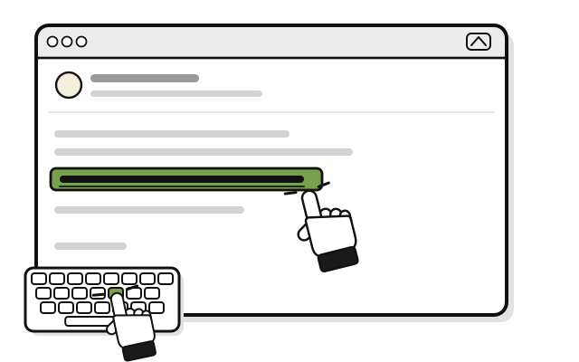
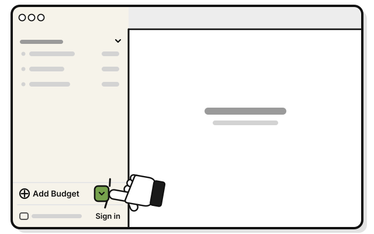
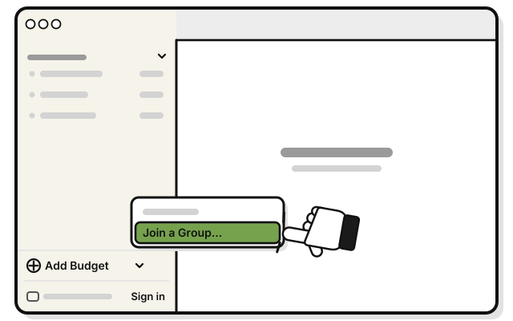
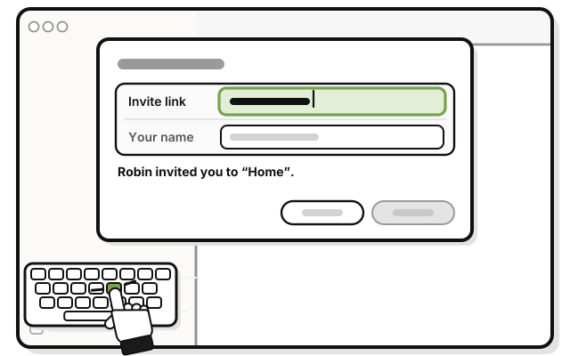
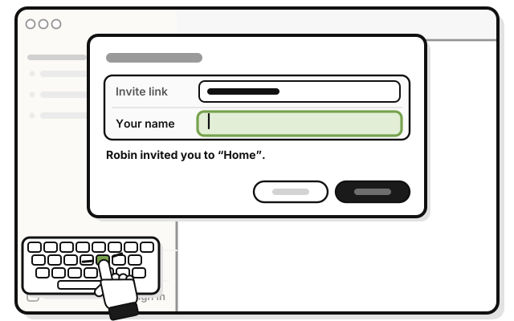
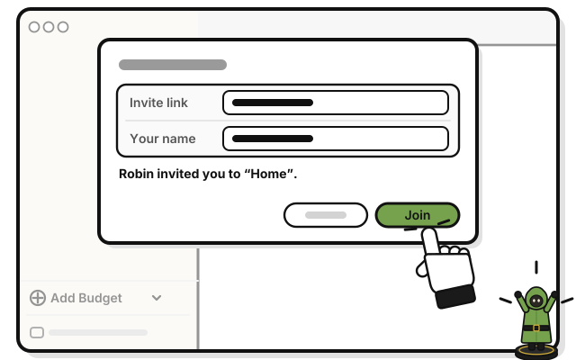

# Quest 8: Join a group

> *Your party is waiting. Join them.*

**Before you start:** sign in, and confirm your email. Joining needs both. You also need the invite link from the person who shared the group.

1. 
   Copy the link from their message.

2. 
   Click the small arrow just right of **Add Budget**, at the bottom of the sidebar.

3. 
   Pick **Join a Group…**

4. 
   Paste the link into **Invite link**.

   > You see who invited you, and the group's name.

5. 
   Type your name in **Your name**. This is the name the group sees.

6. 
   Press **Join**.

   > You see the group in your sidebar. Its budgets fill in a moment later.

## Faster: click the link

Click the link in the message, even with WellSpent closed. WellSpent opens to the invite. Type your name in **Your name**, and press **Join**.

## On an iPhone

Or paste the link: tap **+** at the bottom right of Home, then **Join a Group**.

1. Tap the invite link in the message.

   > You see WellSpent open to the invite.

2. Type your name in **Your name**.

3. Tap **Join**.

   > You see the group on Home.

## If it doesn't work

- **"Confirm your email first. Joining a shared group needs it.":** press **Confirm your email…**, press **Send a code**, and type the code WellSpent emails you. Then try again.
- **"Sign in first, or create an account.":** sign in, and try again. After a clicked link, the invitation stays open while you sign in or make an account. No account yet? Do [Quest 2: Make your account](../getting-started/make-your-account.md).
- **"That invite has expired or can no longer be used.", "That invite has already been accepted." or "That invite was not found. It may have been cancelled.":** ask for a new link. A link works once, for 7 days.
- **"Part of that invite link is missing." or "That is not a WellSpent invite link.":** the message app may have cut the link short. Ask the person who sent it to send it again, or copy the whole link, and paste it.
- **"You are already in that group.":** you're in. Look for the group in your sidebar. The link isn't used up, so it still works for someone else.

<!-- Scenarios: SHARE-07, SHARE-08, SHARE-09, SHARE-10, CLICK-01, CLICK-02, CLICK-04, CLICK-05, CLICK-06, CLICK-07, CLICK-08, CLICK-09, CLICK-10, PASTE-03, PASTE-10 -->
