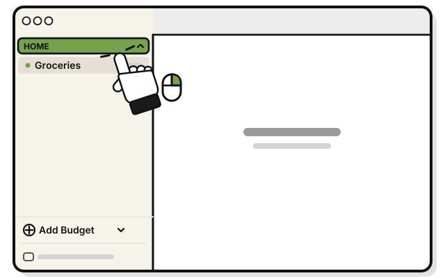
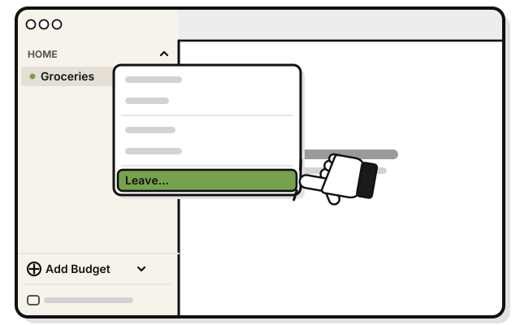
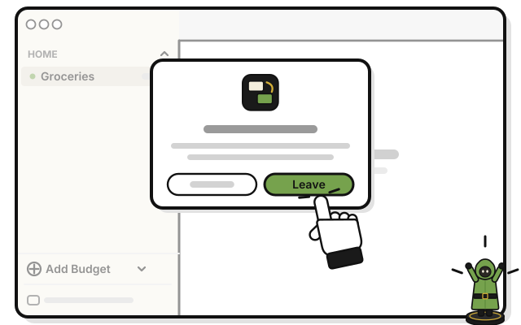
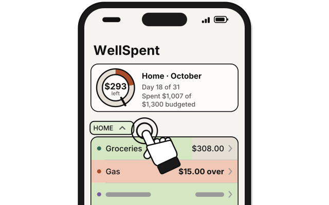
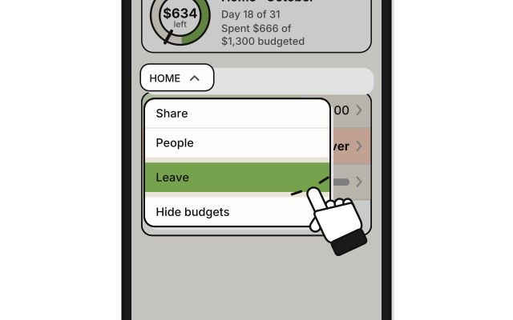
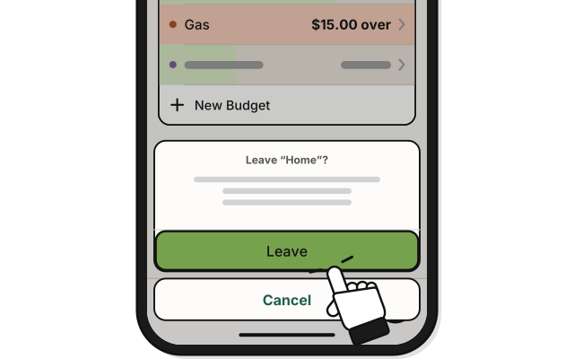
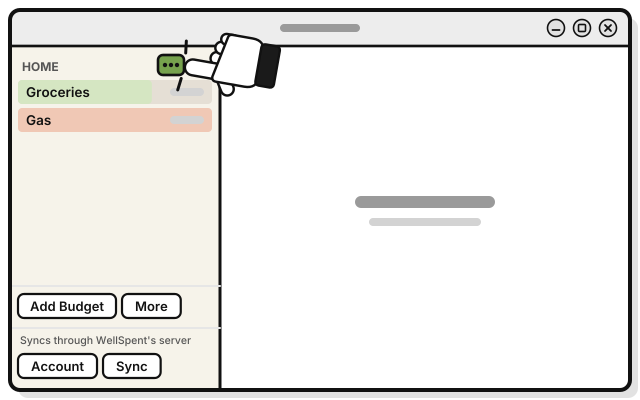
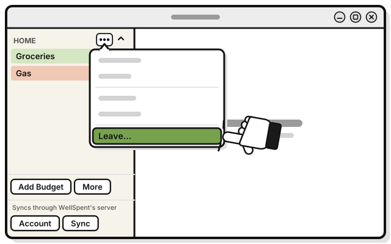
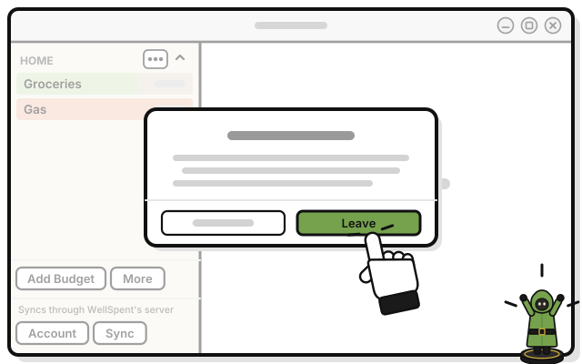

# Side quest: Leave a group

> *Time to leave the party. They'll keep the camp.*

Leaving takes the group off all your devices. The others keep it, along with everything you added.

1. 
   Right-click the group's name in the sidebar.

2. 
   Pick **Leave…**

3. 
   Press **Leave** in the question.

   > You see the group gone from your sidebar.

To come back, ask someone in the group for a new invite link.

## On an iPhone

1. 
   Touch and hold the group's name on Home.

2. 
   Tap **Leave**.

3. 
   Tap **Leave** in the question.

## On Linux

1. 
   Press **⋯** beside the group's name in the sidebar.

2. 
   Pick **Leave…**

3. 
   Press **Leave** in the question.

   > You see the group gone from your sidebar.

## If it doesn't work

- **The menu says Delete…, not Leave…:** you're an Admin. To leave without deleting it, click the group's name, and press **Leave Group…** on its page. On an iPhone, tap the group's name, then **Leave Group** at the end of its page.
- **There's no way to leave:** whoever made a group can't leave it. They can delete it for everyone.

## Related

- [Side quest: Delete a group](../budgets/delete-a-group.md)
- [Tour: A group's page](tour-a-groups-page.md)

<!-- Scenarios: SHARE-15, BUDGET-13, PAGE-14 -->
