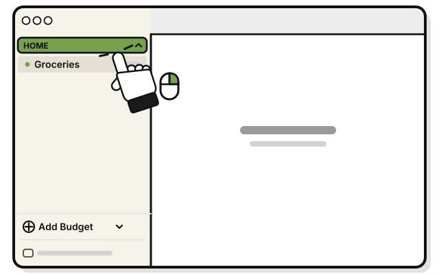
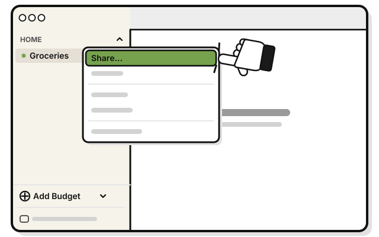
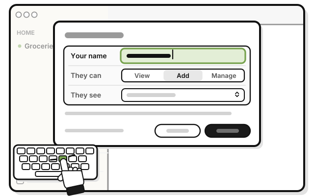
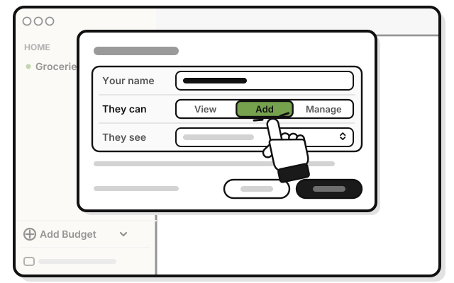
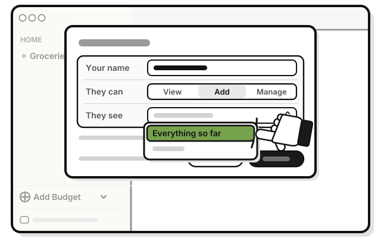
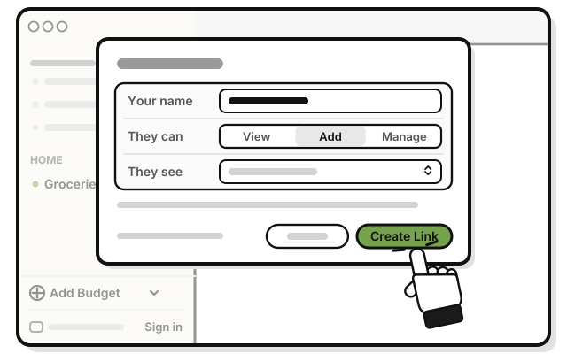
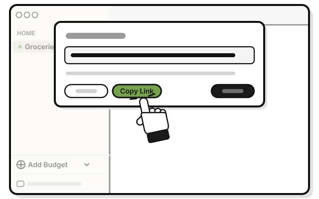
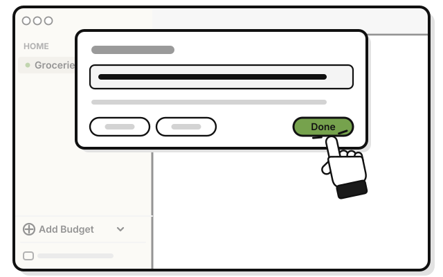
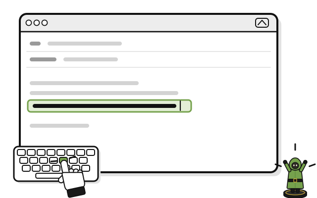

# Quest 7: Share a group

> *Every quest is better with a party.*

**Before you start:** sign in, with the Manage, Admin or Owner level in the group. The person you invite needs WellSpent on their own computer, with their own account. Don't share the sample groups.

1. 
   Right-click **HOME** in the sidebar. Or hold Control and click it.

2. 
   Pick **Share…**

3. 
   Type your name in **Your name**. This is the name the group sees.

4. 
   Under **They can**, pick **View**, **Add** or **Manage**. The line under it says what that level can do.

5. 
   Under **They see**, pick **Everything so far** or **Only from now on**.

6. 
   Press **Create Link**.

7. 
   Press **Copy Link**.

8. 
   Press **Done**.

9. 
   Paste the link into an email or a text to them, and send it.

The link works once, and runs out after 7 days. You can't see or cancel it once it's made, so send it only to the person you mean.

## If it doesn't work

- **"Sign in first. Sharing goes through your account.":** sign in, and try again.
- **"Only a manager or admin can invite people to this group.":** ask the person who made the group to share it.
- **No Manage under They can:** only the group's owner or an Admin can give Manage.
- **The link ran out:** make a new one.
- **The wrong person joined:** open the group's menu, pick **People…**, and remove them.

## Next quest

[Quest 8: Join a group](join-a-group.md)

<!-- Scenarios: SHARE-01, SHARE-02, SHARE-04, SHARE-05, SHARE-06, PAGE-02, SHARE-16 -->
