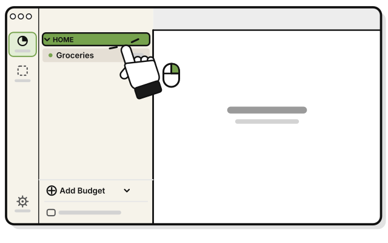
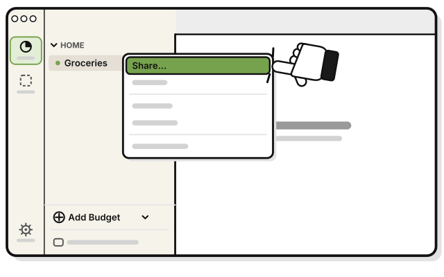
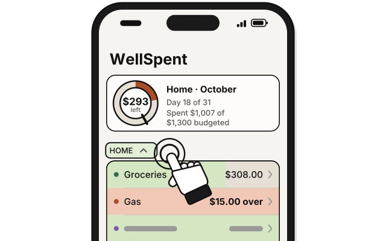
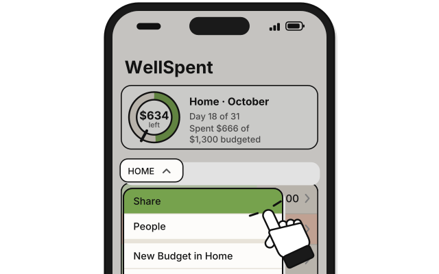
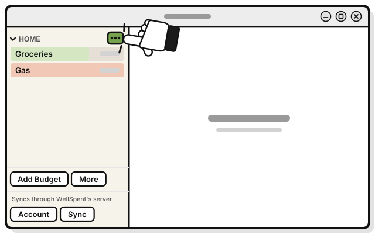
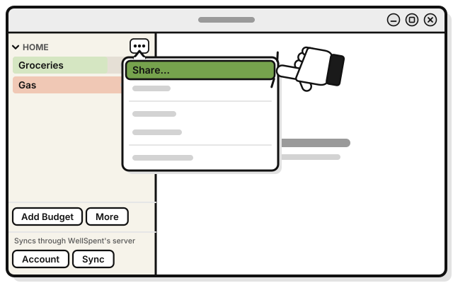

# Quest 7: Share a group

> *Every quest is better with a party.*

**Before you start:** sign in and confirm your email, with the Manage, Admin or Owner level in the group. You need the email address of the person you invite. They need WellSpent on their own Mac, iPhone or Linux computer. Don't share the sample groups.

1. 
   Right-click **HOME** in the sidebar. Or hold Control and click it.

2. 
   Pick **Share…**

3. Type their email address in **Their email**.

4. Type their name in **Their name**. This is how the group sees them.

5. Type your name in **Your name**. This is how the group sees you.

6. Under **They can**, pick **View**, **Add** or **Manage**. The line under it says what that level can do.

7. Under **They see**, pick **Everything so far** or **Only from now on**.

8. Press **Send Invite**.

   > You see "Invitation sent to sam@example.com. It stays Pending until they accept or reject it."

9. Press **Done**.

WellSpent emails the invitation. They accept or reject it in their own group list.

Until they answer, they show under **PEOPLE** on the group's page as **Pending**. Pending means they haven't answered yet. It doesn't mean the email arrived. When they accept, they become a member at your next sync. If they reject it, they show as **Rejected**, and you can send a new invitation.

**Cancel an invitation:** on the group's page, press **Cancel Invite** on their row, then **Cancel Invite** in the question. They can't accept it after that.

## On an iPhone

1. 
   Touch and hold **HOME** on Home.

2. 
   Tap **Share**.

3. Type their email in **Their email**, and their name in **Their name**.

4. Type your name in **Your name**.

5. Pick a level under **They can**, and a choice under **They see**.

6. Tap **Send Invite**, then **Done**.

## On Linux

1. 
   Press **⋯** beside **HOME** in the sidebar.

2. 
   Pick **Share…**

3. Type their email in **Their email**, and their name in **Their name**.

4. Type your name in **Your name**.

5. Pick a level under **They can**, and a choice under **They see**.

6. Press **Send Invite**, then **Done**.

## If it doesn't work

- **"Sign in first. Sharing goes through your account.":** sign in, and try again.
- **"Confirm your email before inviting someone.":** confirm your email with the code WellSpent sent you, as in [Quest 2](../getting-started/make-your-account.md), then try again.
- **"Only a manager or admin can invite people to this group.":** ask the person who made the group to share it.
- **No Manage under They can:** only the group's owner or an Admin can give Manage.
- **Send Invite stays dimmed:** fill in all three: their email, their name, and your name. Their email must be a real email address. A name has 1 to 50 characters.
- **They already have an invitation:** a second one to the same address in the same group is refused. Cancel the first, then send again.
- **The wrong person joined:** open the group's menu, pick **People…**, and remove them.

## Next quest

[Quest 8: Join a group](join-a-group.md)

<!-- Scenarios: SHARE-01, SHARE-04, SHARE-05, SHARE-06, PAGE-02, PAGE-15, SHARE-16, EMAIL-01, EMAIL-05, EMAIL-06 -->
