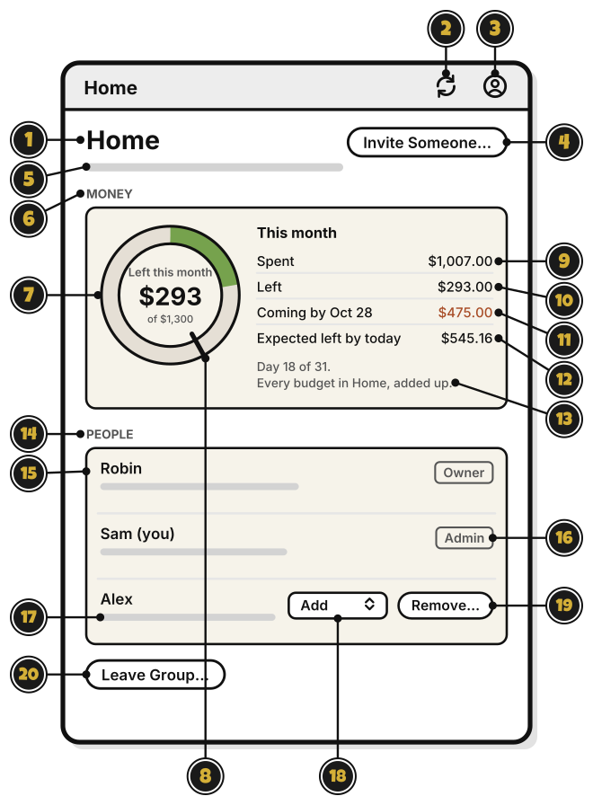
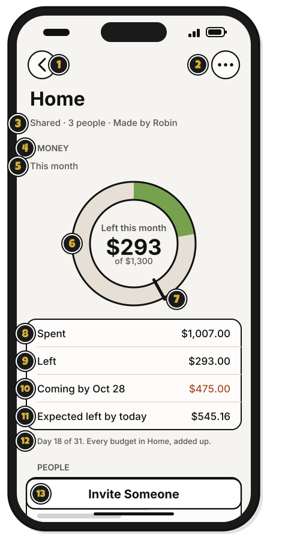
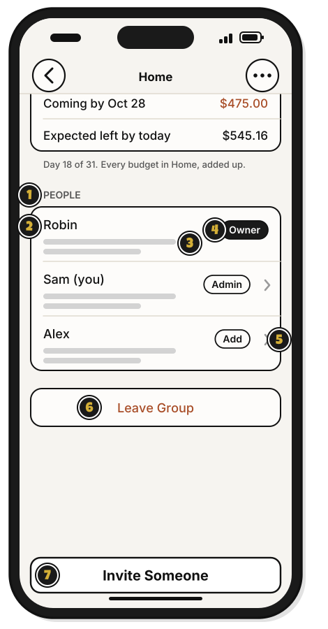
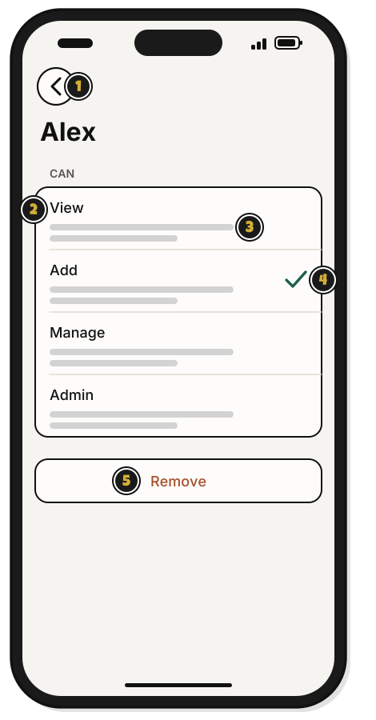
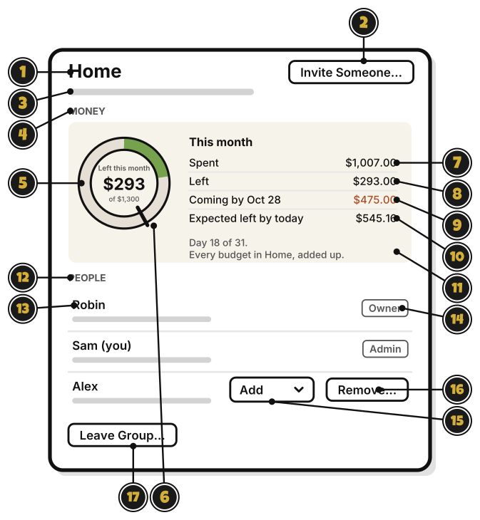

# Tour: A group's page

> *Meet your party.*

Click a group's name in the sidebar, or pick **People…** from its menu, and its page opens. Shown here as an Admin sees it.

1. **Home**: the group's name.
2. **Sync**, the two arrows: send and get changes now.
3. **Account**, the person: your account, and signing out.
4. **Invite Someone…**: share the group. [Quest 7](share-a-group.md)
5. The line under the name: whether it's shared, how many people, and who made it.
6. **MONEY**: the whole group's month, every budget added up.
7. The group's wheel: what's left this month across the group's budgets. Its middle says **Left this month**, and of how much. Over, it's orange all the way round and says **Over this month**.
8. The tick: where the green would end today, at an even pace.
9. **Spent**: what the group has spent this month.
10. **Left**: what's left across its budgets. Below it, **Coming by Nov 28** adds up the bills dated later this month in all its budgets.
11. **Expected left by today**: what would be left today, at an even pace.
12. **Day 18 of 31. Every budget in Home, added up.**: how far into the month, and what the wheel counts.
13. **PEOPLE**: everyone in the group.
14. **Owner**: the person who made the group.
15. **(you)**: your own row. It has no **Remove…** As an Admin, it has a level list. Pick a lower level there, and yours drops at once. At other levels, your level shows as a label.
16. The line under a name: what that person's level lets them do.
17. The level list: change someone's level. Only the Owner or an Admin can make someone an Admin.
18. **Remove…**: take someone out of the group. What they added stays. It asks first.
19. **Leave Group…**: leave the group. The others keep it. The person who made a group deletes it instead.

A group with no budgets shows no MONEY. At the Add or View level, the page shows each person's level as a label, with **Leave Group…**

## On an iPhone

Tap a group's name on Home, and its page opens. Shown here as an Admin sees it.

1. The back arrow: go back to Home.
2. **⋯**: the group's menu, with items such as **Share** and **Rename**.
3. **Shared · 3 people · Made by Robin**: whether it's shared, how many people, and who made it.
4. **MONEY**: the whole group's month, every budget added up.
5. **This month**: the month the wheel counts.
6. The group's wheel: what's left this month across the group's budgets. It turns orange only when the group is over its budgets, not for pace.
7. The tick: where the green would end today, at an even pace.
8. **Spent**: what the group has spent this month.
9. **Left**: what's left across its budgets.
10. **Coming by Oct 28**: bills dated later this month in all its budgets, not counted yet. [Side quest: Add a bill dated later this month](../budgets/a-bill-dated-later.md)
11. **Expected left by today**: what would be left today, at an even pace.
12. **Day 18 of 31. Every budget in Home, added up.**: how far into the month, and what the wheel counts.
13. **Invite Someone**: share the group. It shows at the Manage level or higher. [Quest 7](share-a-group.md)

## On an iPhone: further down

Scroll down for the group's people.

1. **PEOPLE**: everyone in the group.
2. **Robin**: a person in the group. Your own row says **(you)**.
3. The line under a name: what that person's level lets them do.
4. **Owner**: a level you can't change. The Owner is the person who made the group.
5. The arrow: open that person, to change their level or remove them. It shows only on rows you may change. An Admin's own row has one too, to change their own level.
6. **Leave Group**: leave the group. The others keep it. The person who made a group deletes it instead.
7. **Invite Someone**: share the group. It shows at the Manage level or higher.

## On an iPhone: a person

Tap the arrow on a person's row, and their page opens.

1. The back arrow: go back to the group's page.
2. **View**: a level, under **Can**. Tap a level to change theirs at once.
3. The line under a level: what it lets them do.
4. The check: their level now.
5. **Remove**: take them out of the group. What they added stays. It asks first.

You see only the levels you may give. Only the Owner or an Admin can make someone an Admin.

## On Linux

Click a group's name in the sidebar, or pick **People…** from its **⋯** menu, and its page opens. Shown here as an Admin sees it.

1. **Home**: the group's name.
2. **Invite Someone…**: share the group. [Quest 7](share-a-group.md)
3. The line under the name: whether it's shared, how many people, and who made it.
4. **MONEY**: the whole group's month, every budget added up.
5. The group's wheel: what's left this month across the group's budgets. It turns orange only when the group is over its budgets, not for pace.
6. The tick: where the green would end today, at an even pace.
7. **Spent**: what the group has spent this month.
8. **Left**: what's left across its budgets.
9. **Coming by Oct 28**: bills dated later this month in all its budgets, not counted yet.
10. **Expected left by today**: what would be left today, at an even pace.
11. **Day 18 of 31. Every budget in Home, added up.**: how far into the month, and what the wheel counts.
12. **PEOPLE**: everyone in the group.
13. **Robin**: a person, and the line saying what their level lets them do. Your own row says **(you)**.
14. **Owner**: a level you can't change, shown as a label.
15. The level list: change someone's level. Only the Owner or an Admin can make someone an Admin.
16. **Remove…**: take someone out of the group. What they added stays. It asks first.
17. **Leave Group…**: leave the group. The others keep it. The person who made a group deletes it instead.

**Sync** and **Account** are at the bottom of the sidebar, not on the page.

<!-- Scenarios: WHEEL-11, WHEEL-12, PAGE-01, PAGE-02, PAGE-06, PAGE-08, PAGE-09, PAGE-10, PAGE-11, PAGE-12, PAGE-13, PAGE-14, SHARE-16, WHEEL-23 -->
