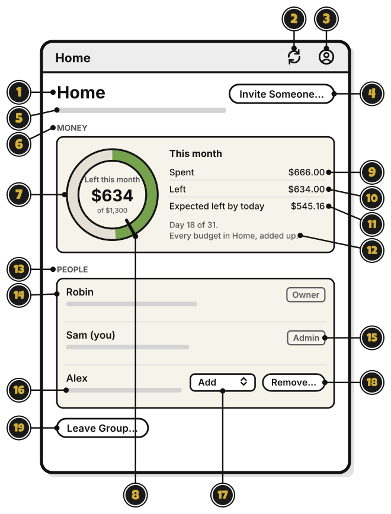

# Tour: A group's page

> *Meet your party.*

Click a group's name in the sidebar, or pick **People…** from its menu, and its page opens. Shown here as an Admin sees it.

1. **Home**: the group's name.
2. **Sync**, the two arrows: send and get changes now.
3. **Account**, the person: your account, and signing out.
4. **Invite Someone…**: share the group. [Quest 7](share-a-group.md)
5. The line under the name: whether it's shared, how many people, and who made it.
6. **MONEY**: the whole group's month, every budget added up.
7. The group's wheel: what's left this month across the group's budgets. Its middle says **Left this month**, and of how much. Over, it's orange all the way round and says **Over this month**.
8. The tick: where the green would end today, at an even pace.
9. **Spent**: what the group has spent this month.
10. **Left**: what's left across its budgets.
11. **Expected left by today**: what would be left today, at an even pace.
12. **Day 18 of 31. Every budget in Home, added up.**: how far into the month, and what the wheel counts.
13. **PEOPLE**: everyone in the group.
14. **Owner**: the person who made the group.
15. **(you)**: your own row, with your level as a label. It has no **Remove…**
16. The line under a name: what that person's level lets them do.
17. The level list: change someone's level. Only the Owner or an Admin can make someone an Admin.
18. **Remove…**: take someone out of the group. What they added stays. It asks first.
19. **Leave Group…**: leave the group. The others keep it. The person who made a group deletes it instead.

A group with no budgets shows no MONEY. At the Add or View level, the page shows each person's level as a label, with **Leave Group…**

<!-- Scenarios: WHEEL-11, WHEEL-12, PAGE-01, PAGE-02, PAGE-06, PAGE-08, PAGE-09, PAGE-10, PAGE-11, PAGE-12, PAGE-13, PAGE-14, SHARE-16 -->
