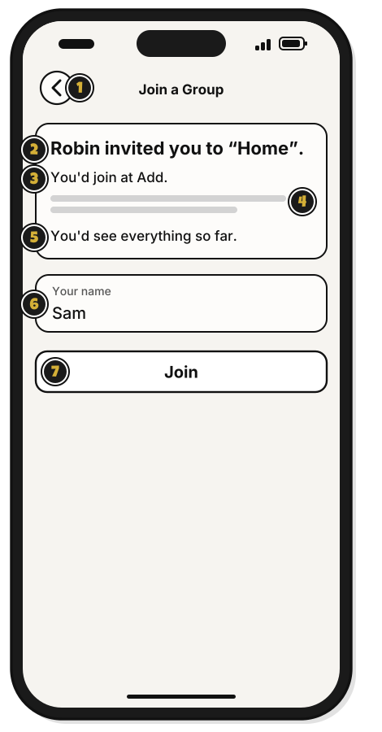
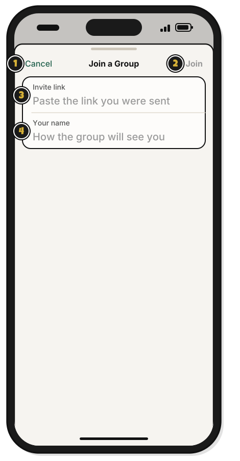

# Tour: Joining a group

> *A seat at the table is waiting for you.*

**Join a Group…**, in the menu beside **Add Budget**, opens this window.

1. **Invite link**: paste the link here.
2. **Your name**: the name the group sees.
3. The invite line: who invited you, and to which group.
4. **Cancel**: close without joining.
5. **Join**: join the group. [Quest 8](join-a-group.md)

## The invitation page

Click an invite link, and WellSpent opens this page.

1. **You'd join at Add.**: the level you'd have, and what you'd see.
2. **Your name**: the name the group sees.
3. **Join**: join the group.

## On an iPhone

Tap an invite link, and WellSpent opens this page.

1. The back arrow: go back to Home without joining.
2. **Robin invited you to “Home”.**: who invited you, and to which group.
3. **You'd join at Add.**: the level you'd have.
4. The line under it: what that level lets you do.
5. **You'd see everything so far.**: whether you'd see what the group already has, or only what comes after you join.
6. **Your name**: the name the group sees.
7. **Join**: join the group. Signed out, **Sign in** shows here instead. [Quest 8](join-a-group.md)

## On an iPhone: paste a link

Tap **+** at the bottom right of Home, then **Join a Group**, and this sheet opens.

1. **Cancel**: close without joining.
2. **Join**: join the group. It stays dimmed until both fields are filled.
3. **Invite link**: paste the link here. Then you see who invited you, and to which group.
4. **Your name**: the name the group sees.

## On Linux

**Join a Group…** is in the **More** menu, next to **Add Budget**. The window is the same, with each label above its box. A clicked invite link opens the same invitation page, with **Your name** beside its box.

<!-- Scenarios: SHARE-07, SHARE-08, SHARE-09, CLICK-01, CLICK-03, CLICK-04 -->
