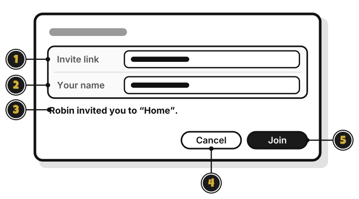
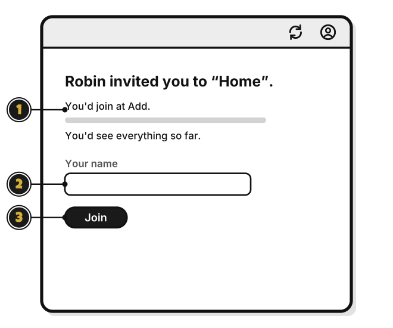

# Tour: Joining a group

> *A seat at the table is waiting for you.*

**Join a Group…**, in the menu beside **Add Budget**, opens this window.

1. **Invite link**: paste the link here.
2. **Your name**: the name the group sees.
3. The invite line: who invited you, and to which group.
4. **Cancel**: close without joining.
5. **Join**: join the group. [Quest 8](join-a-group.md)

## The invitation page

Click an invite link, and WellSpent opens this page.

1. **You'd join at Add.**: the level you'd have, and what you'd see.
2. **Your name**: the name the group sees.
3. **Join**: join the group.

<!-- Scenarios: SHARE-07, SHARE-08, SHARE-09, CLICK-01, CLICK-03, CLICK-04 -->
