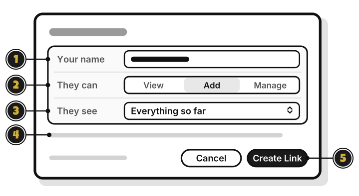
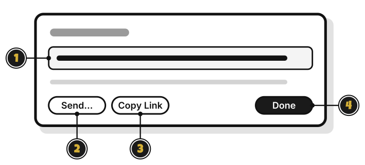
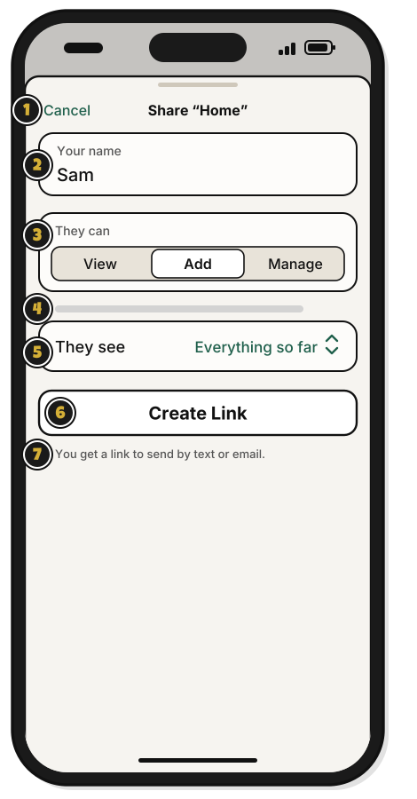

# Tour: The Share window

> *Every invitation needs a messenger.*

**Share…** on a group's menu opens this window.

1. **Your name**: the name the group sees.
2. **They can**: **View**, **Add** or **Manage**.
3. **They see**: **Everything so far**, or **Only from now on**.
4. The line under them: what the level you picked can do.
5. **Cancel**: close, and make no link.
6. **Create Link**: make the invite link. It stays dimmed until there's a name.

## After you press Create Link

1. The link: it works once, for 7 days.
2. **Send…**: send it from another app, such as email.
3. **Copy Link**: copy it, to paste into a message.
4. **Done**: close the window. You can't see the link again after this.

## On an iPhone

**Share** on a group's menu opens this sheet.

1. **Cancel**: close, and make no link. Once the link is made, it says **Done**.
2. **Your name**: the name the group sees.
3. **They can**: **View**, **Add** or **Manage**.
4. The line under them: what the level you picked can do.
5. **They see**: **Everything so far**, or **Only from now on**.
6. **Create Link**: make the invite link, and open the iPhone's share options with it, to send it by text or email, or to copy it. If you close them without sending, the button says **Send**. Tap it to open them again.
7. **You get a link to send by text or email.**: how the link travels. Once the link is made, this line says it works once and expires in 7 days.

## On Linux

The same window, with each label above its box. After **Create Link** there's no **Send…**: press **Copy Link**, and paste the link into a message.

<!-- Scenarios: SHARE-01, SHARE-02, SHARE-03, SHARE-04, SHARE-05, SHARE-06, SHARE-13 -->
