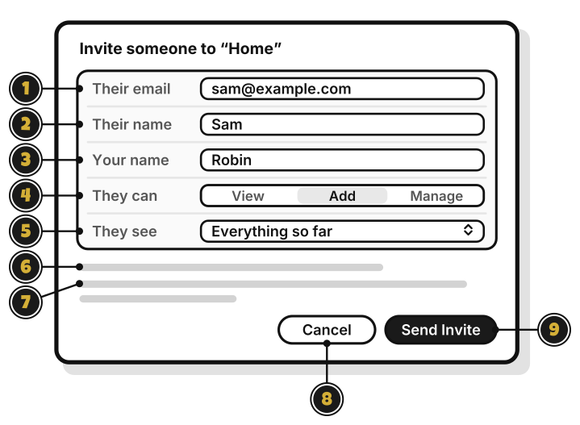
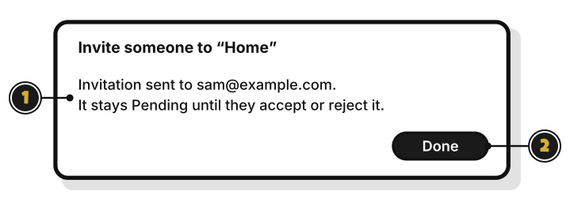
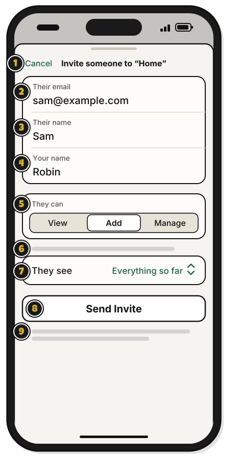
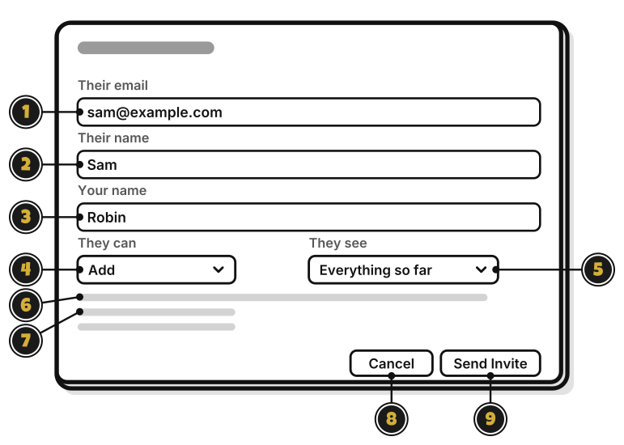
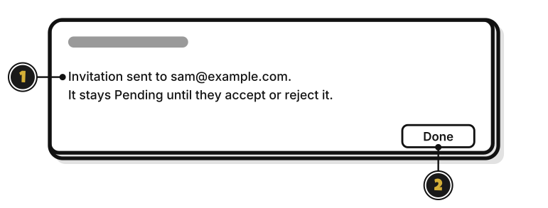

# Tour: The Share window

> *Every invitation needs a messenger.*

**Share…** on a group's menu opens this window.

1. **Their email**: the address WellSpent sends the invitation to.
2. **Their name**: how the group sees them.
3. **Your name**: how the group sees you.
4. **They can**: **View**, **Add** or **Manage**.
5. **They see**: **Everything so far**, or **Only from now on**.
6. The line under them: what the level you picked can do.
7. The note: WellSpent emails the invitation. They accept or reject it in their group list.
8. **Cancel**: close, and send nothing.
9. **Send Invite**: send the invitation. It stays dimmed until all three fields are filled in. [Quest 7](share-a-group.md)

## After you press Send Invite

1. "Invitation sent to sam@example.com. It stays Pending until they accept or reject it.": the invitation is on its way.
2. **Done**: close the window.

## On an iPhone

**Share** on a group's menu opens this sheet.

1. **Cancel**: close, and send nothing. Once the invitation is sent, it says **Done**.
2. **Their email**: the address WellSpent sends the invitation to.
3. **Their name**: how the group sees them.
4. **Your name**: how the group sees you.
5. **They can**: **View**, **Add** or **Manage**.
6. The line under it: what the level you picked can do.
7. **They see**: **Everything so far**, or **Only from now on**.
8. **Send Invite**: send the invitation. [Quest 7](share-a-group.md)
9. The note: WellSpent emails the invitation. They accept or reject it in their group list.

## On Linux

**Share…** in a group's **⋯** menu opens this window.

1. **Their email**: the address WellSpent sends the invitation to.
2. **Their name**: how the group sees them.
3. **Your name**: how the group sees you.
4. **They can**: **View**, **Add** or **Manage**.
5. **They see**: **Everything so far**, or **Only from now on**.
6. The line under them: what the level you picked can do.
7. The note: WellSpent emails the invitation. They accept or reject it in their group list.
8. **Cancel**: close, and send nothing.
9. **Send Invite**: send the invitation. It stays dimmed until all three fields are filled in.

## On Linux: after you press Send Invite

1. "Invitation sent to sam@example.com. It stays Pending until they accept or reject it.": the invitation is on its way.
2. **Done**: close the window.

<!-- Scenarios: SHARE-01, SHARE-04, SHARE-05, SHARE-06, EMAIL-01, EMAIL-05 -->
