# Quest 6: Bring in your first statement

> *Carry your gold home from the bank, and give each coin a budget.*

**Before you start:** a statement file from your bank, for this month. [How to download one](download-a-statement.md). In your bank's download menu, pick "CSV" (comma-separated values), "OFX" (Open Financial Exchange) or "QFX" (Quicken Financial Exchange). Not QuickBooks (QBO). WellSpent can't read a PDF. In a shared group, you need the Add level or higher.

There's no bank connection. You download a statement from your bank and bring it in, so your bank login stays with you.

1. 
   Click a budget in the group the statement is for.

2. 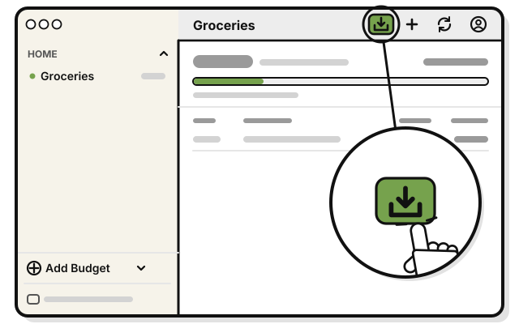
   Press **Import statement**, the box with an arrow pointing down, at the top of the budget's page.

3. 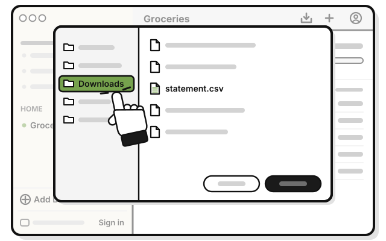
   Click **Downloads**.

4. 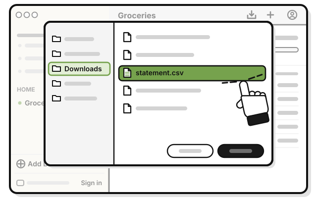
   Double-click your statement file.

5. 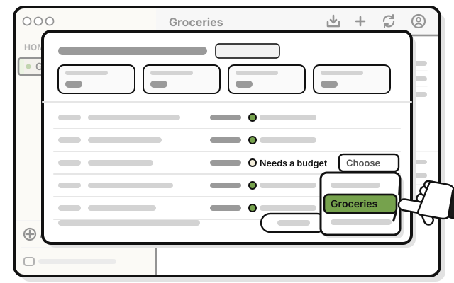
   For each line marked **Needs a budget**, pick a budget from its menu. To skip a line, leave it on **Choose**.

6. 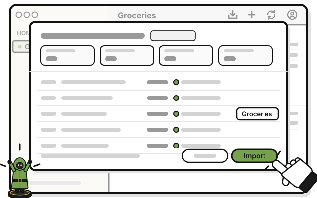
   Press **Import**.

   > You see the new lines in your budgets, marked **Statement**.

Skip deposits, transfers and payments to your card: leave them on **Choose**.

## On an iPhone

1. 
   Tap a budget in the group the statement is for.

2. 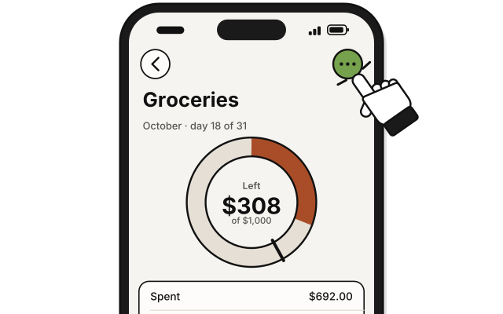
   Tap **⋯** at the top right.

3. 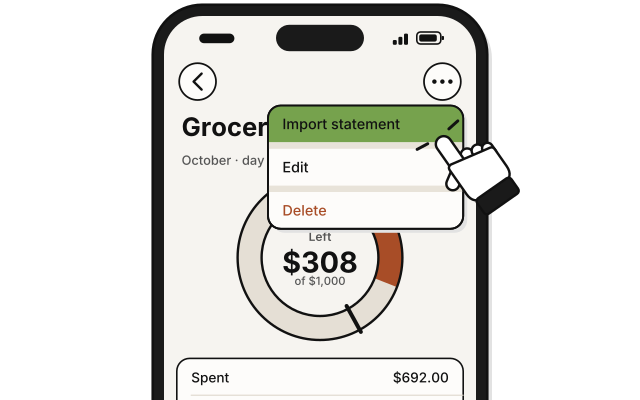
   Tap **Import statement**.

4. 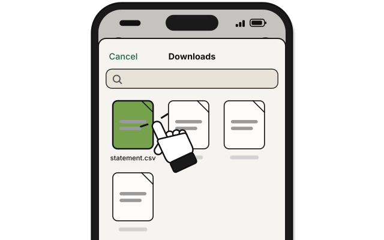
   Find your statement in **Recents**, or tap **Browse** and open **Downloads**.

5. 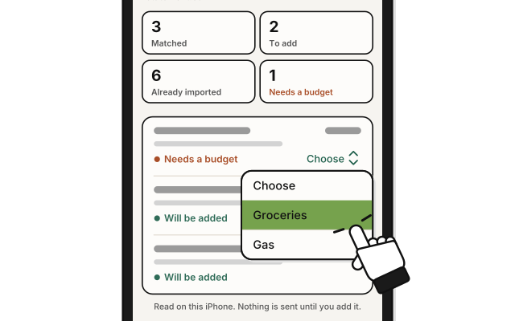
   For each line marked **Needs a budget**, pick a budget. To skip a line, leave it on **Choose**.

6. 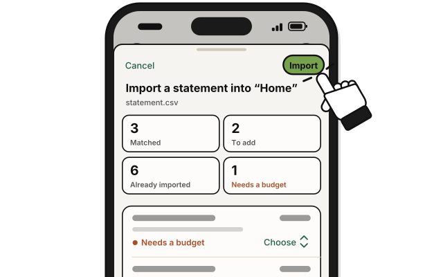
   Tap **Import**.

   > You see the new lines in your budgets.

## On Linux

1. 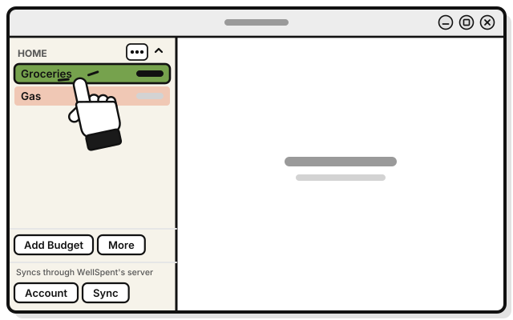
   Click a budget in the group the statement is for.

2. 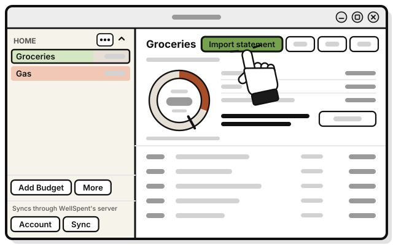
   Press **Import statement** at the top of the budget's page.

3. 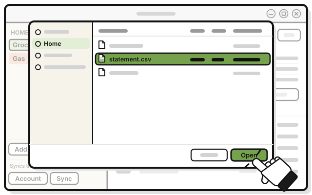
   Pick your statement file, then press **Open**. It's usually in **Downloads**.

4. 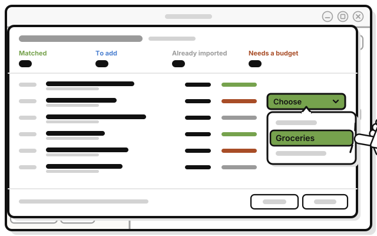
   For each line marked **Needs a budget**, pick a budget from its menu. To skip a line, leave it on **Choose**. If a line's budget goes back to **Choose**, pick it again before pressing **Import**.

5. 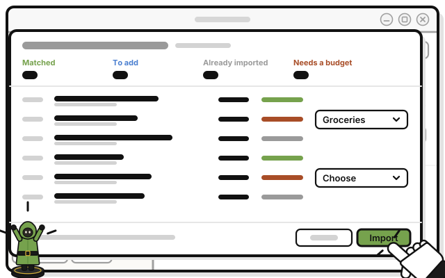
   Press **Import**.

   > You see the new lines in your budgets, marked **Statement**.

## If it doesn't work

- **WellSpent can't read the file:** download it again from your bank as another type, and try again.
- **A line is missing:** a budget's page shows this month only. Lines from earlier months go in, but don't show there.
- **You imported the same file twice:** nothing is added twice. Lines already imported are skipped, and a line you deleted stays deleted.
- **A line asks for a budget again:** its budget was deleted. Pick another one, or leave it on **Choose**.
- **Everything says Already imported:** in a shared group, someone else imported this statement. Their lines count for everyone.
- **A purchase you typed in shows twice:** the amounts were different, or the dates were more than four days apart.

## Next quest

[Quest 7: Share a group](../sharing/share-a-group.md)

<!-- Scenarios: IMPORT-01, IMPORT-03, IMPORT-05, IMPORT-06, IMPORT-07, IMPORT-08, IMPORT-09, IMPORT-10, IMPORT-11, IMPORT-13, IMPORT-14 -->
