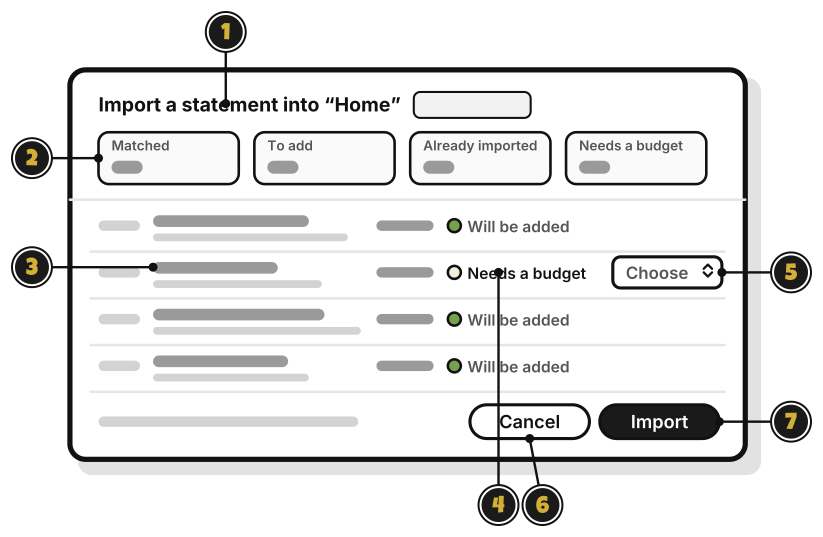

# Tour: The import review

> *Sort the treasure before it goes in the chest.*

After you pick a statement file, WellSpent shows what each line will do. Nothing is added until you press **Import**.

1. **Import a statement into "Home"**: the group the statement goes into.
2. The counts: how many lines are **Matched**, **To add**, **Already imported**, or **Needs a budget**.
3. A line: a cleaned-up name, over the bank's own words.
4. What will happen to it: **Will be added**, **Already imported**, **Matched to entry** or **Needs a budget**.
5. **Choose**: pick a budget for a line that needs one. Leave it on **Choose** to skip the line.
6. **Cancel**: close, and add nothing.
7. **Import**: add the lines. [Quest 6](bring-in-your-first-statement.md)

A line you typed in by hand, with the same amount and a date within four days, shows **Matched to entry**, and isn't added twice.

<!-- Scenarios: IMPORT-01, IMPORT-02, IMPORT-03, IMPORT-04, IMPORT-05, IMPORT-06, IMPORT-07, IMPORT-12 -->
