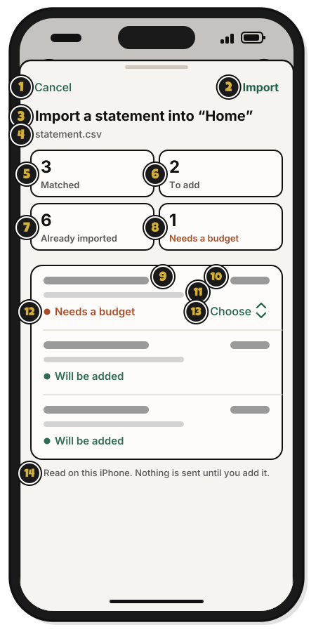

# Tour: The import review

> *Sort the treasure before it goes in the chest.*

After you pick a statement file, WellSpent shows what each line will do. Nothing is added until you press **Import**.

1. **Import a statement into “Home”**: the group the statement goes into.
2. The counts: how many lines are **Matched**, **To add**, **Already imported**, or **Needs a budget**.
3. A line: a cleaned-up name, with the bank's own words under it.
4. What will happen to it: **Will be added**, **Already imported**, **Matched to entry** or **Needs a budget**.
5. **Choose**: pick a budget for a line that needs one. Leave it on **Choose** to skip the line.
6. **Cancel**: close, and add nothing.
7. **Import**: add the lines. [Quest 6](bring-in-your-first-statement.md)

A line you typed in by hand, with the same amount and a date within four days, shows **Matched to entry**, and isn't added twice.

## On an iPhone

Tap **⋯** on a budget's page, then **Import statement**, and pick your file. This sheet opens.

1. **Cancel**: close, and add nothing.
2. **Import**: add the lines. [Quest 6](bring-in-your-first-statement.md)
3. **Import a statement into “Home”**: the group the statement goes into.
4. **statement.csv**: the file's name.
5. **Matched**: lines that match a transaction already typed in. They aren't added twice.
6. **To add**: lines that will be added.
7. **Already imported**: lines brought in before. They're skipped.
8. **Needs a budget**: lines with no budget yet.
9. A line: its date, and a cleaned-up name.
10. Its amount.
11. The bank's own words for it.
12. What will happen to it, such as **Will be added** or **Needs a budget**.
13. **Choose**: pick a budget for a line that needs one. Leave it on **Choose** to skip the line.
14. **Read on this iPhone. Nothing is sent until you add it.**: your iPhone reads the file. Nothing goes in until you tap **Import**.

## On Linux

The review is the same as on a Mac. If a line's budget goes back to **Choose**, pick it again before pressing **Import**.

<!-- Scenarios: IMPORT-01, IMPORT-02, IMPORT-03, IMPORT-04, IMPORT-05, IMPORT-06, IMPORT-07, IMPORT-12 -->
