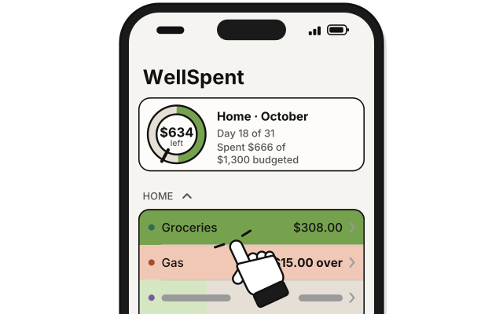
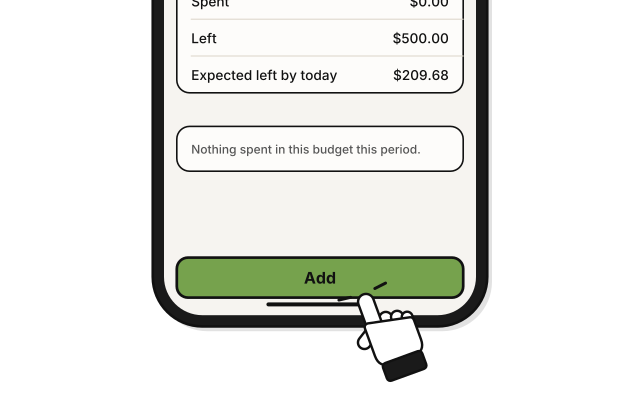
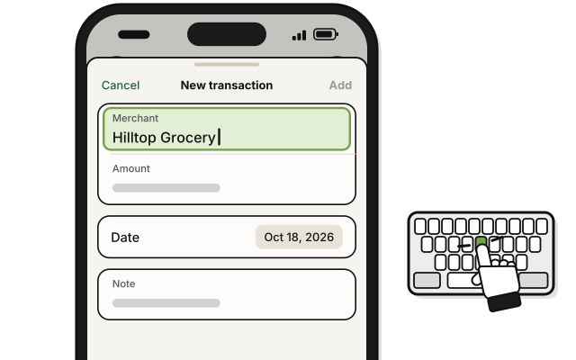
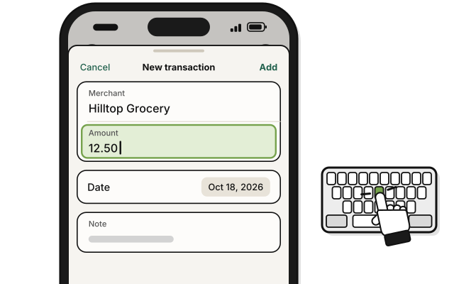
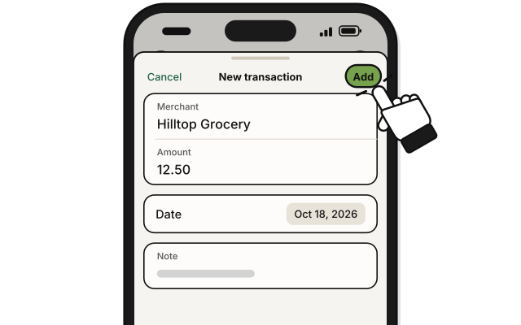

# Quest 5: Add your first transaction

> *Your first move: write down a coin you spent.*

1. 
   Click **Groceries** in the sidebar.

2. 
   Press **Add**, the plus sign at the top of the budget's page.

3. 
   Type where you spent the money in **Merchant**.

4. 
   Type how much in **Amount**, like 12.50. Leave **Date** as today.

5. 
   Press **Add**.

   > You see your transaction in the list, marked **Manual**. What's spent goes up.

The newest transaction is on top. Spot a mistake later? Click it to change or delete it.

On a Mac, Command-N opens **New transaction**, Return adds it, and Escape closes it without adding anything.

## On an iPhone

1. 
   Tap **Groceries** on Home.

2. 
   Tap **Add** at the bottom of the budget.

3. 
   Type where you spent the money in **Merchant**.

4. 
   Type how much in **Amount**, like 12.50.

5. 
   Tap **Add**.

   > You see your transaction in the list, and what's spent goes up.

## If it doesn't work

- **Add stays dimmed:** **Merchant** and **Amount** both need something. Type the amount as a number.
- **"That amount can't be read clearly.":** type the amount the way your region writes numbers, as the message shows. Where a comma marks decimals, 12,50 is twelve fifty. WellSpent never guesses an amount it can't read clearly.
- **It isn't in the list:** a budget's page shows this month only, from the 1st. A transaction dated earlier is saved, but doesn't show there.

## Next quest

[Quest 6: Bring in your first statement](../statements/bring-in-your-first-statement.md)

<!-- Scenarios: ENTRY-01, ENTRY-02, ENTRY-06, ENTRY-05, ENTRY-07, ENTRY-11, ENTRY-12, ENTRY-13, EDIT-01, WHEEL-01 -->
