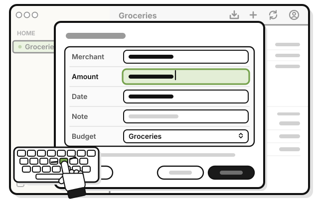
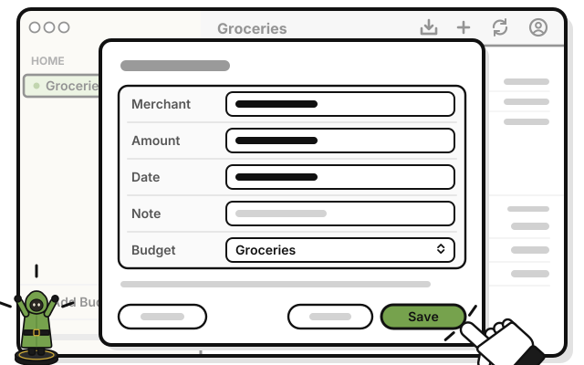
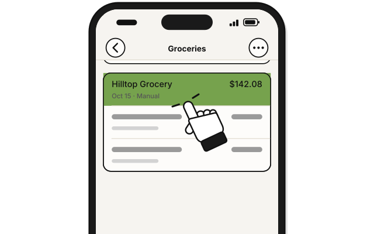
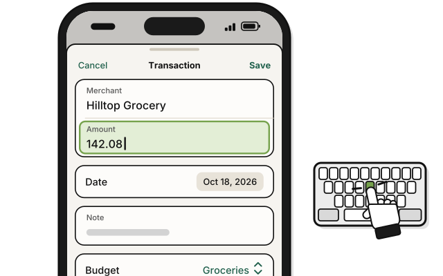
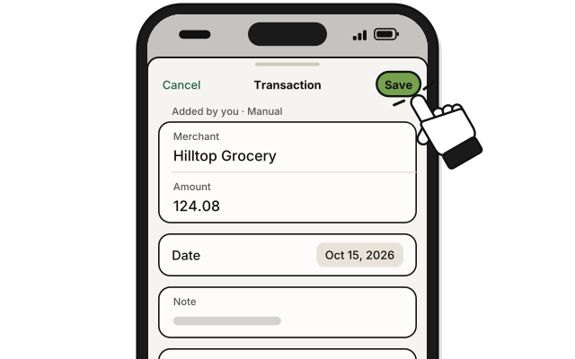
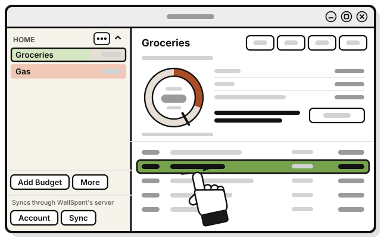
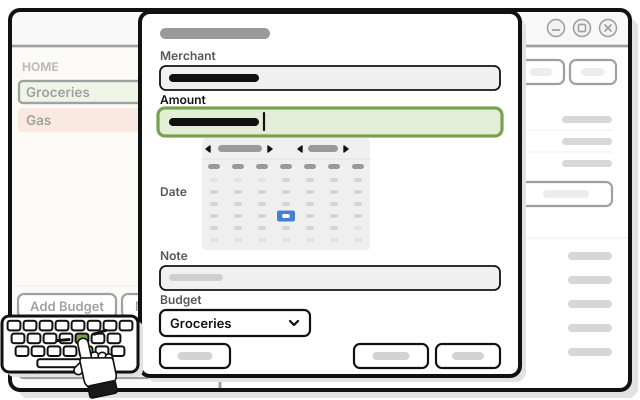
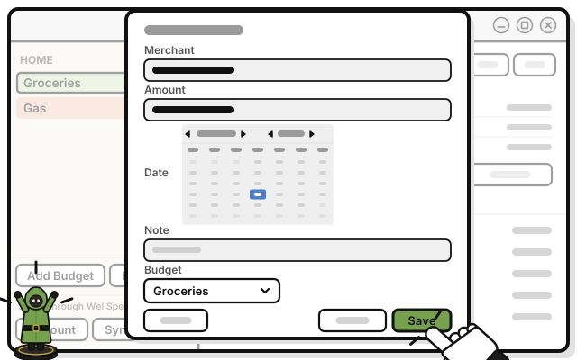

# Side quest: Change or move a transaction

> *Wrong turn? Every party backtracks sometimes.*

**Before you start:** at the Add level, you can change only the transactions you added. At Manage or higher, anyone's.

1. 
   Click the transaction in the budget's list.

2. 
   Change what's wrong: **Merchant**, **Amount**, **Date** or **Note**. To move it, pick another budget in **Budget**.

3. 
   Press **Save**.

   > You see the change in the list, and the budget's totals follow at once.

On a Mac, you can also right-click the transaction, and pick **Edit…** With the keyboard, the arrow keys pick a transaction, Return opens it, Tab moves between fields, Return saves, and Escape closes without saving.

## On an iPhone

You can also swipe a transaction to the left, or touch and hold it, and tap **Edit**.

1. 
   In the budget, tap the transaction.

2. 
   Change what's wrong. To move it, pick another budget in **Budget**.

3. 
   Tap **Save**.

## On Linux

1. 
   Click the transaction in the budget's list.

2. 
   Click what's wrong, and change it: **Merchant**, **Amount**, **Date** or **Note**. For **Date**, use the arrows to reach the month, then click the day. To move it, pick another budget in **Budget**.

3. 
   Press **Save**.

   > You see the change in the list, and the budget's totals follow at once.

## If it doesn't work

- **Save stays dimmed:** nothing has changed yet, or **Merchant** is empty, or **Amount** isn't a number.
- **"This moves it out of this period.":** the date you picked is before this month. It's saved, but it leaves this month's page.
- **Budget offers only some budgets:** a transaction can move only to a budget in the same group.
- **"… deleted this while you had it open.":** someone deleted it on another device first. Nothing you typed is saved. Press **Done**.
- **"Nothing was changed.":** your level in the group changed while it was open. The message says what you can do now.
- **"Your change didn't go through.":** someone else's newer change reached the server first, and theirs is the version everyone sees. Change it again if you need to.

## Related

- [Side quest: Delete a transaction, and undo it](delete-a-transaction.md)
- [Tour: A transaction](tour-a-transaction.md)

<!-- Scenarios: EDIT-01, EDIT-02, EDIT-03, EDIT-04, EDIT-05, EDIT-10, EDIT-11, EDIT-12, EDIT-13, EDIT-14, EDIT-15, EDIT-16, EDIT-17 -->
