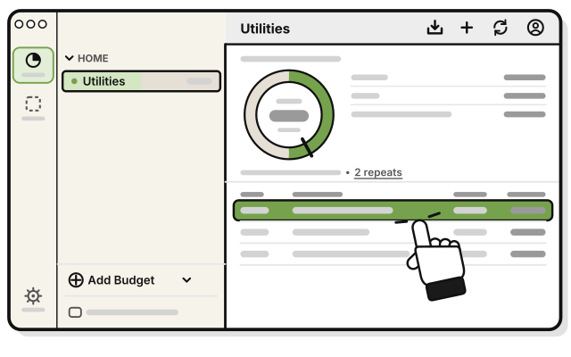
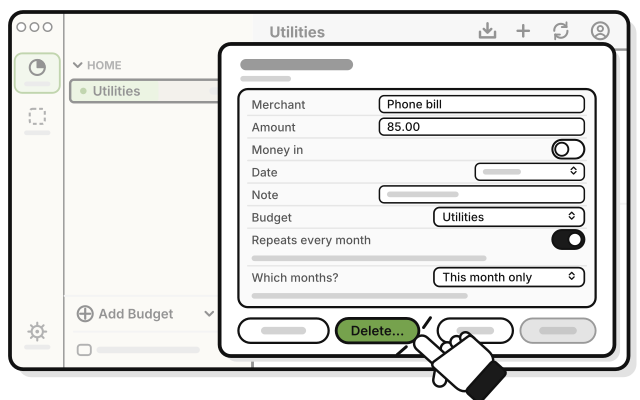
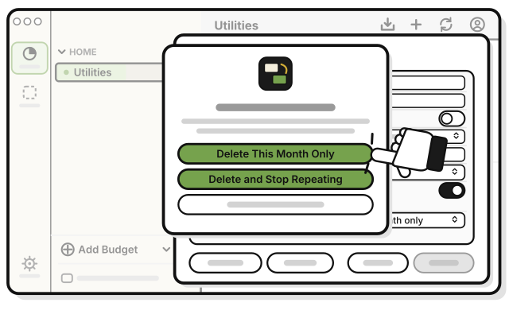
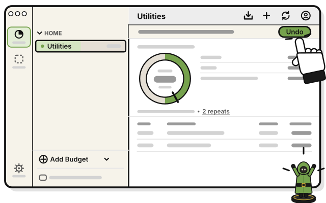
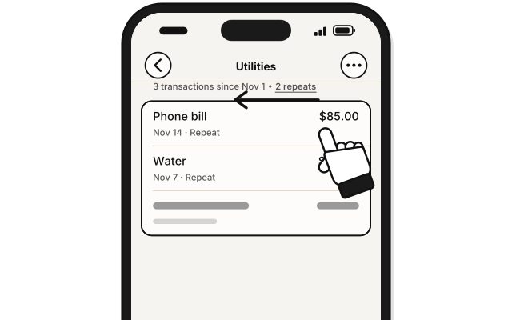
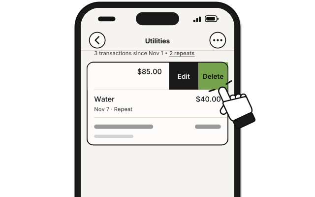
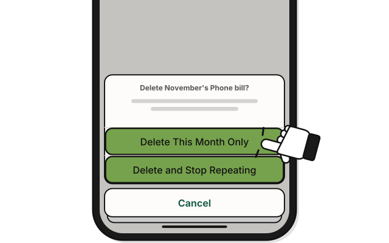
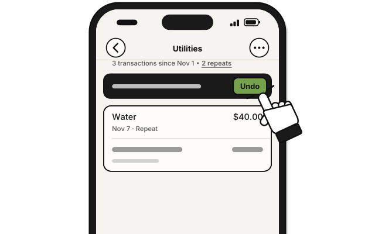

# Side quest: Delete a repeating bill

> *Skip one round, or leave that game for good.*

**Before you start:** you need to be able to change the bill. Only the person who set the repeat, or someone at the Manage level, is offered **Delete and Stop Repeating**.

1. 
   Click the month's bill in the budget's list.

2. 
   Press **Delete…**

3. 
   In the question, press **Delete This Month Only** or **Delete and Stop Repeating**.

   > You see a bar with **Undo**.

4. 
   Changed your mind? Press **Undo** within about 10 seconds.

- **Delete This Month Only:** later bills still come. The month you deleted doesn't come back.
- **Delete and Stop Repeating:** this month's bill goes, and no more bills come.
- Earlier bills stay either way. **Undo** brings back the bill, and the repeat too.

## On an iPhone

**Coming in the next update.**

1. 
   In the budget, swipe the bill to the left.

2. 
   Tap **Delete**.

3. 
   Tap **Delete This Month Only** or **Delete and Stop Repeating**.

4. 
   Changed your mind? Tap **Undo** within about 10 seconds.

## On Linux

The steps are the same as on a Mac.

## Related

- [Side quest: Delete a transaction, and undo it](delete-a-transaction.md)
- [Side quest: Stop a repeating bill](stop-a-repeating-bill.md)

<!-- Scenarios: REPEAT-09, REPEAT-10 -->
