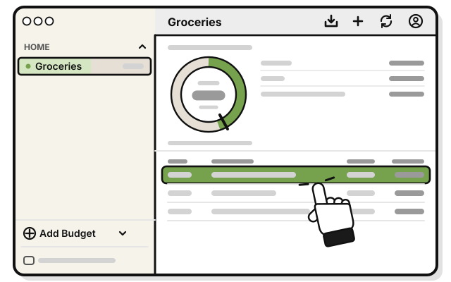
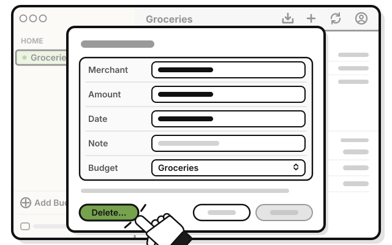
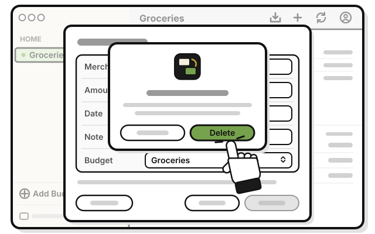
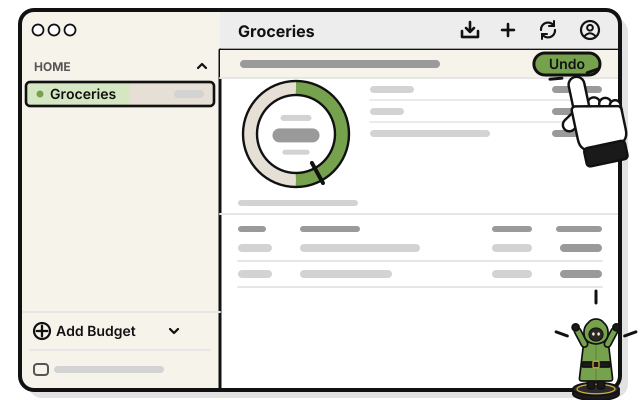
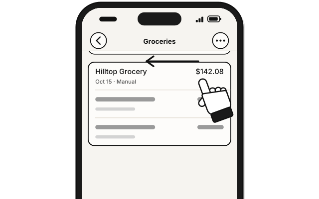
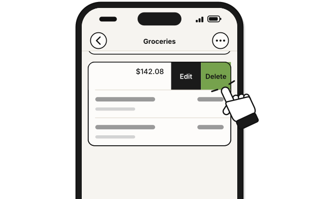
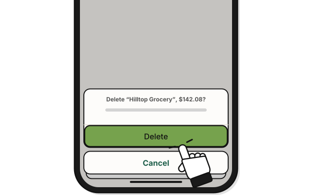
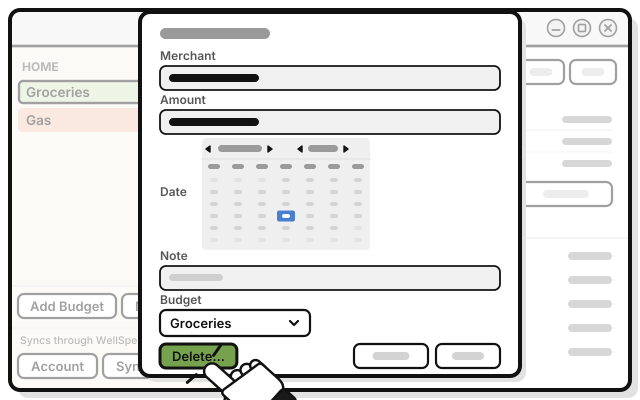
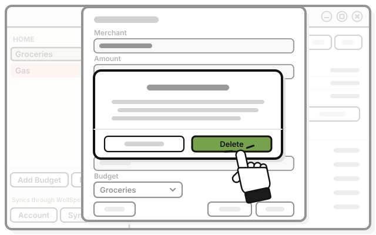
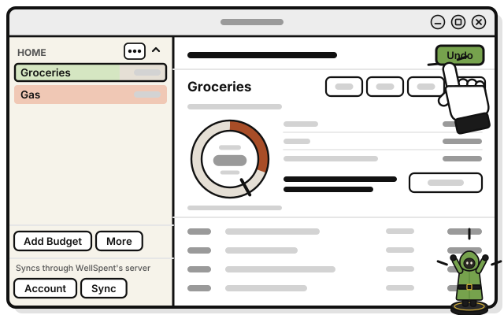

# Side quest: Delete a transaction, and undo it

> *Discard a card. You can take it back, for a moment.*

**Before you start:** at the Add level, you can delete only the transactions you added. At Manage or higher, anyone's.

1. 
   Click the transaction in the budget's list.

2. 
   Press **Delete…**

3. 
   Press **Delete** in the question.

   > You see a bar at the top of the budget, with **Undo**.

4. 
   Changed your mind? Press **Undo** within about 10 seconds.

   > You see the transaction back, just as it was.

On a Mac, you can also right-click the transaction, and pick **Delete…**

In a shared group, a delete takes the transaction out for everyone in the group.

## On an iPhone

1. 
   In the budget, swipe the transaction to the left.

2. 
   Tap **Delete**.

3. 
   Tap **Delete** in the question.

   > You see a bar with **Undo**.

4. 
   Changed your mind? Tap **Undo** within about 10 seconds.

## On Linux

1. 
   Click the transaction in the budget's list.

2. 
   Press **Delete…** at the bottom left.

3. 
   Press **Delete** in the question.

   > You see a bar at the top of the budget's page, with **Undo**.

4. 
   Changed your mind? Press **Undo** within about 10 seconds.

   > You see the transaction back, just as it was.

## If it doesn't work

- **The Undo bar is gone:** it goes after about 10 seconds, or at your next change. Add the transaction again.
- **"This can't be undone now.":** your level or the budget changed since the delete. The message says why.

## Related

- [Side quest: Change or move a transaction](change-or-move-a-transaction.md)

<!-- Scenarios: EDIT-06, EDIT-07, EDIT-08, EDIT-09, EDIT-15, EDIT-17 -->
